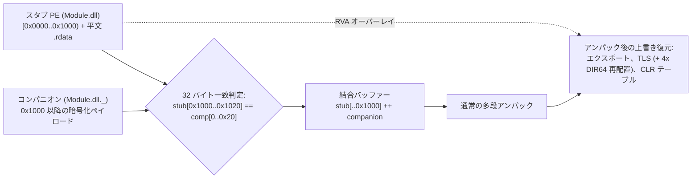

# セクションデータとコンパニオンファイル

## セクションペイロードのファイル基準位置（`0x1080`）

すべての Windows ビルド系統において、セクションブロックのディスクリプターに記録されたソースオフセットは、ファイルオフセット `0x1080` にビット反転（NOT）で格納された基準オフセットからの相対値になっています。

```text
section_data_file_base = (~u32@0x1080 + 0x1000) & 0xFFFFFFFF
```

各ディスクリプターの `src` フィールドは、コンテナ内（コンパニオン構成では仮想結合バッファー `stub[..4096] ++ companion` 内）のファイルオフセット `src + section_data_file_base` を指します。

## 外部コンパニオンレイアウト（`._` ファイル）

一部の PE32+ EXE 形式ビルドでは、保護対象の EXE または DLL が同一ディレクトリ内の 2 つのファイルに分割されます。

* **`Module.dll` / `App.exe`（スタブ）:** 外側 PE ヘッダー（`0x0000..0x0FFF`）、`0x1000..0x101F` の 32 バイト `info` ヘッダー、最小限のローダーエントリセクション、および `.rdata` 内の一部の平文データディレクトリを保持します。
* **`Module.dll._` / `App.exe._`（コンパニオンファイル）:** 単体の PE ヘッダーを持たない高エントロピーのペイロードで、コンテナオフセット `0x1000` 以降のデータを保持します。



ペアリングの成立には、`stub[4096..4128]` と `companion[0..32]`（暗号化された `info` ヘッダー）の 32 バイトが完全に一致する必要があります。


**エントリサンク内のコンパニオン指定。** PE32+ シェルでは、63 バイトのローダーエントリレコードにも外部コンパニオンファイルの有無が記録されています。外部コンパニオン構成ではオフセット `+53` が `~0x1000`（単一ファイル構成では `~0`）、オフセット `+58` が `~u32("._\0\0")` となります。静的解析ではこのシグネチャを確認することで、`._` ファイルの欠落と単一ファイルバイナリの破損を区別できます。


## スタブ側にのみ平文で残る領域

暗号化された `._` コンパニオンファイル側では、Windows ローダーや CLR が参照するいくつかのテーブルが省略またはゼロ埋めされているため、コアセクションの復元後にスタブ PE から該当 RVA 範囲を上書きして復元します。

* **エクスポートディレクトリ（`DD[0]`）:** コンパニオンペイロード側ではエクスポート領域が未展開または暗号化されたまま残るため、スタブからコピーします。
* **TLS ディレクトリ（`DD[9]`）:** コンパニオンペイロード側では `DD[9]`、`IMAGE_TLS_DIRECTORY64` 構造体、および TLS テンプレートデータ（RawData 領域）がゼロ埋めされています。再構築時にはこれらをスタブから復元したうえで、`IMAGE_TLS_DIRECTORY64` 内の 4 つの VA フィールドに対応する `IMAGE_REL_BASED_DIR64` ベース再配置エントリを 4 個追加します。
* **ASLR とベース再配置（`DD[5]`）:** コンパニオン構成のモジュールは `/FIXED` を強制せず、`DllCharacteristics`（`DYNAMIC_BASE` / `HIGH_ENTROPY_VA`）と有効なベース再配置テーブルをそのまま維持します。
* **マネージドコンパニオンの CLR メタデータ（`DD[14]`）:** 暗号化された IL メソッド本体は `._` ペイロード側に格納される一方、スタブ側には `COR20` ヘッダーと、そこから参照されるメタデータ（`BSJB`）、リソース、厳密名（Strong Name）、VTable フィックスアップの各範囲が保持されています（[再配置、ページ変換、CLR データ](../loading-and-pe-repair/pe-reconstruction/relocations-managed.md)を参照）。
