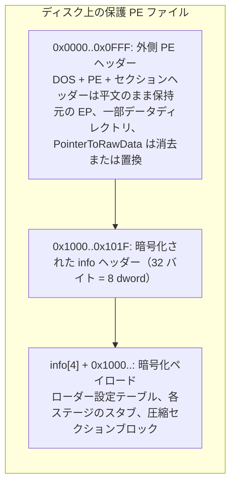

# コンテナと暗号化ヘッダー

保護された PE ファイルでは、元のセクション配置が暗号化コンテナに置き換えられています。先頭の 4,096 バイト（`0x0000..0x0FFF`）には平文の外側 PE ヘッダーが残り、オフセット `0x1000` に 32 バイトの暗号化パラメーターブロックが置かれ、残りの領域に暗号化されたローダーテーブル、各ステージのスタブ、および圧縮されたアプリケーションセクションが格納されます。

## コンテナレイアウト



| 領域 | ファイルオフセット | 内容 |
| --- | --- | --- |
| 外側 PE ヘッダー | `0x0000..0x0FFF` | DOS/PE シグネチャ、COFF ヘッダー、オプションヘッダー、セクションテーブル。元のエントリポイント、一部のデータディレクトリ、各セクションの `PointerToRawData`（ファイル内オフセット）はゼロ埋めされるかローダー側へ向け直されます。 |
| `info` ヘッダー | `0x1000..0x101F` | `header_kdf` で復号されるリトルエンディアンの 8 dword。コンテナ全体のマジック値、配置先 RVA、ペイロード境界を保持します。 |
| ペイロード | `info[4] + 0x1000` 以降 | 暗号化されたローダーテーブル、ステージコード、および圧縮されたセクションデータ。 |

確認されているすべての Windows ビルドは、オフセット `0x1000` を境界として PE ヘッダーとコンテナ本体を分離しています。`0x1000` 以降のコンテナデータを別個の `._` ファイルへ切り出す[外部コンパニオンレイアウト](companion-layout.md)でもこの境界は共通です。

## `info` ヘッダーと鍵導出

`info[0]` はオフセット `0x1000` に平文のまま格納されており、`info[1..7]` の各ワードは暗号文ワードと `i * i` を混ぜ合わせるローリング鍵で復号されます。

```python
def header_kdf(file_data, offset=4096):
    info = [0] * 8
    info[0] = get_u32(file_data, offset)
    k = info[0]
    for i in range(7):
        cell = get_u32(file_data, offset + 4 + 4 * i)
        info[i + 1] = k ^ cell
        k = (i * i) ^ ((k + cell - i) & 0xFFFFFFFF)
    return info
```

この 32 バイトの鍵導出処理は、PE32 と PE32+、EXE と DLL、単一ファイル構成とコンパニオンファイル構成のすべてで共通です。

| フィールド | 意味 |
| --- | --- |
| `info[0]` | 平文のシード鍵（`payload_xor_chain` の初期シードにも使用） |
| `info[1]` | フォーマットマジック（`0x4E4E4F4B` = リトルエンディアンの ASCII `KONN`） |
| `info[2]` | 予約領域／ビルド派生フィールド |
| `info[3]` | 作業用イメージバッファー内でペイロードをマップする先頭 RVA |
| `info[4]` | ファイルオフセット補正値（ペイロードはファイルオフセット `info[4] + 4096` から開始） |
| `info[5]` | イメージ範囲 `[info[3], info[3] + info[5])` にコピーされるペイロード総バイト長 |
| `info[6]` | 暗号化されたローダー前方領域の終端およびアンカー探索の基準となる RVA マーカー |
| `info[7]` | 予約領域／ビルド派生フィールド |

## ペイロード転送と `decrypt_size`

ファイル内の範囲 `[info[4] + 4096, info[4] + 4096 + info[5])` は、作業用イメージバッファーの RVA 範囲 `[info[3], info[3] + info[5])` へ展開されます。

* **標準の前方領域復号:** 64 ビットビルドおよび標準の PE32 ビルドでは、先頭の `decrypt_size = info[6] - info[3] + 8192` バイトだけを `payload_xor_chain`（[ローリング鍵暗号とローテーション暗号](../data-transforms/rolling-and-rotation.md)を参照）で復号し、`info[5]` の残り領域はそのままコピーします。
* **PE32 の全ペイロード復号バリアント:** 旧世代のコンパクト型 PE32 ビルドでは、ペイロード全体が暗号化対象になります（`decrypt_size = info[5]` となり、これに連動して初期 XOR シード `info[0] + ~decrypt_size` の値も変化します）。PE32 の静的復元では、前方領域復号で `SecondStage` の検証を通過する `tbl` 候補が 1 つも見つからない場合、`decrypt_size = info[5]` へフォールバックします。

ペイロード転送の完了後、イメージ RVA `info[3]` に dword 値 `4096`（`0x1000`）が書き込まれ、ファイル先頭の `4096` バイトが作業用 PE ヘッダーとして `[0, 0x1000)` にコピーされます。
