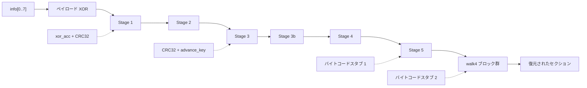
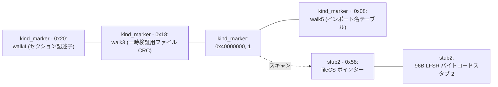

# ステージ連鎖とマーカーありレイアウト

`payload_xor_chain` が復号するのはアプリケーション本体ではなく外側のローダー作業領域です。この作業領域の内部で Stage 1 から Stage 5 が順に展開されます。各ステージの復号鍵は、ヘッダーチェックサム、直前に復号されたステージの CRC-32、および `advance_key` に渡されるコンテンツシードを組み合わせて導出されます。

## 複合ステージ復号器（Stage 3..5）

Stage 3 以降の各ステージ（Stage 3、3b、4、5）は 16 バイトの 4 要素タプル `{src, src_len, dest, dest_len}` で記述され、次の 4 ステップで復号されます。

1. **AES-CBC 復号：** ステージ用鍵スケジュール `key_offsets[3]` を用い、`d[src .. src + src_len]` をインプレースで復号します。
2. **XOR + 右ローテート：** 導出したステージ鍵と右ローテート幅 `19`（`shift = 19`）を指定し、`{src, src_len}` に対して `xor_ror_dwords` を実行します。
3. **バイトコード変換（Stage 5 のみ）：** `src .. src + src_len` の各バイトをバイトコードスタブ 1 で変換します。
4. **ハフマン / LZ 展開：** `src_len != dest_len` の場合、ステージ用ハフマンテーブル `key_offsets[1]` を使って `src -> dest` へ展開します。

## 64 ビット・マーカーありレイアウトの 9 フェーズパイプライン



### フェーズ 1・2：`info` ヘッダーとペイロード前半の展開

オフセット `0x1000` の `info[0..7]` を `header_kdf` で復号し、`info[1] == 0x4E4E4F4B`（`KONN`）を検証します。ゼロ初期化した `SizeOfImage` バイトの作業バッファーを確保し、ファイルオフセット `info[4] + 4096` から `decrypt_size = info[6] - info[3] + 8192` バイト分に対して `payload_xor_chain` を実行して `info[3]` に書き込みます。残りの末尾 `info[5] - decrypt_size` バイトをそのままコピーし、`info[3]` の位置に `0x1000` を書き込んだうえで、ファイルの先頭 `[0, 0x1000)` をイメージ先頭にコピーします。



### フェーズ 3：設定アンカーと Stage 1

`[info[6] + 1000, info[6] + 8000)` の範囲をスキャンし、`u32@anchor == info[3]` かつ `u32@(anchor + 8)` が `info[6]` より手前 `0x1000` 以内の `0x200` 境界にある `anchor` を探します。続いて `extra` に `0` と `8` を順に当てはめ、`anchor + 120 + extra` にある Stage 1 の `{base, length}` 記述子が有効（`base >= info[3]`、`length >= 16`、かつイメージ範囲内）になる方を選択します。

`anchor + 8` と `anchor + 4` から `DD[1]`（Import Directory）の `(RVA, size)` を復元し、`anchor + 184 + extra` から始まる `(offset, length)` 記述子配列全体で `xor_acc` を累積します。さらに `chk1 = calculate_checksum(d, anchor + 56 + extra)` と `v = u32@(anchor + 20)` を求め、`xor_ror_dwords(d, anchor + 120 + extra, xor_acc ^ chk1 ^ v, 21)` で Stage 1 を復号します。



### フェーズ 4：Stage 2 と 4 つの `key_offsets`

Stage 1 内をスキャンし、ペイロード範囲内で `d0 == d2`、`d1 > 0x10000`、`0 < d3 < d1` を満たす一意な 16 バイトの Stage 2 タプル（`stage2_off`）を特定します。そこから先頭方向へ遡って `chk_src_start`（有効な `(src, len)` ペアが 4 つ連続する先頭位置）を見つけ、`chk_src_start - 20` から Stage 2 の鍵を読み取り、`xor_ror_dwords`（右ローテート幅 `19`）で Stage 2 を復号します。

Stage 2 内で `(1, 0, info[3], 0)` の並び（`table_start`）を探し、`table_start + 32` にある 2 つの `head` エントリ（種別 `1` / `0x11` は `byte_rotate3`、種別 `2` は `(src, len, dst, chk)` のコピーリスト）を処理します。その後、`head - 88` にある 4 つの `walk2` スロットを `byte_rotate3` で復号します。

| スロット | テーブルの用途 |
| --- | --- |
| `key_offsets[0]` | **セクション**展開用のハフマンテーブル |
| `key_offsets[1]` | **ステージ**展開用のハフマンテーブル |
| `key_offsets[2]` | **セクション**復号用の AES 鍵スケジュール |
| `key_offsets[3]` | **ステージ**復号用の AES 鍵スケジュール |



### フェーズ 5：Stage 3、3b、4、5

`stage2_off` からの相対位置にある 4 つのステージ記述タプルを順に復号します。

| ステージ | タプルのオフセット | 鍵の算出式 |
| --- | --- | --- |
| Stage 3 | `stage2_off + 88` | `xor_acc ^ chk2 ^ advance_key(u32@(chk_src_start - 16), rounds)`（既定値は `rounds = 4`。展開または `v4` 探索に失敗した場合は `0..=8` を再試行） |
| Stage 3b | `stage2_off + 104` | `xor_acc ^ chk3 ^ v4`（`v4` は Stage 3 内の `C3 CC CC CC` 直後にある最後の非ゼロ dword） |
| Stage 4 | `stage2_off + 136` | `xor_acc ^ chk4 ^ ~v5`（`v5 = u32@(Stage 3b 内の最初の "Virtual..." 文字列 - 8)`） |
| Stage 5 | `stage2_off + 216` | `xor_acc ^ chk4 ^ chk5 ^ advance_key(accum2, rounds)`（既定値は `rounds = 3`。展開失敗時は `0..=8` を再試行）、**バイトコードスタブ 1**で変換 |

Stage 4 内では、アンチデバッグ API 文字列（`IsDebuggerPresent`、`CheckRemoteDebuggerPresent`）付近を LFSR スキャンしてバイトコードスタブ 1 を特定し、最後の `48 EB 01 B9` シーケンス直後（`0xCC` パディングがあればスキップした位置）から `accum2` を読み取ります。



### フェーズ 6：Stage 5 のマーカー構造とバイトコードスタブ 2

Stage 5 内で `"pm\0\0cm\0\0"`（`70 6D 00 00 63 6D 00 00`）および種別マーカー `0x40000000, 1`（`00 00 00 40 01 00 00 00`）を特定します。

* **`walk3`：** 元ファイル領域の連鎖 CRC-32 を検証するために一時復号し、検証後は元の暗号化バイト列へ戻します。
* **`fileCS`（`stub2 - 0x58`）：** `len == 0` に達するまで連続する 16 バイトエントリを `byte_rotate2` でインプレース復号し、復号後の状態で保持します。
* **バイトコードスタブ 2：** LFSR で復号した命令列から 256 バイトのルックアップテーブルを事前計算します。



### フェーズ 7：並列化可能なセクション復元（`walk4`）

`walk4` は `len == 0` で終端する連続した 16 バイトの `{src, len, dst, plain_len}` 記述子配列（各配置 RVA で `byte_rotate2` により復号）です。各エントリについて `file[src + section_data_file_base .. +len]` を `image[dst]` へコピーし、`aes_decrypt`（`key_offsets[2]`）とバイトコードスタブ 2 による変換を実行したうえで、`len != plain_len` の場合に `decompress`（`key_offsets[0]`）で展開します。続く 2 つ目の `walk4` 記述子配列で `.bss` 領域をゼロクリアします。書き込み先範囲は互いに重ならないため、逐次処理でも並列処理でも同一の復元結果が得られます。



### フェーズ 8：`walk5` インポート名の復号

`walk5` が非 NULL の場合（ネイティブモジュール）、各 20 バイトエントリは暗号化された DLL 名（`+12`、`name_rva & 0xFF` を鍵として `string_cipher` で復号し小文字化）とサンク配列（`+0` または `+16`）を参照します。名前指定インポートの各サンク（ビット 63 が 0）では、初期鍵 `hint_name_rva & 0xFF` を使って `hint_name_rva + 2` のシンボル名を大文字・小文字を維持したまま復号し、先頭 2 バイトの `Hint` をゼロクリアします。マネージドアセンブリでは `walk5` ポインターは NULL です。



### フェーズ 9：PE ヘッダー、ページスクランブル、データディレクトリの確定

各セクションヘッダーの `PointerToRawData`（ファイル内オフセット）を RVA 配置に揃え、`.text` ページスクランブル（`dd8`）を適用し、エントリポイントとデータディレクトリを一時復号して復元したうえで、TLS・ベース再配置・CLR メタデータのオーバーレイを適用します（詳細は [PE 再構築](../pe-reconstruction/README.md)を参照）。


