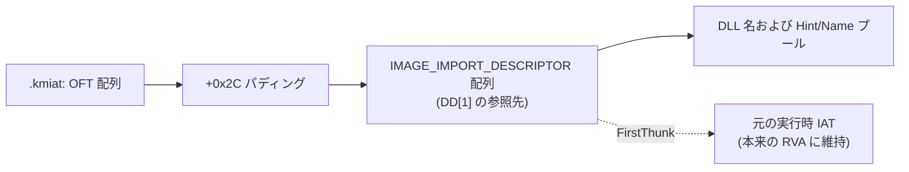

# インポート・TLS・エクスポート

## インポートテーブルと文字列の復元

暗号化されたインポート文字列には `string_cipher`（`dd7`）が使われます。`name_rva` にある DLL 名は `pos = name_rva`、初期鍵 `key = name_rva & 0xFF` で復号されるのに対し、`hint_name_rva` にある名前インポートの `IMAGE_IMPORT_BY_NAME` エントリは 2 バイトの `Hint`（復元時にゼロクリア）を飛ばした `pos = hint_name_rva + 2` から開始し、初期鍵には `hint_name_rva & 0xFF` を用います。序数サンク（PE32+ ではビット 63、PE32 ではビット 31。PE32+ では必ず 64 ビット幅全体を読み取る必要があります）は変更せずそのまま残します。



* Stage 5 の `walk5` テーブルに並ぶ 20 バイトエントリ（`+12` = DLL 名 RVA、`+0` / `+16` = サンクチェーン）を走査します。マネージドアセンブリでは `walk5 == 0` です。
* 各 DLL 名をインプレースで復号して小文字化し、各名前インポートの関数名文字列を `hint_name_rva + 2` で**小文字化せずに**復号し（シンボル名の大文字・小文字は区別されるため維持）、`Hint` をゼロクリアします。
* `DataDirectory[12]`（IAT）には、退避されていた 128 バイトのデータディレクトリ配列の値をそのまま使います。



* インポート文字列が `.text` 内部に配置されているため、`.text` の `dd8` 処理を実行した**後に**、復元された `DataDirectory[1]`（退避されていた `DD[1]` がゼロの場合はアンカーのインポート RVA にフォールバック）から `IMAGE_IMPORT_DESCRIPTOR` 配列（IDT）を走査します。
* すでに印字可能な ASCII 文字列になっているモジュール名や関数名には `string_cipher` を適用せずスキップし、復号した DLL 名は小文字化しつつ関数名の大文字・小文字は保持します。
* 全ディスクリプタの `FirstThunk` チェーンを走査して最小・最大アドレスを求め、`DataDirectory[12]`（IAT）の範囲を算出します。



* インポートテーブルから DLL 名と名前インポートの関数名文字列をインプレースで復号します（DLL 名の小文字化は行いません）。
* `info[3] + 16` にある 656 バイトの退避ヘッダーブロックから `DataDirectory[12]` を復元します。



* `EighthStage`（`+0x18`）のインポートテーブルと退避データディレクトリ（`DD[1]`）のインポートテーブルのうち有効な方を選択します。
* **インプレース `.idata` の PE32：** 文字列をその場で復号します（`.idata` を持つ EXE ではサンク範囲から `DD[12]` を算出し、PE32 DLL では `DD[12]` を `(0, 0)` にクリアします）。
* **`.kmiat` の再構築（PE32 EXE のみ）：** ローダーが書き込む IAT の配置が標準的な `.idata` 構造と乖離している場合、末尾セクションを `.kmiat`（サイズ `0x7000`、Characteristics `0xE0000060`）に改名し、その内部に OFT（OriginalFirstThunk）配列、`+0x2C` のアライメントパディング、`IMAGE_IMPORT_DESCRIPTOR` 配列（IDT）、および小文字化した DLL 名と大文字・小文字を保持したシンボル文字列（`api-ms-win-crt-*` は `ucrtbase.dll` に正規化）を再構築します。元の実行時 IAT は本来の RVA に残したまま、`DD[12]` は `(0, 0)` にクリアします。




## TLS の復元とベース再配置の再有効化

CrackProof は暗号化ペイロードから TLS 構造体や初期データを除去し、実行時はローダー側で TLS を自前処理します。そのため、外側スタブの平文領域から TLS を復元しないと、静的展開イメージは起動時に `_tls_index` や `LdrpAllocateTlsEntry` でアクセス違反（`0xC0000005`）を起こします。

* **単一ファイルの 64 ビット・マーカーありビルド：** 退避されたデータディレクトリには非ゼロの `DD[9]` が残っていますが、参照先の `IMAGE_TLS_DIRECTORY64` はゼロクリアされています。再構築時には、保護済みファイル内の同一 RVA から平文の TLS 構造体と初期データテンプレートをコピーします（単一ファイルのマーカーありビルドは `/FIXED` のためベース再配置の合成は不要です。一方、マーカーなしの単一ファイルビルドでは、復元後の構造体がすべてゼロであれば `DD[9]` をクリアします）。
* **外部コンパニオンファイル（`._`）の 64 ビットビルド：** コンパニオンファイル側では `DD[9]`、TLS 構造体、テンプレートがいずれもゼロクリアされ、対応するベース再配置エントリも削除されています。再構築時にはスタブ PE から `DD[9]`、`IMAGE_TLS_DIRECTORY64` 構造体、および初期データテンプレートを復元したうえで、`StartAddressOfRawData`、`EndAddressOfRawData`、`AddressOfIndex`、`AddressOfCallBacks` の 4 フィールドに対応する 4 個の `IMAGE_REL_BASED_DIR64` エントリを `.reloc` に**追記します**。
* **PE32 の EXE および DLL：** ローダースタブから平文の `IMAGE_TLS_DIRECTORY32` とテンプレートをコピーします（存在しない場合は最小限の `.tls` / `.data` プレースホルダーにフォールバックします）。特に **PE32 DLL** では、CrackProof が `.reloc` 内の TLS ポインター用再配置エントリ 4 個を非ゼロのページオフセットを残したまま `IMAGE_REL_BASED_ABSOLUTE`（`type = 0`）へ降格させているため、再構築時にこれら 4 スロットを `IMAGE_REL_BASED_HIGHLOW`（`type = 3`）へ**再有効化**し、リベース時に `IMAGE_TLS_DIRECTORY32` の 4 つのポインターフィールドすべてが更新されるようにします。

## エクスポートテーブル（`DD[0]`）

単一ファイルビルドでは、保護済みファイル内の該当 RVA に平文のエクスポートテーブルがそのまま残っています。外部コンパニオンファイル（`._`）のペイロードではエクスポート領域が復号後に不定値となるため、スタブ PE の `.rdata` から `DataDirectory[0]` の範囲全体を上書きコピーします。
