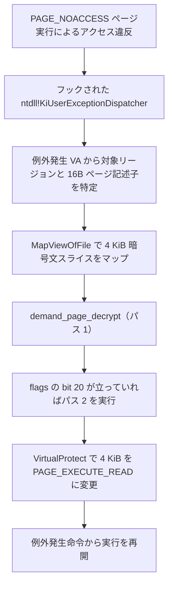

# ページ保護とローダーコード

## オンデマンドページ暗号化（`640` -> `840`）

ページ保護はモジュール単位で選択できるランタイム保護層です（一般にホスト EXE で有効化され、プラグイン DLL では無効化されます）。

1. ステージ `640` で実行可能セクション全体がいったん一括復号されます。
2. ステージ `840` で実行可能ページが 4 KiB ページ単位で再暗号化されて `PAGE_NOACCESS` に設定され、同時に `ntdll!KiUserExceptionDispatcher` の先頭に `HtdpStub2.dll` へジャンプするインラインフックが仕掛けられます（[手動マップされる補助モジュール](mapped-modules.md)を参照）。
3. CPU が `PAGE_NOACCESS` ページの命令を実行しようとしてアクセス違反（`STATUS_ACCESS_VIOLATION`）が発生すると、ディスパッチャフックがすべての SEH チェーンより先に例外を捕捉し、該当する 4 KiB ページをその場で復号して `PAGE_EXECUTE_READ` に変更したうえで実行を再開します。

未実行のページは `PAGE_NOACCESS` のまま残るため（さらに一部のビルドでは **scribble** が有効化され、オンデマンド復号の合間に復号済みページの一部バイトが XOR マスクで難読化されます）、OEP 到達後に単発のメモリスナップショットを取得しただけでは、そこまでに実行されて復号されたページしか回収できません。実行コード全体を復元するには、保護対象の全ページへ順次アクセスしてオンデマンド復号を発火させ、scribble のマスクも解除する必要があります。

## オンデマンドページ復号アルゴリズム



`HtdpStub2.dll` の内部では、保護された各モジュールがリージョン記述子を登録します。この記述子は `region_base + page_table_offset` に配置された 16 バイト単位のページ記述子配列を指しており、`(fault_va - region_base) >> 12` をインデックスとして参照されます。

| 構造体 | オフセット | サイズ | 確認されている意味 |
| --- | --- | --- | --- |
| リージョン記述子 | `+0x08` | 8 | `region_base` 仮想アドレス（VA） |
| リージョン記述子 | `+0x10` | 4 | リージョンのバイトサイズ |
| リージョン記述子 | `+0x20` | 4 | `region_base` からの相対 `page_table_offset` |
| リージョン記述子 | `+0x24` | 4 | 4 KiB ページの総数 |
| リージョン記述子 | `+0x28` | 8 | `MapViewOfFile` に渡されるセクションハンドル |
| リージョン記述子 | `+0x34` | 4 | 復号済みページ数のカウンタ |
| ページ記述子（`16B`） | `+0x00` | 4 | `flags`（`bit 20`、ビット位置 `0x14` / マスク `0x00100000` でパス 2 が有効化） |
| ページ記述子（`16B`） | `+0x04` | 4 | ページごとの `key_part` |
| ページ記述子（`16B`） | `+0x08` | 4 | 直近の `GetTickCount` タイムスタンプ |
| ページ記述子（`16B`） | `+0x0C` | 2 | オンデマンド復号（例外）回数カウンタ |
| ページ記述子（`16B`） | `+0x0E` | 2 | 用途未確定の 16 ビットフィールド |

パス 1 では、`page_va + region_base` の下位 32 ビットと `key_part` の XOR から 32 ビット鍵を導出し、4 KiB ページ全体に対して DWORD 単位のローリング復号を実行します。

```python
def demand_page_key(page_va, region_base, key_part):
    return ((page_va + region_base) ^ key_part) & MASK32


def demand_page_decrypt(buf, key):
    count = len(buf) >> 2
    state = ((key << 16) ^ key) & MASK32
    prev = state
    for i in range(count):
        enc = get_u32(buf, i * 4)
        state = rol32((state + i) & MASK32, 3)
        put_u32(buf, i * 4, enc ^ prev ^ state)
        prev = enc
```

`get_u32`、`put_u32`、`rol32`、`MASK32` の定義は[ローリング鍵とビット回転暗号](../data-transforms/rolling-and-rotation.md)にあり、実行可能なテストベクタは [primitives.py](https://app.gitbook.com/s/UWQkIK86mO8QHm25y3lh/primitives.py) に収録されています。`flags & 0x00100000` が非ゼロの場合は、`VirtualProtect` でページ属性を `PAGE_EXECUTE_READ` に切り替える前にビルド固有の第 2 パスが実行されます。

## ローダーのポリモーフィック変形・デコイ・ディスクからの自ファイルマッピング

* **重複するポリモーフィックプロローグ:** Stage 5 には同一の復号ルーチンが最大 16 個複製されており、ジャンクジャンプの配置などを表層的に入れ替えた状態で出力されます。
* **逆アセンブル同期崩しと戻りアドレス演算:** 無条件ジャンプ直後のジャンクバイト配置、命令途中への分岐ターゲット、`call $+5` と定数オフセット加算を組み合わせた間接分岐により、線形走査や単純な再帰下降型の逆アセンブラの同期を崩します。
* **タイミング計測用デコイと `#DB` SEH デコイ:** 片方のデコイは汎用レジスタ 16 本すべてを退避したうえでポート `0x5658` の `in eax, dx` プローブを実行し、`jne $+2`（変位 `disp = 0` のため条件にかかわらず次の命令へ進む）を経てリターンする構造で、外部のタイミング検査に時間差を与えるためだけに存在します。もう片方のデコイは `TF` をセット（`pushfq; or [rsp], 0x100; popfq`）し、通常実行時は SEH 経由で正規経路へ分岐させる一方、`#DB` を握りつぶすデバッガやエミュレータをデッドコードへ誘導します。
* **起動後のテーブル消去とディスクからの自ファイルマッピング:** Stage 5 は `GetModuleFileNameW` で自身のファイルパスを取得し、OS が解決済みのインポート API（`CreateFileW` / `CreateFileMappingA` / `MapViewOfFile`）を使ってディスク上の自ファイルを開いてメモリにマップします。その後、ステージ `655` で `.reloc` エントリを自前で適用し、使用済みのステージテーブルやマーカーをゼロ消去してから `280` へ移行します。
