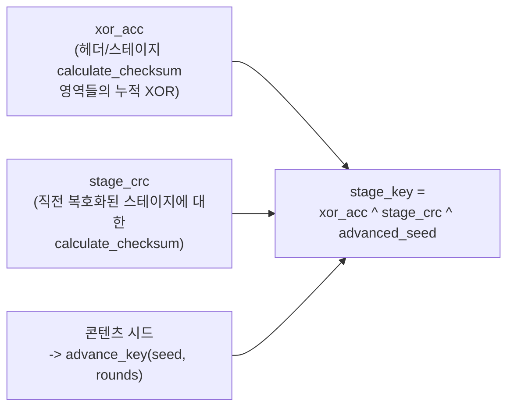

# 체크섬 및 키 진행

## 반전 CRC-32 체크섬

스테이지 무결성 검증과 키 파생에는 표준 반전(reflected) CRC-32(다항식 `0xEDB88320`, zlib/IEEE 802.3과 동일하며 `crc32(b"123456789") == 0xCBF43926`)를 사용합니다. 디스크립터는 `(offset, length)` 쌍을 제공하며, `calculate_checksum`은 해당 영역의 CRC-32 결과에 `length`를 XOR합니다.

```python
def _build_crc_table():
    table = []
    for i in range(256):
        c = i
        for _ in range(8):
            c = 0xEDB88320 ^ (c >> 1) if c & 1 else c >> 1
        table.append(c)
    return table

CRC_TABLE = _build_crc_table()

def crc32_append(initial, data):
    crc = ~initial & MASK32
    for b in data:
        crc = CRC_TABLE[(crc ^ b) & 0xFF] ^ (crc >> 8)
    return ~crc & MASK32

def crc32(data):
    return crc32_append(0, data)

def calculate_checksum(d, pos):
    """crc32(region) ^ length, where (offset, length) is read from d[pos]."""
    offset = get_u32(d, pos)
    length = get_u32(d, pos + 4)
    return crc32(d[offset:offset + length]) ^ length
```

연속 누적 변형인 `crc32_append(initial, data)`는 [스테이지 체인과 마커 레이아웃](../loading-and-pe-repair/loading/stage-chain.md)의 검증 전용 `walk3` 검사에서 사용되며, 원본 파일 조각들을 순회하면서 직전 CRC 출력값을 다음 호출의 `initial` 인자로 넘깁니다.

## 삼각수 키 진행

이전 스테이지에서 추출한 시드 dword는 다음 스테이지 키에 혼합되기 전에 `m = 0 .. iterations - 1`의 총 `iterations`라운드에 걸쳐 라운드마다 삼각수 합(`1 + 2 + ... + (m + 1) * 100`)을 더해 갱신합니다.

```python
def advance_key(key, iterations):
    for m in range(iterations):
        bound = ((m + 1) * 25) << 2
        for n in range(1, bound + 1):
            key = (key + n) & MASK32
    return key
```

## 스테이지 키 합성



각 후속 스테이지 키는 다음 세 입력을 XOR하여 만들어집니다.

* **`xor_acc`:** 앵커 또는 헤더 테이블의 디스크립터 목록에 대해 계산한 `calculate_checksum` 값들의 누적 XOR입니다.
* **상위 스테이지 CRC-32 (`stage_crc`):** 앞선 스테이지들이 복호화해 놓은 평문 바이트 구간에 대한 `calculate_checksum` 값입니다.
* **콘텐츠 파생 시드:** 방금 복호화된 스테이지 내부에서 읽은 dword에 `advance_key`를 적용한 값입니다.

모든 스테이지 키가 상위 스테이지의 평문 바이트와 헤더 체크섬 양쪽에 의존하므로 각 스테이지는 반드시 정해진 순서대로 복호화해야 하며, 오프셋이나 시프트 값이 잘못되거나 바이트가 하나라도 손상되면 후속 스테이지 복호화와 Huffman 압축 해제가 즉시 실패합니다.
