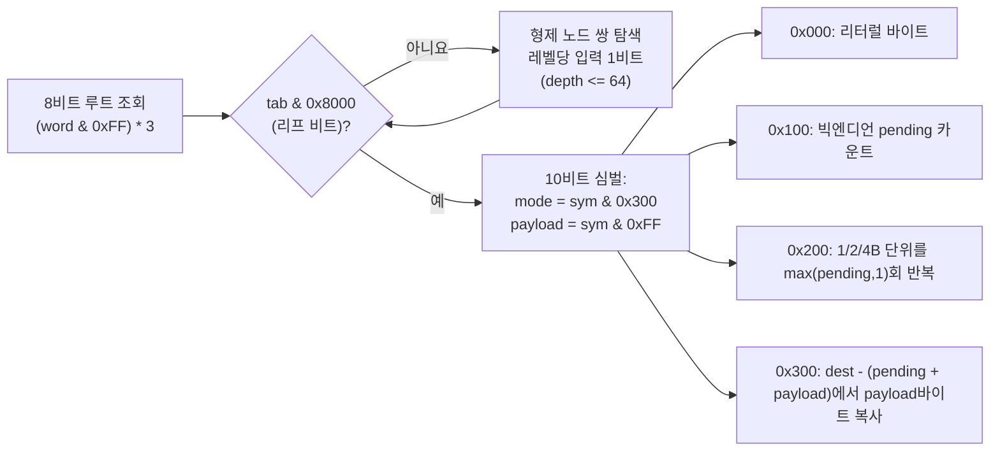

# 허프만 및 LZ 압축

## 하이브리드 허프만/LZ 스트림 포맷

Stage 3부터 Stage 5까지의 로더 스테이지와 압축된 섹션 블록은 작업 버퍼의 `key_offset`에 저장된 노드당 3바이트 크기의 허프만 테이블로 비트스트림을 10비트 토큰으로 디코딩해 압축을 해제합니다.



* **3바이트 테이블 엔트리:** 각 엔트리는 `(u16 tab, u8 bits)`로 구성됩니다. 입력 하위 8비트로 루트 테이블을 인덱싱하며, `tab & 0x8000` 비트가 설정되어 있으면 리프 노드를 뜻합니다. 내부 노드에는 형제 노드 쌍의 기준 인덱스가 저장되어 있으며, 트리 레벨이 내려갈 때마다 입력 비트 1개씩을 추가로 읽어 이동합니다(총 `8 + depth`비트 소비).
* **10비트 리프 심벌:** 비트 `8..9`는 모드를 선택하고 비트 `0..7`은 `payload` 값을 담습니다.

| 모드 (`tab & 0x300`) | 페이로드 (`tab & 0xFF`) | 동작 |
| --- | --- | --- |
| `0x000` | 리터럴 바이트 | `payload` 기록 (`1`바이트 출력) |
| `0x100` | 카운트 바이트 | `pending >= 256`이면 실패 처리, 아니면 `pending = (pending << 8) \| payload`로 시프트 누적 (`0`바이트 출력) |
| `0x200` | 단위 폭 (`1`, `2`, `4`) | `reps = max(pending, 1)`로 설정하고 직전 `payload`바이트 단위를 `reps`회 반복 기록한 뒤(`reps * payload`바이트 출력) `pending = 0`으로 초기화 |
| `0x300` | 복사 길이 (`payload`) | 이미 출력된 `dest - (pending + payload)` 위치에서 `payload`바이트를 복사한 뒤 `pending = 0`으로 초기화 |

```python
def decompress(d, src, dest, key_offset, s_size, d_size):
    """Decompress s_size bytes at `src` into d_size bytes at `dest`,
    in place within buffer `d`. Returns True when exactly d_size bytes
    were produced."""
    bit_pos = 0
    buf = bytearray(d[src:src + s_size]) + bytearray(3)  # 3 bytes of slack
    buf_off = 0
    src_consumed = 0
    pending = 0
    written = 0

    while src_consumed < s_size and written < d_size:
        word = get_u32(buf, buf_off) >> bit_pos
        tab_addr = key_offset + (word & 0xFF) * 3
        tab = get_u16(d, tab_addr)
        if tab & 0x8000:  # leaf
            tab &= 0x7FFF
            bits = d[tab_addr + 2]
        else:             # internal node: walk down one bit per level
            bits = d[tab_addr + 2]
            if bits >= 32:
                return False
            mask = 1 << bits
            bits += 1
            idx = (tab & 0x7FFF) + (1 if word & mask else 0)
            t2 = get_u16(d, key_offset + idx * 3)
            depth = 0
            while not (t2 & 0x8000):
                depth += 1
                if depth > 64:
                    return False
                mask <<= 1
                bits += 1
                idx = (t2 & 0x7FFF) + (1 if word & mask else 0)
                t2 = get_u16(d, key_offset + idx * 3)
            tab = t2 & 0x7FFF

        bit_pos += bits
        advance = bit_pos // 8
        buf_off += advance
        src_consumed += advance
        bit_pos %= 8

        mode = tab & 0x300
        payload = tab & 0xFF
        if mode == 0x000:  # literal
            step = 1
            d[dest] = payload
        elif mode == 0x100:  # count accumulator
            step = 0
            if pending >= 256:
                return False
            pending = payload if pending == 0 else (pending << 8) | payload
        elif mode == 0x200:  # run fill
            if pending == 0:
                pending = 1
            step = pending * payload
            if step + written > d_size:
                return False
            if payload == 1:
                if dest < 1:
                    return False
                v = d[dest - 1]
                for k in range(pending):
                    d[dest + k] = v
            elif payload == 2:
                if dest < 2:
                    return False
                v = get_u16(d, dest - 2)
                for k in range(pending):
                    put_u16(d, dest + k * 2, v)
            elif payload == 4:
                if dest < 4:
                    return False
                v = get_u32(d, dest - 4)
                for k in range(pending):
                    put_u32(d, dest + k * 4, v)
            else:
                return False
            pending = 0
        else:  # 0x300: LZ back-reference
            step = payload
            if written + payload > d_size or pending + payload > written:
                return False
            back = pending + payload
            for k in range(payload):
                d[dest + k] = d[dest + k - back]
            pending = 0

        dest += step
        written += step
        if bits == 0 and step == 0:
            return False

    return written == d_size
```

`decompress`는 트리 깊이, 역참조 범위, `pending` 누적 폭, 정확한 출력 길이(`written == d_size`)를 모두 검증하므로, [로딩 및 섹션 복구](../loading-and-pe-repair/loading/README.md) 전반에서 시험 압축 해제를 통해 잘못된 스테이지 키나 시프트 추정값, 오탐된 바이트코드 스텁 후보를 걸러낼 수 있습니다. 동일한 3바이트 테이블 엔트리 구조와 4가지 토큰 모드는 [CrackProof for Android SO 내부 구조](https://app.gitbook.com/s/lHw4BUMHINzsXego7Ota/data-transforms/compression)에서도 그대로 사용됩니다.
