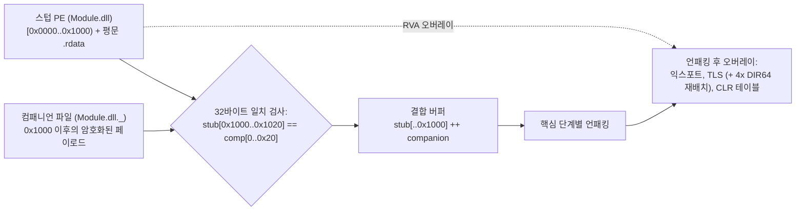

# 섹션 데이터 및 컴패니언 파일

## 섹션 페이로드 파일 기준 오프셋 (`0x1080`)

모든 Windows 빌드 계열에서 섹션 블록 디스크립터의 `src` 필드는 파일 오프셋 `0x1080`의 값을 비트 NOT(`~`)으로 반전해 구한 파일 기준 오프셋에 대한 상대값으로 저장됩니다.

```text
section_data_file_base = (~u32@0x1080 + 0x1000) & 0xFFFFFFFF
```

각 디스크립터의 `src` 필드는 컨테이너 내부(컴패니언 빌드의 경우 가상의 `stub[..4096] ++ companion` 결합 버퍼 내부)의 파일 오프셋 `src + section_data_file_base`로 해석됩니다.

## 외부 컴패니언 레이아웃 (`._` 파일)

일부 PE32+ EXE 스타일 빌드는 보호된 EXE 또는 DLL을 같은 디렉터리 안의 두 파일로 분할합니다.

* **`Module.dll` / `App.exe` (스텁):** 외부 PE 헤더(`0x0000..0x0FFF`), `0x1000..0x101F`의 32바이트 `info` 헤더, 최소한의 로더 엔트리 섹션, 그리고 `.rdata` 내 일부 평문 디렉터리를 유지합니다.
* **`Module.dll._` / `App.exe._` (컴패니언 파일):** 독립된 PE 헤더 없이 컨테이너 오프셋 `0x1000` 이후의 바이트를 담고 있는 고엔트로피 페이로드 파일입니다.



두 파일이 올바른 쌍인지 확인하려면 암호화된 `info` 헤더에 해당하는 `stub[4096..4128]`과 `companion[0..32]`의 32바이트가 정확히 일치해야 합니다.


**엔트리 썽크의 컴패니언 선언.** PE32+ 셸에서는 63바이트 로더 엔트리 레코드에도 외부 컴패니언 파일의 필요 여부가 기록됩니다. 오프셋 `+53`에는 `~0x1000`(단일 파일 빌드는 `~0`), 오프셋 `+58`에는 `~u32("._\0\0")` 값이 들어 있습니다. 이 시그니처를 확인하면 `._` 파일이 누락된 경우와 단일 파일 바이너리가 손상된 경우를 구분할 수 있습니다.


## 스텁에만 평문으로 유지되는 영역

암호화된 `._` 컴패니언 파일에는 Windows 로더나 CLR이 참조하는 일부 테이블이 생략되어 있거나 0으로 채워져 있으므로, 핵심 섹션 복구가 끝난 뒤 스텁 PE에서 해당 영역을 RVA 기준으로 덮어써 복원합니다.

* **익스포트 디렉터리 (`DD[0]`):** 컴패니언 페이로드에서는 익스포트 영역이 암호화된 채로 남거나 비어 있으므로 스텁에서 그대로 복사합니다.
* **TLS 디렉터리 (`DD[9]`):** 컴패니언 페이로드에서는 `DD[9]`, `IMAGE_TLS_DIRECTORY64` 구조체, TLS 원본 데이터 템플릿이 모두 0으로 비워져 있습니다. 복원 과정에서 스텁의 값을 가져와 채우고, `IMAGE_TLS_DIRECTORY64` 내부의 VA 필드 4개에 대해 `IMAGE_REL_BASED_DIR64` 기준 재배치 항목 4개를 추가합니다.
* **ASLR 및 기준 재배치 (`DD[5]`):** 컴패니언 모듈은 `/FIXED`를 강제하지 않고 `DllCharacteristics` (`DYNAMIC_BASE` / `HIGH_ENTROPY_VA`)와 활성 기준 재배치 테이블을 그대로 보존합니다.
* **관리형 컴패니언의 CLR 메타데이터 (`DD[14]`):** 암호화된 IL 메서드 본문은 `._` 페이로드에 들어 있는 반면, `COR20` 헤더와 이 헤더가 가리키는 메타데이터(`BSJB`), 리소스, 강력한 이름(strong-name), vtable 수정(vtable-fixup) 영역은 스텁에 남아 있습니다([재배치, 페이지 변환 및 CLR 데이터](../loading-and-pe-repair/pe-reconstruction/relocations-managed.md) 참고).
