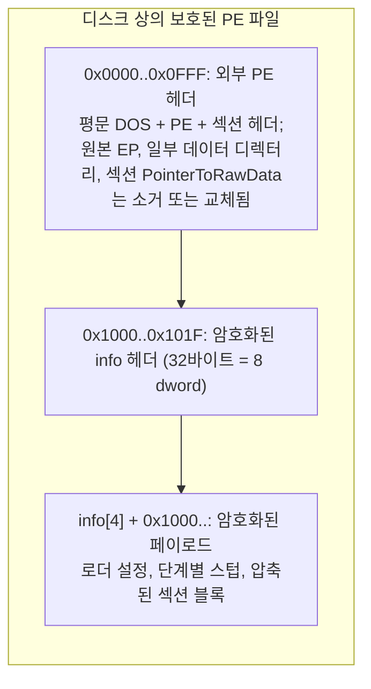

# 컨테이너 및 암호화된 헤더

보호된 PE 파일은 원본 섹션 레이아웃을 암호화된 컨테이너로 대체합니다. 첫 4,096바이트(`0x0000..0x0FFF`)에는 읽을 수 있는 외부 PE 헤더가 유지되고, 오프셋 `0x1000`에는 암호화된 32바이트 파라미터 블록이 자리하며, 파일의 나머지 영역에는 암호화된 로더 테이블, 스테이지 스텁, 압축된 애플리케이션 섹션이 저장됩니다.

## 컨테이너 레이아웃



| 영역 | 파일 오프셋 | 내용 |
| --- | --- | --- |
| 외부 PE 헤더 | `0x0000..0x0FFF` | DOS/PE 시그니처, COFF 헤더, 옵션 헤더 및 섹션 테이블. 원본 엔트리 포인트(OEP), 일부 데이터 디렉터리, 섹션의 `PointerToRawData`(파일 오프셋)는 0으로 비워지거나 로더 영역을 가리키도록 바뀝니다. |
| `info` 헤더 | `0x1000..0x101F` | `header_kdf`로 복호화되는 8개의 리틀 엔디언 dword. 전체 컨테이너의 매직 값, RVA 배치 주소, 페이로드 범위를 제공합니다. |
| 페이로드 | `info[4] + 0x1000` 이후 | 암호화된 로더 테이블, 스테이지 코드, 압축된 섹션 데이터. |

확인된 모든 Windows 빌드는 `0x1000`을 경계로 헤더와 컨테이너 데이터를 분리합니다. `0x1000` 이후의 컨테이너 바이트를 별도의 `._` 파일로 분리하는 [외부 컴패니언 레이아웃](companion-layout.md)도 동일한 경계를 따릅니다.

## `info` 헤더와 키 파생

`info[0]`은 오프셋 `0x1000`에 평문으로 저장되며, `info[1..7]` 워드는 원본 암호문 워드와 `i * i`를 혼합하는 롤링 키로 복호화됩니다.

```python
def header_kdf(file_data, offset=4096):
    info = [0] * 8
    info[0] = get_u32(file_data, offset)
    k = info[0]
    for i in range(7):
        cell = get_u32(file_data, offset + 4 + 4 * i)
        info[i + 1] = k ^ cell
        k = (i * i) ^ ((k + cell - i) & 0xFFFFFFFF)
    return info
```

이 32바이트 KDF는 PE32와 PE32+, EXE와 DLL, 단일 파일 빌드와 컴패니언 빌드 전반에 동일하게 적용됩니다.

| 필드 | 의미 |
| --- | --- |
| `info[0]` | 평문 시드 키. `payload_xor_chain`의 초기 시드 계산에도 사용됨 |
| `info[1]` | 포맷 매직 값 (`0x4E4E4F4B` = 리틀 엔디언 ASCII `KONN`) |
| `info[2]` | 예약 필드 / 빌드 변형 필드 |
| `info[3]` | 작업 이미지 버퍼에서 페이로드가 매핑되는 대상 기준 RVA |
| `info[4]` | 파일 오프셋 바이어스. 페이로드 바이트는 파일 오프셋 `info[4] + 4096`에서 시작 |
| `info[5]` | 이미지 범위 `[info[3], info[3] + info[5])`로 복사되는 전체 페이로드 바이트 길이 |
| `info[6]` | 암호화된 로더 프리픽스 및 앵커 탐색의 끝 RVA 마커 |
| `info[7]` | 예약 필드 / 빌드 변형 필드 |

## 페이로드 적재와 `decrypt_size`

파일 바이트 `[info[4] + 4096, info[4] + 4096 + info[5])` 구간은 작업 이미지의 RVA `[info[3], info[3] + info[5])` 구간으로 매핑됩니다.

* **표준 프리픽스 복호화:** 64비트 빌드와 표준형 PE32 빌드에서는 앞쪽 `decrypt_size = info[6] - info[3] + 8192` 바이트를 `payload_xor_chain`([롤링 키 및 회전 암호](../data-transforms/rolling-and-rotation.md) 참고)으로 복호화하고, `info[5]`의 나머지 뒷부분은 그대로 복사합니다.
* **전체 페이로드 PE32 변형:** 구형 컴팩트 PE32 빌드는 페이로드 전체를 암호화합니다(`decrypt_size = info[5]`가 되며, 이에 따라 초기 XOR 시드인 `info[0] + ~decrypt_size` 값도 달라집니다). 정적 복원 시 PE32에서 프리픽스 복호화 결과로 `SecondStage` 검증을 통과하는 `tbl` 후보를 찾지 못하면 `decrypt_size = info[5]`로 폴백합니다.

페이로드 적재가 끝나면 이미지 RVA `info[3]` 위치에 dword 값 `4096` (`0x1000`)을 기록하고, 파일의 첫 `4096`바이트를 이미지 앞쪽 `[0, 0x1000)` 구간에 작업 PE 헤더로 복사합니다.
