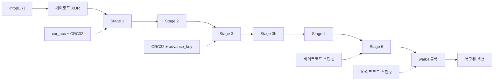
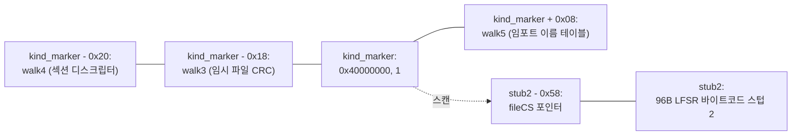

# 스테이지 체인과 마커 레이아웃

`payload_xor_chain`은 애플리케이션 본체가 아니라 외곽 로더 작업 공간을 복호화합니다. 이 작업 공간 내부에서 Stage 1부터 Stage 5까지가 순차적으로 풀리며, 각 스테이지의 키는 헤더 체크섬, 직전 복호화 스테이지의 CRC-32, 그리고 `advance_key`를 거친 콘텐츠 시드를 결합해 파생됩니다.

## 복합 스테이지 복호화기 (Stage 3..5)

Stage 2 이후의 모든 스테이지는 16바이트 `{src, src_len, dest, dest_len}` 쿼드 디스크립터로 정의되며 다음 4단계로 디코딩됩니다.

1. **AES-CBC 복호화:** 스테이지 키 스케줄 `key_offsets[3]`을 사용해 `d[src .. src + src_len]` 구간을 제자리에서 복호화합니다.
2. **XOR 및 우측 회전:** 파생된 스테이지 키와 비트 회전 수 `19`를 사용해 `{src, src_len}` 구간에 `xor_ror_dwords`를 적용합니다.
3. **바이트코드 변환 (Stage 5 전용):** `src .. src + src_len`의 모든 바이트를 바이트코드 스텁 1로 변환합니다.
4. **허프만/LZ 압축 해제:** `src_len != dest_len`일 때 스테이지 허프만 테이블 `key_offsets[1]`을 사용해 `src -> dest`로 압축을 해제합니다.

## 9단계 64비트 마커 파이프라인



### 1~2단계: `info` 헤더 및 페이로드 프리픽스

파일 오프셋 `0x1000`의 `info[0..7]`을 `header_kdf`로 디코딩하고 `info[1] == 0x4E4E4F4B`(`KONN`) 매직 값을 검증합니다. 이어서 0으로 초기화된 `SizeOfImage` 크기의 작업 버퍼를 할당하고, 파일 오프셋 `info[4] + 4096`부터 `decrypt_size = info[6] - info[3] + 8192`바이트에 대해 `payload_xor_chain`을 실행하여 이미지의 `info[3]` 위치에 기록합니다. 남은 `info[5] - decrypt_size`바이트의 후미 데이터는 그대로 복사한 뒤, `info[3]` 위치에 `0x1000`을 기록하고 파일 앞부분 `[0, 0x1000)`을 이미지 맨 앞에 복사합니다.



### 3단계: 설정 앵커 및 Stage 1

`[info[6] + 1000, info[6] + 8000)` 구간을 스캔하여 `u32@anchor == info[3]`이고 `u32@(anchor + 8)`이 `info[6]` 아래쪽 `0x1000`바이트 이내의 `0x200` 정렬 경계에 놓이는 `anchor`를 찾습니다. 그다음 `anchor + 120 + extra`에 위치한 Stage 1 `{base, length}` 디스크립터가 유효한 범위(`base >= info[3]`, `length >= 16`, 이미지 내부)를 가리키는지 `extra in (0, 8)` 두 경우에 대해 검사합니다.

`anchor + 8`과 `anchor + 4`에서 `DD[1]`(임포트 디렉터리)의 `(RVA, size)`를 복원하고, `anchor + 184 + extra`의 `(offset, length)` 디스크립터 배열을 순회하며 `xor_acc` 값을 누적합니다. 여기에 `chk1 = calculate_checksum(d, anchor + 56 + extra)`와 `v = u32@(anchor + 20)`을 구한 뒤 `xor_ror_dwords(d, anchor + 120 + extra, xor_acc ^ chk1 ^ v, 21)`을 실행해 Stage 1을 복호화합니다.



### 4단계: Stage 2 및 4개의 `key_offsets`

Stage 1 내부를 스캔하여 `d0 == d2`가 페이로드 범위 내에 있고 `d1 > 0x10000`이며 `0 < d3 < d1`을 만족하는 유일한 16바이트 Stage 2 쿼드(`stage2_off`)를 찾습니다. 이 지점에서 역방향으로 탐색해 연속된 유효 `(src, len)` 쌍 4개가 시작되는 `chk_src_start`를 찾고, `chk_src_start - 20`에서 Stage 2 키를 읽어 비트 회전 수 `19`로 Stage 2를 복호화합니다.

복호화된 Stage 2 내부에서 `(1, 0, info[3], 0)` 패턴(`table_start`)을 찾은 뒤, `table_start + 32`에 있는 두 개의 `head` 엔트리를 처리합니다(종류 `1`/`0x11` -> `byte_rotate3` 복호화, 종류 `2` -> `(src, len, dst, chk)` 복사 목록). 이어서 `head - 88`에 위치한 4개의 `walk2` 슬롯을 `byte_rotate3` 함수로 복호화하여 `key_offsets`를 확보합니다.

| 슬롯 | 테이블 역할 |
| --- | --- |
| `key_offsets[0]` | **섹션** 압축 해제용 허프만 테이블 |
| `key_offsets[1]` | **스테이지** 압축 해제용 허프만 테이블 |
| `key_offsets[2]` | **섹션** 복호화용 AES 키 스케줄 |
| `key_offsets[3]` | **스테이지** 복호화용 AES 키 스케줄 |



### 5단계: Stage 3, 3b, 4 및 5

`stage2_off` 기준 상대 오프셋에 자리한 4개의 스테이지 쿼드를 순서대로 디코딩합니다.

| 스테이지 | 쿼드 오프셋 | 키 계산식 |
| --- | --- | --- |
| Stage 3 | `stage2_off + 88` | `xor_acc ^ chk2 ^ advance_key(u32@(chk_src_start - 16), rounds)` (기본값 `rounds = 4`, 압축 해제나 `v4` 탐색 실패 시 `0..=8` 재시도) |
| Stage 3b | `stage2_off + 104` | `xor_acc ^ chk3 ^ v4` (`v4`는 Stage 3 내 `C3 CC CC CC` 뒤에 나타나는 마지막 0이 아닌 dword) |
| Stage 4 | `stage2_off + 136` | `xor_acc ^ chk4 ^ ~v5` (`v5 = u32@(Stage 3b 내 첫 번째 "Virtual..." 문자열 오프셋 - 8)`) |
| Stage 5 | `stage2_off + 216` | `xor_acc ^ chk4 ^ chk5 ^ advance_key(accum2, rounds)` (기본값 `rounds = 3`, 압축 해제 실패 시 `0..=8` 재시도), **바이트코드 스텁 1** 변환 적용 |

Stage 4에서는 안티디버깅 API 문자열(`IsDebuggerPresent`, `CheckRemoteDebuggerPresent`) 부근을 LFSR로 스캔하여 바이트코드 스텁 1을 찾고, 마지막 `48 EB 01 B9` 시퀀스 직후(`0xCC` 패딩 건너뜀)에서 `accum2` 값을 읽습니다.



### 6단계: Stage 5 마커 배치와 바이트코드 스텁 2

Stage 5 내부에서 `"pm\0\0cm\0\0"`(`70 6D 00 00 63 6D 00 00`) 문자열과 종류 마커 `0x40000000, 1`(`00 00 00 40 01 00 00 00`)을 찾습니다.

* **`walk3` 테이블**은 원본 파일 영역의 연쇄 CRC-32를 검증하기 위해 일시적으로 복호화한 뒤, 다시 원래 암호문 바이트로 되돌립니다.
* **`fileCS`**(`stub2 - 0x58`)는 `len == 0` 종료 엔트리가 나올 때까지 16바이트 엔트리 단위로 `byte_rotate2`를 적용해 제자리에서 복호화한 채로 유지합니다.
* **스텁 2**는 LFSR 키스트림으로 복호화한 뒤 256바이트 룩업 테이블을 미리 계산합니다.



### 7단계: 병렬 처리 가능한 섹션 복구 (`walk4`)

`walk4`는 각 엔트리의 RVA 위치에서 `byte_rotate2`로 복호화되는 연속된 16바이트 `{src, len, dst, plain_len}` 디스크립터 배열이며, `len == 0` 엔트리에서 끝납니다. 각 블록은 `file[src + section_data_file_base .. +len]` 데이터를 `image[dst]`로 복사하고 `aes_decrypt`(`key_offsets[2]`)와 스텁 2 바이트 변환을 거친 뒤, `len != plain_len`이면 `decompress`(`key_offsets[0]`)를 실행합니다. 이어서 두 번째 `walk4` 배열이 `.bss` 영역을 0으로 채웁니다. 각 블록의 출력 대상 구간이 서로 겹치지 않으므로 순차 실행과 병렬 실행 모두 동일한 결과를 보장합니다.



### 8단계: `walk5` 임포트 이름 복호화

네이티브 모듈(`walk5`가 널이 아닌 경우)에서는 20바이트 엔트리마다 암호화된 DLL 이름(`+12`, 초기 키 `name_rva & 0xFF`로 `string_cipher` 복호화 후 소문자 변환)과 썽크 배열(`+0` 또는 `+16`)을 참조합니다. 이름 기반 썽크(비트 63이 0인 항목)는 `hint_name_rva + 2` 위치의 심벌 이름을 초기 키 `hint_name_rva & 0xFF`로 복호화하되 대소문자를 그대로 보존하며, 앞쪽 2바이트 `Hint` 필드는 0으로 지웁니다. 관리형 모듈은 `walk5` 포인터가 널입니다.



### 9단계: PE 헤더, 페이지 스크램블 및 디렉터리 마무리

각 섹션 헤더의 `PointerToRawData`(파일 오프셋)를 RVA 레이아웃에 맞게 설정하고 `.text` 페이지 스크램블(`dd8`)을 복구한 뒤, 임시 메타데이터 블록을 일시 복호화해 엔트리 포인트와 데이터 디렉터리를 복원하고 TLS, 기준 재배치, CLR 메타데이터 오버레이를 적용합니다(자세한 과정은 [PE 재구성](../pe-reconstruction/README.md) 참고).


