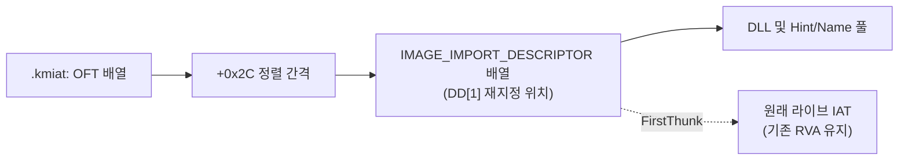

# 임포트, TLS 및 익스포트

## 임포트 테이블 및 문자열 복구

암호화된 임포트 문자열은 `string_cipher`(`dd7`)로 복호화합니다. `name_rva`에 위치한 DLL 이름은 `pos = name_rva`, 초기 키 `key = name_rva & 0xFF`로 복호화를 시작합니다. 반면 `hint_name_rva`에 위치한 이름 기반 `IMAGE_IMPORT_BY_NAME` 엔트리는 앞쪽 2바이트 `Hint`(0으로 초기화됨)를 건너뛴 `pos = hint_name_rva + 2`부터 시작하되, 초기 키는 `hint_name_rva & 0xFF`를 사용합니다. 서수 썽크(PE32+는 비트 63, PE32는 비트 31 기준이며 PE32+에서는 반드시 64비트 전체 폭으로 읽어야 함)는 수정하지 않고 그대로 둡니다.



* Stage 5의 `walk5` 테이블에 있는 20바이트 엔트리를 순회합니다(`+12` = DLL 이름 RVA, `+0` / `+16` = 썽크 체인). 관리형 어셈블리는 `walk5 == 0`입니다.
* 각 DLL 이름을 제자리에서 복호화한 뒤 소문자로 변환하고, 이름 기반 함수 문자열은 `hint_name_rva + 2`에서 복호화하되 **소문자로 바꾸지 않고** 원래 대소문자를 유지하며 `Hint`를 0으로 지웁니다.
* `DataDirectory[12]`(IAT)는 저장된 128바이트 데이터 디렉터리 배열에서 그대로 가져옵니다.



* 임포트 문자열이 `.text` 섹션 내부에 놓여 있으므로, **반드시 `.text` `dd8` 페이지 스크램블 해제가 끝난 뒤에** 복원된 `DataDirectory[1]`(저장된 `DD[1]`이 0이면 앵커의 임포트 RVA로 대체)에서 `IMAGE_IMPORT_DESCRIPTOR` 배열을 순회합니다.
* 이미 출력 가능한 평문 ASCII 상태인 모듈 이름이나 함수 이름에는 `string_cipher`를 적용하지 않고 건너뛰며, 복호화한 DLL 이름은 소문자로 변환하고 함수 이름의 대소문자는 그대로 보존합니다.
* 각 디스크립터의 `FirstThunk` 체인을 순회해 `DataDirectory[12]`(IAT)의 범위를 계산합니다.



* 임포트 테이블을 따라 DLL 이름과 이름 기반 함수 문자열을 제자리에서 복호화하며, DLL 이름을 소문자로 변환하지 않습니다.
* `info[3] + 16` 위치의 656바이트 헤더·디렉터리 블록에서 `DataDirectory[12]`를 복원합니다.



* `EighthStage`(`+0x18`) 임포트 테이블과 저장된 데이터 디렉터리(`DD[1]`)의 임포트 테이블 중 유효한 쪽을 선택합니다.
* **제자리 `.idata` 방식 PE32:** 문자열을 제자리에서 복호화합니다(`.idata` 기반 EXE는 썽크 범위로 `DD[12]`를 계산하고, PE32 DLL은 `DD[12]`를 `(0, 0)`으로 비움).
* **`.kmiat` 재구축 (PE32 EXE 전용):** 로더가 기록한 IAT 배치가 표준 `.idata` 구조와 어긋난 경우, 마지막 섹션의 이름을 `.kmiat`(크기 `0x7000`, 특성 플래그 `0xE0000060`)로 바꾸고 그 안에 임포트 디스크립터, OriginalFirstThunk 배열(`+0x2C` 패딩 간격), 소문자 변환된 DLL 이름(`api-ms-win-crt-*`는 `ucrtbase.dll`로 정규화) 및 대소문자가 보존된 심벌 문자열 풀을 새로 구축합니다. 이때 실제 코드가 참조하는 라이브 IAT는 원래 RVA에 그대로 유지하고 `DD[12]`는 `(0, 0)`으로 비웁니다.




## TLS 복원 및 기준 재배치 재활성화

CrackProof는 암호화된 페이로드에서 TLS 상태를 제거하고 런타임 로더 내부에서 TLS를 직접 처리합니다. 따라서 외곽 스텁에 남아 있는 평문 정보로 TLS를 복원하지 않으면 정적으로 복구한 이미지를 실행할 때 `_tls_index` 참조나 `LdrpAllocateTlsEntry` 단계에서 `0xC0000005` 접근 위반이 발생합니다.

* **단일 파일 64비트 마커:** 저장된 데이터 디렉터리의 `DD[9]`는 0이 아닌 RVA를 유지하지만 실제 `IMAGE_TLS_DIRECTORY64` 구조체는 0으로 비워져 있습니다. 재구성 시에는 보호된 파일의 동일 RVA에서 평문 TLS 구조체와 원시 데이터 템플릿을 복사합니다(단일 파일 마커 빌드는 `/FIXED` 이미지이므로 재배치 항목을 새로 합성하지 않으며, 마커리스 단일 파일 빌드는 복구된 구조체가 모두 0이면 `DD[9]`를 비움).
* **외부 컴패니언 (`._`) 64비트:** 컴패니언 파일은 `DD[9]`, TLS 구조체, 데이터 템플릿을 모두 0으로 비우고 해당 기준 재배치 항목도 제거합니다. 재구성 시에는 스텁 PE에서 `DD[9]`, `IMAGE_TLS_DIRECTORY64` 구조체, 원시 데이터 템플릿을 복원한 뒤, `StartAddressOfRawData`, `EndAddressOfRawData`, `AddressOfIndex`, `AddressOfCallBacks` 네 필드를 가리키는 **4개의 `IMAGE_REL_BASED_DIR64` 항목을 `.reloc` 섹션 끝에 추가**합니다.
* **PE32 EXE 및 DLL:** 로더 스텁에서 평문 `IMAGE_TLS_DIRECTORY32`와 템플릿을 복사합니다(스텁에 없을 경우 최소한의 `.tls`/`.data` 플레이스홀더로 대체). 특히 **PE32 DLL**에서는 CrackProof가 `.reloc` 내부의 TLS 포인터 재배치 항목 4개를 페이지 오프셋만 남긴 채 `IMAGE_REL_BASED_ABSOLUTE`(`type = 0`) 패딩 타입으로 바꿔 비활성화해 두므로, 재구성 과정에서 **이 4개 슬롯을 다시 `IMAGE_REL_BASED_HIGHLOW`(`type = 3`) 타입으로 재활성화**해 이미지 베이스가 재배치될 때 `IMAGE_TLS_DIRECTORY32`의 포인터 필드 4개가 모두 정상 갱신되도록 합니다.

## 익스포트 디렉터리 (`DD[0]`)

단일 파일 빌드는 보호된 파일 내부의 원래 RVA 위치에 평문 익스포트 디렉터리를 그대로 유지합니다. 반면 외부 컴패니언(`._`) 페이로드는 익스포트 영역을 복호화하면 유효하지 않은 바이트열이 나오므로, 스텁 PE의 `.rdata`에서 `DataDirectory[0]` 전체 구간을 읽어 덮어씁니다.
