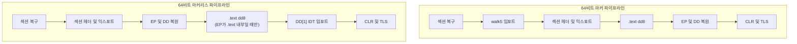

# 기준 재배치, 페이지 변환 및 CLR 데이터

## 기준 재배치와 `/FIXED` 대 ASLR 정책

* **단일 파일 64비트 마커 및 32비트 EXE (`/FIXED`):** 패커가 기준 재배치 테이블을 폐기하고 `DllCharacteristics`를 0으로 비웁니다. 정적 재구성에서도 EXE가 기본 `ImageBase`에 고정 로드되도록 `DataDirectory[5]`와 `DllCharacteristics`를 모두 0으로 설정합니다.
* **모든 DLL (계열 무관 32비트 및 64비트):** DLL은 반드시 주소 재배치가 가능해야 하므로 `DataDirectory[5]`를 보존하고 `IMAGE_DLLCHARACTERISTICS_DYNAMIC_BASE`(`0x0040`) 플래그를 설정하며, PE32 DLL에서는 비활성화된 TLS 재배치 항목을 재활성화합니다.
* **마커리스 64비트 및 외부 컴패니언 (`._`) 빌드:** 활성화된 ASLR 플래그(`DYNAMIC_BASE` / `HIGH_ENTROPY_VA`)와 `DataDirectory[5]`를 그대로 유지합니다(컴패니언 TLS를 복원한 경우에는 4개의 `DIR64` TLS 재배치 항목을 추가).

## `.text` 페이지 스크램블 (`dd8`) 실행 순서

마커리스 빌드는 암호화된 임포트 문자열과 평문 CLR 메타데이터를 `.text` 내부에 함께 배치하므로, 마커 파이프라인과 마커리스 파이프라인에서 `dd8`을 실행하는 시점이 달라야 합니다.

마커리스 빌드에서는 섹션 헤더와 EP/데이터 디렉터리를 먼저 복원한 뒤, `DD[1]` 임포트 이름 복호화 및 CLR 오버레이보다 **앞서** `dd8`을 실행해야 합니다(`AddressOfEntryPoint`가 `.text` 내부를 가리킬 때만 `dd8` 적용). 그래야 복호화한 임포트 문자열을 `dd8`이 다시 뒤섞거나 오버레이한 `COR20`/`BSJB` 바이트가 깨지는 일을 막을 수 있습니다.

## 정밀 CLR 메타데이터 복원

관리형 CrackProof 빌드는 IL 메서드 본문을 섹션 페이로드 안에 암호화해 넣는 반면, ECMA-335 메타데이터 구조체들은 외곽 파일이나 컴패니언 스텁에 평문 상태로 남겨 둡니다.

* **단일 파일 마커리스 64비트:** `dd8` 실행 이후에 `COR20` 헤더(`cb == 0x48`)와 `BSJB` 메타데이터 스트림을 각자의 RVA 위치에 오버레이합니다.
* **단일 파일 마커 64비트:** `COR20` 헤더, `BSJB` 메타데이터, 그리고 `COR20.Resources`(`+0x18`) 영역을 오버레이합니다.
* **관리형 컴패니언 (`._`) DLL:** 스텁 PE에서 `COR20`(`0x48`바이트) 헤더와 함께 값이 0이 아닌 최대 7개의 하위 참조 영역인 `MetaData`(`BSJB`, 필수), `Resources`, `StrongNameSignature`, `CodeManagerTable`, `VTableFixups`(참조된 각 슬롯 배열 포함), `ExportAddressTableJumps`, `ManagedNativeHeader`를 모두 오버레이합니다.


**섹션 복구가 끝난 뒤에는 CLR이 포함된 섹션 전체를 덮어쓰면 안 됩니다.** IL 메서드 본문은 `COR20` 및 `BSJB`와 동일한 `.text` 섹션에 함께 들어 있으며 `walk4`와 `dd8`을 통해 복구됩니다. 보호된 원본 파일이나 스텁에서 섹션 전체를 덮어쓰면 복호화된 메서드 본문이 다시 암호문으로 바뀝니다. (예외적으로 구형 전용 64비트 DLL 파이프라인만 `walk4`가 복구된 메서드 본문을 기록하기 **이전**에 CLR 섹션을 미리 채워 넣습니다.)


`DataDirectory[14]`가 유효한 보존 사본도 없이 0으로 비워진 `COR20` 헤더(`cb == 0`)를 가리키는 경우에는 `DataDirectory[14]`를 비웁니다. Unity IL2CPP 타이틀은 CLR 헤더 없는 네이티브 `GameAssembly.dll`로 패킹하며 `global-metadata.dat` 파일을 별도로 난독화합니다(자세한 내용은 [IL2CPP 메타데이터 난독화](../../analysis/il2cpp-metadata.md) 참고).
