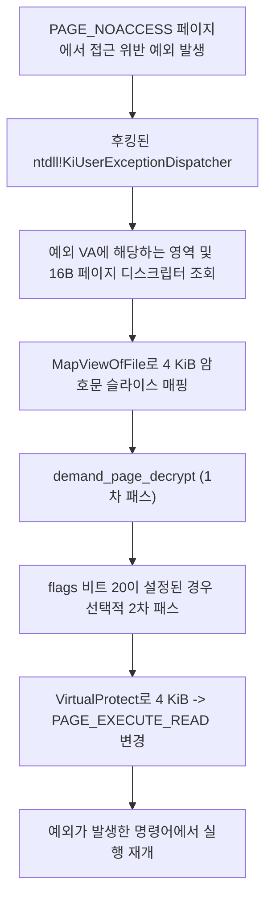

# 페이지 보호 및 로더 코드

## 예외 기반 온디맨드 페이지 암호화 (`640` -> `840`)

페이지 보호는 모듈별로 선택 적용되는 런타임 보호 계층으로, 일반적으로 호스트 EXE에서는 활성화되고 플러그인 DLL에서는 비활성화됩니다.

1. 실행 섹션은 `640` 단계에서 먼저 일괄 복호화됩니다.
2. `840` 단계에서 실행 페이지를 4 KiB 페이지 단위로 다시 암호화해 `PAGE_NOACCESS`로 전환하고, `ntdll!KiUserExceptionDispatcher` 시작부를 인라인 후킹해 `HtdpStub2.dll`로 점프하도록 연결합니다([수동 매핑 보조 모듈](mapped-modules.md) 참고).
3. 실행 흐름이 `PAGE_NOACCESS` 페이지에 도달해 접근 위반 예외(`STATUS_ACCESS_VIOLATION`)가 발생하면, 디스패처 훅이 모든 SEH 체인보다 먼저 예외를 가로채 해당 4 KiB 페이지를 복호화한 뒤 보호 속성을 `PAGE_EXECUTE_READ`로 변경하고 실행을 재개합니다.

아직 실행되지 않은 페이지는 계속 `PAGE_NOACCESS` 상태로 남고, 일부 빌드는 예외 처리 사이에 이미 복호화된 페이지의 일부 바이트를 다시 XOR 마스킹하는 **scribble** 기능도 활성화합니다. 따라서 보호 대상 페이지 전체에 접근해 복호화를 유도하고 scribble 마스킹을 해제하지 않는 한, OEP 진입 직후의 단일 메모리 스냅샷에는 그때까지 실행되어 복호화된 페이지만 담깁니다.

## 온디맨드 페이지 복호화 알고리즘



`HtdpStub2.dll` 내부에는 보호된 모듈마다 영역 디스크립터가 등록되며, 이 구조체는 `region_base + page_table_offset` 위치에 있는 16바이트 페이지 디스크립터 배열(`(fault_va - region_base) >> 12`로 인덱싱)을 가리킵니다.

| 구조체 | 오프셋 | 크기 | 관찰된 의미 |
| --- | --- | --- | --- |
| 영역 디스크립터 | `+0x08` | 8 | `region_base` 가상 주소(VA) |
| 영역 디스크립터 | `+0x10` | 4 | 영역 바이트 크기 |
| 영역 디스크립터 | `+0x20` | 4 | `region_base` 기준 `page_table_offset` |
| 영역 디스크립터 | `+0x24` | 4 | 전체 4 KiB 페이지 개수 |
| 영역 디스크립터 | `+0x28` | 8 | `MapViewOfFile`에 전달되는 섹션 핸들 |
| 영역 디스크립터 | `+0x34` | 4 | 복호화된 페이지 카운터 |
| 페이지 디스크립터 (`16B`) | `+0x00` | 4 | `flags` (`bit 20`, 비트 인덱스 `0x14` / 마스크 `0x00100000` 설정 시 2차 패스 활성화) |
| 페이지 디스크립터 (`16B`) | `+0x04` | 4 | 페이지별 `key_part` |
| 페이지 디스크립터 (`16B`) | `+0x08` | 4 | 마지막 `GetTickCount` 타임스탬프 |
| 페이지 디스크립터 (`16B`) | `+0x0C` | 2 | 예외 카운터 |
| 페이지 디스크립터 (`16B`) | `+0x0E` | 2 | 미확인 16비트 필드 |

1차 패스는 `page_va + region_base`의 하위 32비트를 `key_part`와 XOR해 32비트 키를 유도한 뒤, 4 KiB 페이지 전체에 롤링 DWORD 복호화를 수행합니다.

```python
def demand_page_key(page_va, region_base, key_part):
    return ((page_va + region_base) ^ key_part) & MASK32


def demand_page_decrypt(buf, key):
    count = len(buf) >> 2
    state = ((key << 16) ^ key) & MASK32
    prev = state
    for i in range(count):
        enc = get_u32(buf, i * 4)
        state = rol32((state + i) & MASK32, 3)
        put_u32(buf, i * 4, enc ^ prev ^ state)
        prev = enc
```

`get_u32`, `put_u32`, `rol32`, `MASK32`의 정의는 [롤링 키 및 비트 회전 암호](../data-transforms/rolling-and-rotation.md)에 수록되어 있으며, 실행 가능한 테스트 벡터는 [primitives.py](https://app.gitbook.com/s/XSPACE_REFERENCE_KO/primitives.py)에 있습니다. `flags & 0x00100000`이 0이 아니면 `VirtualProtect`가 페이지 권한을 `PAGE_EXECUTE_READ`로 전환하기 전에 빌드별 2차 패스가 추가로 실행됩니다.

## 로더 다형성, 디코이 및 디스크 자체 매핑

* **중복된 다형성 프롤로그:** Stage 5는 동일한 복호화 루틴이라도 정크 점프 배치만 다르게 변형한 사본을 최대 16개까지 생성합니다.
* **디스어셈블리 동기화 교란 점프 및 반환 주소 연산:** 무조건 점프 직후의 정크 바이트, 명령어 중간을 가리키는 분기 타깃, `call $+5` 기반 상수 오프셋 보정을 통해 선형 디스어셈블리와 단순 재귀 하강 디스어셈블리를 방해합니다.
* **타이밍 및 `#DB` SEH 디코이:** 한 디코이는 16개 범용 레지스터를 모두 저장한 뒤 `0x5658` `in eax, dx` 프로브와 `jne $+2`(`disp = 0`이므로 분기 여부와 무관하게 다음 명령어로 진행)를 실행하고 복귀하여 외부 타이밍 검사에 소요 시간을 반영하는 역할만 수행합니다. 또 다른 디코이는 `TF`(`pushfq; or [rsp], 0x100; popfq`)를 설정해 정상 실행 시에는 SEH 핸들러로 우회시키고, `#DB` 예외를 내부적으로 소비하는 디버거나 에뮬레이터는 더미 코드로 빠지게 만듭니다.
* **부팅 후 테이블 소거 및 디스크 자체 매핑:** Stage 5는 `GetModuleFileNameW`로 자신의 파일 경로를 구하고 OS가 해석한 임포트(`CreateFileW` / `CreateFileMappingA` / `MapViewOfFile`)를 통해 디스크 상의 원본 파일을 열어 매핑한 뒤, `655` 단계에서 `.reloc` 항목을 직접 적용하고 `280` 단계 진입 전에 사용이 끝난 스테이지 테이블과 마커를 0으로 지웁니다.
