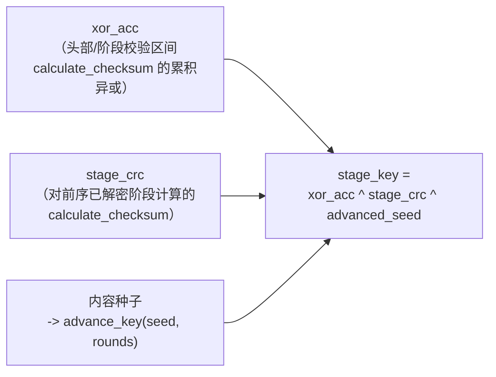

# 校验和与密钥步进

## 反射 CRC-32 校验和

阶段完整性校验与密钥派生均使用标准反射 CRC-32（多项式 `0xEDB88320`，与 zlib/IEEE 802.3 一致，满足 `crc32(b"123456789") == 0xCBF43926`）。描述符提供 `(offset, length)` 对，`calculate_checksum` 将目标区间的 CRC-32 与 `length` 异或：

```python
def _build_crc_table():
    table = []
    for i in range(256):
        c = i
        for _ in range(8):
            c = 0xEDB88320 ^ (c >> 1) if c & 1 else c >> 1
        table.append(c)
    return table

CRC_TABLE = _build_crc_table()

def crc32_append(initial, data):
    crc = ~initial & MASK32
    for b in data:
        crc = CRC_TABLE[(crc ^ b) & 0xFF] ^ (crc >> 8)
    return ~crc & MASK32

def crc32(data):
    return crc32_append(0, data)

def calculate_checksum(d, pos):
    """crc32(region) ^ length, where (offset, length) is read from d[pos]."""
    offset = get_u32(d, pos)
    length = get_u32(d, pos + 4)
    return crc32(d[offset:offset + length]) ^ length
```

[阶段链与有标记布局](../loading-and-pe-repair/loading/stage-chain.md)中仅用于校验的 `walk3` 描述符序列采用分段递推方式：将上一段的输出作为 `initial` 传入 `crc32_append(initial, data)`，依次累加加壳文件内多段字节区间的 CRC-32。

## 三角和密钥步进

从前一阶段提取出的种子双字在混入下一阶段密钥之前，需先执行 `iterations` 轮三角和累加（第 `m` 轮累加 `1 + 2 + ... + (m + 1) * 100`）：

```python
def advance_key(key, iterations):
    for m in range(iterations):
        bound = ((m + 1) * 25) << 2
        for n in range(1, bound + 1):
            key = (key + n) & MASK32
    return key
```

## 阶段密钥合成



后续每个阶段的解密密钥由三项输入异或合成：

* **`xor_acc`：** 对锚点表或头部表中的描述符列表逐项调用 `calculate_checksum` 得到的累积异或值。
* **前序阶段 CRC-32（`stage_crc`）：** 对前序阶段解密得到的明文字节调用 `calculate_checksum` 的结果。
* **内容派生种子：** 从刚解密完成的阶段中读取一个双字，并经 `advance_key` 多轮步进后的结果。

由于每一阶段的密钥都同时依赖前序阶段明文与头部校验和，各阶段必须严格按顺序依次解码；任何偏移偏差、移位参数错误或字节损坏都会导致后续阶段解密和 Huffman 解压立即失败。
