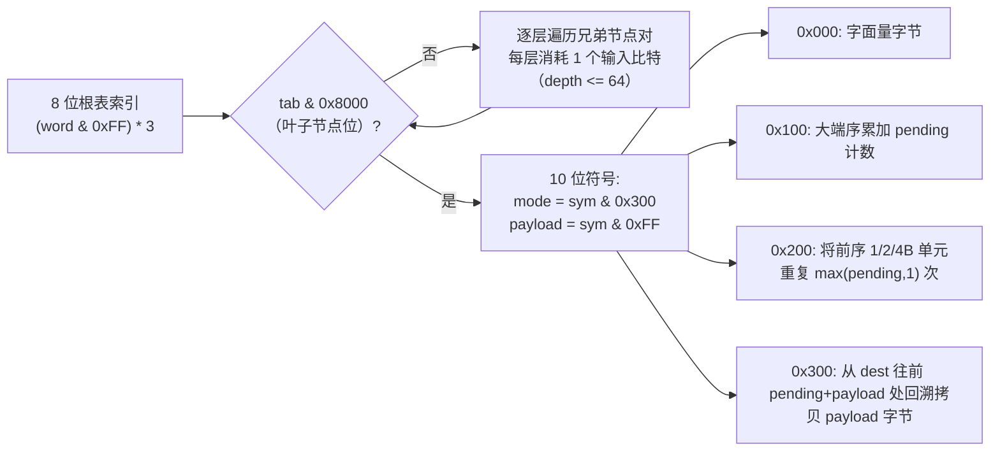

# Huffman 与 LZ 压缩

## 混合 Huffman/LZ 位流格式

Stage 3 至 Stage 5 与压缩节数据块通过工作缓冲区 `key_offset` 处的 Huffman 表（每节点 3 字节）解码为 10 位令牌流：



* **3 字节节点表项：** 每个表项结构为 `(u16 tab, u8 bits)`。读取低 8 位输入比特直接索引根表：`tab & 0x8000` 置位代表叶子节点；否则为内部节点，存放下一层兄弟节点对的下标，之后每向下一层额外消耗 1 个输入比特选择左/右分支（总消耗位数为 `8 + depth`）。
* **10 位叶子符号：** 位 `8..9` 选择令牌模式，位 `0..7` 携带参数 `payload`：

| 模式（`tab & 0x300`） | 参数（`tab & 0xFF`） | 操作 |
| --- | --- | --- |
| `0x000` | 字面量字节 | 写出 `payload`（写入 `1` 字节） |
| `0x100` | 计数字节 | 若 `pending >= 256` 则报错返回；否则移位并入 `pending = (pending << 8) \| payload`（写入 `0` 字节） |
| `0x200` | 单元宽度（`1`、`2` 或 `4`） | 令 `reps = max(pending, 1)`，将紧邻的前序 `payload` 字节单元重复写出 `reps` 次（共写入 `reps * payload` 字节），并将 `pending` 清零 |
| `0x300` | 拷贝长度（`payload`） | 从当前 `dest` 往前 `pending + payload` 字节处拷贝 `payload` 字节，随后将 `pending` 清零 |

```python
def decompress(d, src, dest, key_offset, s_size, d_size):
    """Decompress s_size bytes at `src` into d_size bytes at `dest`,
    in place within buffer `d`. Returns True when exactly d_size bytes
    were produced."""
    bit_pos = 0
    buf = bytearray(d[src:src + s_size]) + bytearray(3)  # 3 bytes of slack
    buf_off = 0
    src_consumed = 0
    pending = 0
    written = 0

    while src_consumed < s_size and written < d_size:
        word = get_u32(buf, buf_off) >> bit_pos
        tab_addr = key_offset + (word & 0xFF) * 3
        tab = get_u16(d, tab_addr)
        if tab & 0x8000:  # leaf
            tab &= 0x7FFF
            bits = d[tab_addr + 2]
        else:             # internal node: walk down one bit per level
            bits = d[tab_addr + 2]
            if bits >= 32:
                return False
            mask = 1 << bits
            bits += 1
            idx = (tab & 0x7FFF) + (1 if word & mask else 0)
            t2 = get_u16(d, key_offset + idx * 3)
            depth = 0
            while not (t2 & 0x8000):
                depth += 1
                if depth > 64:
                    return False
                mask <<= 1
                bits += 1
                idx = (t2 & 0x7FFF) + (1 if word & mask else 0)
                t2 = get_u16(d, key_offset + idx * 3)
            tab = t2 & 0x7FFF

        bit_pos += bits
        advance = bit_pos // 8
        buf_off += advance
        src_consumed += advance
        bit_pos %= 8

        mode = tab & 0x300
        payload = tab & 0xFF
        if mode == 0x000:  # literal
            step = 1
            d[dest] = payload
        elif mode == 0x100:  # count accumulator
            step = 0
            if pending >= 256:
                return False
            pending = payload if pending == 0 else (pending << 8) | payload
        elif mode == 0x200:  # run fill
            if pending == 0:
                pending = 1
            step = pending * payload
            if step + written > d_size:
                return False
            if payload == 1:
                if dest < 1:
                    return False
                v = d[dest - 1]
                for k in range(pending):
                    d[dest + k] = v
            elif payload == 2:
                if dest < 2:
                    return False
                v = get_u16(d, dest - 2)
                for k in range(pending):
                    put_u16(d, dest + k * 2, v)
            elif payload == 4:
                if dest < 4:
                    return False
                v = get_u32(d, dest - 4)
                for k in range(pending):
                    put_u32(d, dest + k * 4, v)
            else:
                return False
            pending = 0
        else:  # 0x300: LZ back-reference
            step = payload
            if written + payload > d_size or pending + payload > written:
                return False
            back = pending + payload
            for k in range(payload):
                d[dest + k] = d[dest + k - back]
            pending = 0

        dest += step
        written += step
        if bits == 0 and step == 0:
            return False

    return written == d_size
```

由于 `decompress` 同时严格检查树深度上限、LZ 回溯边界、`pending` 位宽以及输出字节数精确满足 `written == d_size`，试探解压可在[加载流程与节还原](../loading-and-pe-repair/loading/README.md)各环节直接筛除错误的阶段密钥、移位猜测值与误命中的字节码存根候选。相同的 3 字节节点表项与四种令牌模式同样用于 [CrackProof for Android SO 内部机制](https://app.gitbook.com/s/Aoyn9wKiHAVzBKGSUifa/data-transforms/compression)。
