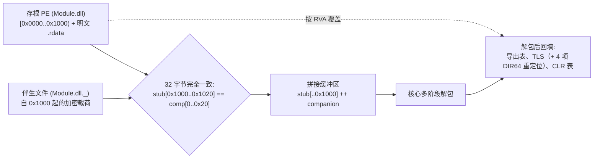

# 节数据与伴生文件

## 节载荷文件基址（`0x1080`）

在所有 Windows 构建类型中，节数据块描述符里的源偏移均相对于一处基址计算，该基址以按位取反形式编码在文件偏移 `0x1080` 处：

```text
section_data_file_base = (~u32@0x1080 + 0x1000) & 0xFFFFFFFF
```

每个描述符的 `src` 字段解析为容器内的文件偏移 `src + section_data_file_base`（对于伴生文件构建，则对应拼接缓冲区 `stub[..4096] ++ companion` 内的偏移）。

## 外部伴生文件布局（`._` 文件）

部分采用 EXE 壳结构的 PE32+ 构建会将加壳后的 EXE 或 DLL 拆分为同目录下的两个文件：

* **`Module.dll` / `App.exe`（存根文件）：** 保留外层 PE 头部（`0x0000..0x0FFF`）、`0x1000..0x101F` 处的 32 字节 `info` 头部、极简加载器入口节，以及 `.rdata` 中的部分明文数据目录。
* **`Module.dll._` / `App.exe._`（伴生文件）：** 高熵载荷文件，保存原容器自偏移 `0x1000` 起的全部字节，自身不含独立的 PE 头部。



配对校验要求 `stub[4096..4128]` 与 `companion[0..32]`（即加密的 `info` 头部）32 字节完全一致。


**入口跳板中的伴生文件标记。** 在 PE32+ 壳中，63 字节的加载器入口记录同样标明了当前模块是否依赖外部伴生文件：偏移 `+53` 处存放 `~0x1000`（单文件构建为 `~0`），偏移 `+58` 处存放 `~u32("._\0\0")`。静态分析可据此区分“缺失 `._` 伴生文件”与“单文件样本损坏”。


## 仅保留在存根文件中的明文区域

由于加密的 `._` 伴生文件省略或清零了若干由 Windows 加载器或 CLR 直接读取的表结构，核心节数据还原完成后，还需按 RVA 从存根 PE 将这些区域覆盖回输出映像：

* **导出表（`DD[0]`）：** 伴生文件载荷中的导出表区间处于加密或未填充状态，需直接从存根文件按 RVA 拷贝恢复。
* **TLS 目录（`DD[9]`）：** 伴生文件载荷将 `DD[9]`、`IMAGE_TLS_DIRECTORY64` 结构体及 TLS 原始数据模板清零；重建时需从存根文件恢复这些数据，并为 `IMAGE_TLS_DIRECTORY64` 内的四个 VA 字段补齐四项 `IMAGE_REL_BASED_DIR64` 基址重定位。
* **ASLR 与基址重定位（`DD[5]`）：** 伴生文件模块保留 `DllCharacteristics` 中的 `DYNAMIC_BASE` / `HIGH_ENTROPY_VA` 标志与有效的基址重定位表，不强制改为 `/FIXED`。
* **托管伴生文件的 CLR 元数据（`DD[14]`）：** `._` 载荷存放加密后的 IL 方法体，而存根文件保留明文的 `COR20` 头部及其引用的元数据（`BSJB`）、资源、强名称签名与 vtable 修正区间（详见[重定位、页变换与 CLR 数据](../loading-and-pe-repair/pe-reconstruction/relocations-managed.md)）。
