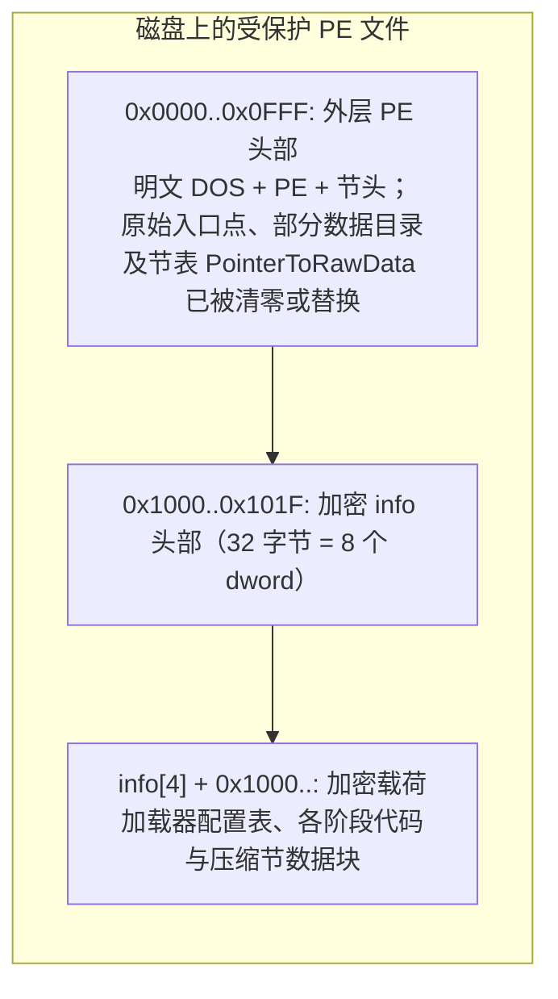

# 容器布局与加密头部

加壳后的 PE 文件以加密容器替代原始节布局：前 4,096 字节（`0x0000..0x0FFF`）保留明文外层 PE 头部，偏移 `0x1000` 处存放 32 字节的加密参数块，后续区域存放加密的加载器配置表、阶段代码与压缩后的应用节数据。

## 容器布局



| 区域 | 文件偏移 | 内容 |
| --- | --- | --- |
| 外层 PE 头部 | `0x0000..0x0FFF` | DOS/PE 签名、COFF 头部、可选头部与节表。原始入口点、部分数据目录及节表中的文件偏移（`PointerToRawData`）被清零或重定向至加载器。 |
| `info` 头部 | `0x1000..0x101F` | 由 `header_kdf` 解密的 8 个小端序 dword，给出整个容器的魔数、RVA 映射位置及载荷边界。 |
| 载荷区 | 自 `info[4] + 0x1000` 起 | 加密的加载器配置表、阶段代码与压缩节数据。 |

所有已观测到的 Windows 构建均以 `0x1000` 为界切分 PE 头部与容器数据；[外部伴生文件布局](companion-layout.md)同样遵循这一边界，将 `0x1000` 及之后的容器字节拆分到独立的 `._` 文件中。

## `info` 头部与密钥派生

`info[0]` 以明文存放在 `0x1000` 处；`info[1..7]` 使用由原始密文双字与 `i * i` 递推更新的滚动密钥逐项异或解密：

```python
def header_kdf(file_data, offset=4096):
    info = [0] * 8
    info[0] = get_u32(file_data, offset)
    k = info[0]
    for i in range(7):
        cell = get_u32(file_data, offset + 4 + 4 * i)
        info[i + 1] = k ^ cell
        k = (i * i) ^ ((k + cell - i) & 0xFFFFFFFF)
    return info
```

这套 32 字节密钥派生算法通用于 PE32 与 PE32+、EXE 与 DLL，以及单文件和伴生文件构建：

| 字段 | 含义 |
| --- | --- |
| `info[0]` | 明文种子密钥；同时作为 `payload_xor_chain` 的初始种子输入 |
| `info[1]` | 格式魔数（小端序 `0x4E4E4F4B`，对应 ASCII `KONN`） |
| `info[2]` | 保留字段 / 构建变体字段 |
| `info[3]` | 载荷映射到工作映像缓冲区时的目标基址 RVA |
| `info[4]` | 载荷文件偏移增量：载荷字节起始于文件偏移 `info[4] + 4096` |
| `info[5]` | 拷贝至映像区间 `[info[3], info[3] + info[5])` 的载荷总字节长度 |
| `info[6]` | 加密加载器前缀的结束 RVA，同时作为配置锚点的搜索基准 |
| `info[7]` | 保留字段 / 构建变体字段 |

## 载荷搬运与 `decrypt_size`

文件字节区间 `[info[4] + 4096, info[4] + 4096 + info[5])` 映射到工作映像的 RVA 区间 `[info[3], info[3] + info[5])`：

* **标准前缀解密：** 在 64 位构建与标准 PE32 构建中，前 `decrypt_size = info[6] - info[3] + 8192` 字节由 `payload_xor_chain` 解密（详见[滚动密钥与循环移位算法](../data-transforms/rolling-and-rotation.md)），`info[5]` 剩余的尾部字节原样拷贝。
* **全载荷加密 PE32 变体：** 早期紧凑 PE32 构建对整段载荷执行加密，此时 `decrypt_size = info[5]`，初始异或种子 `info[0] + ~decrypt_size` 也随之改变。静态还原处理 PE32 样本时，若标准前缀解密后找不到任何能通过 `SecondStage` 校验的 `tbl` 候选，便回退至 `decrypt_size = info[5]` 重试。

载荷搬运完成后，向映像 RVA `info[3]` 处写入双字 `4096`（`0x1000`），并将文件前 `4096` 字节拷贝至 `[0, 0x1000)` 作为工作 PE 头部。
