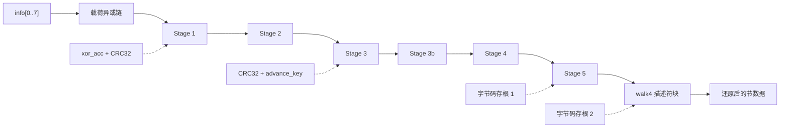
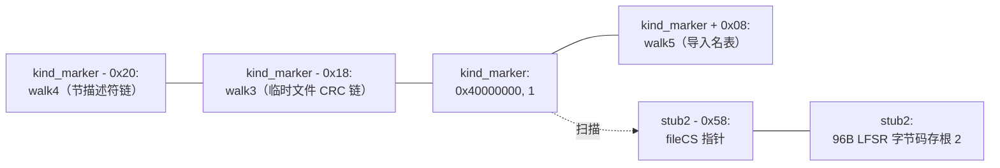

# 阶段链与有标记布局

`payload_xor_chain` 解开的是外层加载器工作区，应用自身的节数据仍封装在内层阶段中。工作区内，Stage 1 至 Stage 5 按顺序逐级解密：每一阶段的密钥由头部校验和、前一已解密阶段的 CRC-32 以及经 `advance_key` 步进的内容种子共同派生。

## 复合阶段解码流程（Stage 3..5）

Stage 2 之后的每个阶段均由 16 字节四元组 `{src, src_len, dest, dest_len}` 描述，按以下四步解码：

1. **AES-CBC 解密：** 使用阶段轮密钥表 `key_offsets[3]` 对 `d[src .. src + src_len]` 原地解密。
2. **异或 + 循环右移：** 使用派生出的阶段密钥对 `{src, src_len}` 执行 `xor_ror_dwords`（移位量 `19`）。
3. **字节码置换**（仅限 Stage 5）：通过字节码存根 1 逐字节映射 `src .. src + src_len`。
4. **Huffman/LZ 解压：** 当 `src_len != dest_len` 时，使用阶段 Huffman 表 `key_offsets[1]` 将 `src` 解压展开至 `dest`。

## 64 位有标记布局的九阶段流水线



### 阶段 1 与阶段 2：`info` 头部与载荷前缀

用 `header_kdf` 解密 `0x1000` 处的 `info[0..7]` 并校验 `info[1] == 0x4E4E4F4B`（`KONN`），分配清零的 `SizeOfImage` 工作缓冲区；随后对文件偏移 `info[4] + 4096` 起的前 `decrypt_size = info[6] - info[3] + 8192` 字节执行 `payload_xor_chain` 解密写入映像 `info[3]`，将剩余 `info[5] - decrypt_size` 尾部字节紧随其后原样拷入，在 `info[3]` 处写入 `0x1000`，最后把文件 `[0, 0x1000)` 区间拷贝到映像起始位置。



### 阶段 3：配置锚点与 Stage 1

在 `[info[6] + 1000, info[6] + 8000)` 区间内扫描 `anchor`，要求 `u32@anchor == info[3]`，且 `u32@(anchor + 8)` 小于 `info[6]`（差值不超过 `0x1000`）并按 `0x200` 对齐。接着对 `anchor + 120 + extra` 处的 Stage 1 `{base, length}` 描述符测试 `extra in (0, 8)`（要求 `base >= info[3]`、`length >= 16` 且未越出映像边界）。

从 `anchor + 8` 和 `anchor + 4` 恢复 `DD[1]`（导入表目录）的 `(RVA, size)`，遍历 `anchor + 184 + extra` 处的 `(offset, length)` 描述符序列累积 `xor_acc`，计算 `chk1 = calculate_checksum(d, anchor + 56 + extra)` 并读取 `v = u32@(anchor + 20)`，最后调用 `xor_ror_dwords(d, anchor + 120 + extra, xor_acc ^ chk1 ^ v, 21)` 解开 Stage 1。



### 阶段 4：Stage 2 与四项 `key_offsets`

在 Stage 1 内扫描唯一的 16 字节 Stage 2 四元组（`stage2_off`），满足 `d0 == d2` 且落在载荷范围内、`d1 > 0x10000` 以及 `0 < d3 < d1`。向前回溯找到 `chk_src_start`（连续四组合法的 `(src, len)` 对），从 `chk_src_start - 20` 读取 Stage 2 密钥，并以移位量 `19` 解开 Stage 2。

在 Stage 2 内定位 `(1, 0, info[3], 0)`（记为 `table_start`），处理 `table_start + 32` 处的两个 `head` 表项（类型 `1`/`0x11` 执行 `byte_rotate3`；类型 `2` 按 `(src, len, dst, chk)` 列表拷贝），再用 `byte_rotate3` 解密 `head - 88` 处的四个 `walk2` 槽位：

| 槽位 | 表用途 |
| --- | --- |
| `key_offsets[0]` | 用于**节数据**解压的 Huffman 表 |
| `key_offsets[1]` | 用于**阶段代码**解压的 Huffman 表 |
| `key_offsets[2]` | 用于**节数据**解密的 AES 轮密钥表 |
| `key_offsets[3]` | 用于**阶段代码**解密的 AES 轮密钥表 |



### 阶段 5：Stage 3、3b、4 与 5

按相对 `stage2_off` 的偏移依次解码四个阶段四元组：

| 阶段 | 四元组偏移 | 密钥公式 |
| --- | --- | --- |
| Stage 3 | `stage2_off + 88` | `xor_acc ^ chk2 ^ advance_key(u32@(chk_src_start - 16), rounds)`（默认 `rounds = 4`；若解压或 `v4` 查找失败则遍历重试 `0..=8`） |
| Stage 3b | `stage2_off + 104` | `xor_acc ^ chk3 ^ v4`，其中 `v4` 为 Stage 3 内 `C3 CC CC CC` 之后的最后一个非零双字 |
| Stage 4 | `stage2_off + 136` | `xor_acc ^ chk4 ^ ~v5`，其中 `v5 = u32@(Stage 3b 内首个 "Virtual..." 字符串偏移 - 8)` |
| Stage 5 | `stage2_off + 216` | `xor_acc ^ chk4 ^ chk5 ^ advance_key(accum2, rounds)`（默认 `rounds = 3`；解压失败时遍历重试 `0..=8`），并经**字节码存根 1** 置换 |

在 Stage 4 中，于反调试 API 字符串（`IsDebuggerPresent`、`CheckRemoteDebuggerPresent`）附近执行 LFSR 扫描定位字节码存根 1，并在最后一处 `48 EB 01 B9` 字节序列之后（跳过任何 `0xCC` 填充）读取 `accum2`。



### 阶段 6：Stage 5 标记偏移布局与字节码存根 2

在 Stage 5 内定位 `"pm\0\0cm\0\0"`（`70 6D 00 00 63 6D 00 00`）与类型标记 `0x40000000, 1`（`00 00 00 40 01 00 00 00`）：

* **`walk3`** 仅临时解密以校验加壳文件各区间的分段递推 CRC-32，校验完毕即恢复为密文字节。
* **`fileCS`**（`stub2 - 0x58`）原地解密并保留明文（对 16 字节表项逐一执行 `byte_rotate2`，直至 `len == 0`）。
* **存根 2** 经 LFSR 解密后预计算为 256 字节查找表。



### 阶段 7：可并行化的节数据还原（`walk4`）

`walk4` 串联一系列 16 字节 `{src, len, dst, plain_len}` 描述符（按各自所在 RVA 经 `byte_rotate2` 解密），以 `len == 0` 终止。处理每个块时，将 `file[src + section_data_file_base .. +len]` 拷贝至 `image[dst]`，执行 `aes_decrypt`（`key_offsets[2]`），经存根 2 查表置换，并在 `len != plain_len` 时调用 `decompress`（`key_offsets[0]`）解压。随后由第二组 `walk4` 描述符序列将 `.bss` 区间清零。由于各块的目标写入区间互不重叠，顺序执行与并行执行的还原结果完全一致。



### 阶段 8：`walk5` 导入名解密

当 `walk5` 非空时（原生模块），每个 20 字节表项指向一处加密 DLL 名称（偏移 `+12`，以 `name_rva & 0xFF` 为初始密钥执行 `string_cipher` 解密并转为小写）及 thunk 数组（偏移 `+0` 或 `+16`）。每个按名称导入的 thunk（第 63 位为 0）以 `hint_name_rva & 0xFF` 为初始密钥解密 `hint_name_rva + 2` 处的符号名（保留符号原始大小写），并将 2 字节 `Hint` 清零。托管模块的 `walk5` 指针为空。



### 阶段 9：PE 头部、页面混淆与数据目录收尾

将节表中的文件偏移（`PointerToRawData`）对齐为 RVA 布局，执行 `.text` 页面混淆还原（`dd8`），临时解密并写回入口点与数据目录，最后完成 TLS、基址重定位与 CLR 元数据的修补与回填（详见[PE 重建](../pe-reconstruction/README.md)）。


