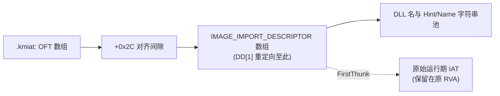

# 导入表、TLS 与导出表

## 导入表与字符串恢复

加密的导入字符串采用 `string_cipher`（`dd7`）：位于 `name_rva` 的 DLL 名称从 `pos = name_rva` 开始解密，初始密钥为 `key = name_rva & 0xFF`；按名称导入的 `IMAGE_IMPORT_BY_NAME` 表项位于 `hint_name_rva`，跳过前 2 字节被清零的 `Hint`，从 `pos = hint_name_rva + 2` 开始解密，初始密钥为 `hint_name_rva & 0xFF`。按序号导入的 Thunk（PE32+ 看第 63 位，PE32 看第 31 位；PE32+ 上必须读取完整的 64 位 Thunk）保持原样不变。



* 遍历 Stage 5 的 `walk5` 表中每项 20 字节的记录（`+12` 为 DLL 名称 RVA，`+0` / `+16` 为 Thunk 链）。托管程序集的 `walk5 == 0`。
* 原地解密每个 DLL 名称并转为小写；在 `hint_name_rva + 2` 处解密按名称导入的函数字符串，**不**转为小写（符号名区分大小写），同时将 `Hint` 清零。
* `DataDirectory[12]`（IAT）取自备份的 128 字节数据目录数组。



* 由于导入字符串存放在 `.text` 节内，必须在 `.text` 的 `dd8` 页混淆还原完成**之后**，再从已恢复的 `DataDirectory[1]` 遍历 `IMAGE_IMPORT_DESCRIPTOR`（若元数据中的 `DD[1]` 为零，则回退至锚点记录的导入表 RVA）。
* 若模块名或函数名本身已是可打印 ASCII 字符串，则跳过 `string_cipher`；对解密出的 DLL 名称转为小写，同时保留函数名原有大小写。
* 扫描各描述符的 `FirstThunk` 链起止范围，据此计算 `DataDirectory[12]`（IAT）的边界。



* 根据导入表原地解密 DLL 名称和按名称导入的函数字符串，DLL 名称不转小写。
* 从 `info[3] + 16` 处的 656 字节元数据块恢复 `DataDirectory[12]`。



* 在 `EighthStage`（`+0x18`）导入表与备份数据目录中的导入表之间择一使用。
* **原地修复 `.idata` 的 PE32：** 原地解密名称字符串（对保留 `.idata` 的 EXE 根据 Thunk 范围计算 `DD[12]`，对 PE32 DLL 则将 `DD[12]` 清零为 `(0, 0)`）。
* **重建 `.kmiat`（仅限 PE32 EXE）：** 当加载器写入的 IAT 布局偏离标准 `.idata` 结构时，将末尾节重命名为 `.kmiat`（大小 `0x7000`，节属性 `0xE0000060`），在其中重建导入描述符、`OriginalFirstThunk` 数组（留有 `+0x2C` 对齐间隙）以及转为小写的 DLL 名与保留大小写的符号字符串（其中 `api-ms-win-crt-*` 统一归并为 `ucrtbase.dll`）；运行期实际使用的 IAT 仍留在原 RVA，并将 `DD[12]` 清零为 `(0, 0)`：




## TLS 还原与重定位项修复

CrackProof 会从加密载荷中剥离 TLS 状态，改由运行期加载器手动接管 TLS 初始化；静态还原时若未从明文外层桩补回 TLS，生成的镜像会在访问 `_tls_index` 或执行 `LdrpAllocateTlsEntry` 时触发 `0xC0000005` 崩溃：

* **单文件 64 位带标记版本：** 保存的元数据保留了非零 `DD[9]`，但其指向的 `IMAGE_TLS_DIRECTORY64` 已被清零；重建时按各自 RVA 从受保护文件中拷回明文结构体与初始数据模板（单文件带标记版本采用 `/FIXED` 链接，无需合成重定位项；单文件无标记版本若恢复出的结构体全为零，则直接清空 `DD[9]`）。
* **外部伴生文件（`._`）64 位版本：** 伴生载荷将 `DD[9]`、TLS 结构体及数据模板全部置零，并丢弃了对应的基址重定位项。重建时需从桩 PE 恢复 `DD[9]`、`IMAGE_TLS_DIRECTORY64` 结构体及其原始数据模板，再向 `.reloc` 节**追加四条 `IMAGE_REL_BASED_DIR64` 重定位项**，分别覆盖 `StartAddressOfRawData`、`EndAddressOfRawData`、`AddressOfIndex` 和 `AddressOfCallBacks`。
* **PE32 EXE 与 DLL：** 从加载器桩拷贝明文 `IMAGE_TLS_DIRECTORY32` 与数据模板（若缺失则回退至最小化的 `.tls`/`.data` 占位结构）。在 **PE32 DLL** 上，CrackProof 会将 `.reloc` 中对应四个 TLS 指针的重定位项降级为 `IMAGE_REL_BASED_ABSOLUTE`（`type = 0`），但保留其非零页内偏移；重建时需**将这四个重定位槽位改回 `IMAGE_REL_BASED_HIGHLOW`（`type = 3`）**，确保 DLL 重定位基址时同步修正 `IMAGE_TLS_DIRECTORY32` 的全部四个指针字段。

## 导出表目录（`DD[0]`）

单文件版本在受保护文件的对应 RVA 处直接保留了明文导出表目录。外部伴生文件（`._`）载荷在导出表区间解密出的是无效数据，因此重建时需从桩 PE 的 `.rdata` 节拷回整个 `DataDirectory[0]` 区间。
