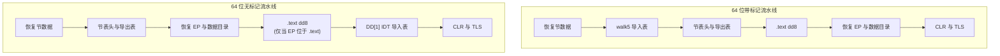

# 重定位、页面变换与 CLR 数据

## 基址重定位与 `/FIXED` / ASLR 策略

* **单文件 64 位带标记版本与 32 位 EXE（`/FIXED`）：** 加壳器丢弃了基址重定位表并清空 `DllCharacteristics`。静态重建时将 `DataDirectory[5]` 与 `DllCharacteristics` 置零，使 EXE 固定按首选 `ImageBase` 加载。
* **所有 DLL（32 位与 64 位、任意族系）：** DLL 必须支持基址重定位；重建时保留 `DataDirectory[5]`，确保置位 `IMAGE_DLLCHARACTERISTICS_DYNAMIC_BASE`（`0x0040`），并在 PE32 DLL 上恢复被改为无效类型的 TLS 重定位项。
* **64 位无标记版本与外部伴生文件（`._`）版本：** 保留原有的 ASLR 标志（`DYNAMIC_BASE` / `HIGH_ENTROPY_VA`）和 `DataDirectory[5]`（还原伴生文件 TLS 时同步追加四条 `DIR64` TLS 重定位项）。

## `.text` 页混淆（`dd8`）执行顺序

无标记版本将加密的导入字符串与明文 CLR 元数据一并存放在 `.text` 节内，因此带标记与无标记两条流水线必须在不同的时机执行 `dd8`：

在无标记版本中，`dd8` 安排在节表头和入口点/数据目录恢复之后（且仅当 `AddressOfEntryPoint` 落在 `.text` 节内时触发），同时严格早于 `DD[1]` 导入名称解密和 CLR 元数据覆盖；这样既不会把刚解密好的导入字符串再次打乱，也不会破坏覆盖回来的 `COR20`/`BSJB` 字节。

## CLR 元数据按字段精确还原

受 CrackProof 保护的托管程序集会将 IL 方法体加密进节载荷，但将 ECMA-335 元数据结构以明文保留在外层文件或伴生桩中：

* **单文件 64 位无标记版本：** 在 `dd8` 完成后，按各自 RVA 拷回 `COR20` 头部（`cb == 0x48`）与 `BSJB` 元数据流。
* **单文件 64 位带标记版本：** 拷回 `COR20`、`BSJB` 元数据以及 `COR20.Resources`（`+0x18`）。
* **托管伴生文件（`._`）DLL：** 从桩 PE 拷回 `COR20`（`0x48` 字节），并按范围逐一拷回全部七个非零子区间：`MetaData`（`BSJB`，必选）、`Resources`、`StrongNameSignature`、`CodeManagerTable`、`VTableFixups`（含其引用的各个槽位数组）、`ExportAddressTableJumps` 与 `ManagedNativeHeader`。


**切勿在节数据恢复之后整节覆盖含 CLR 数据的节。** IL 方法体与 `COR20`、`BSJB` 共用 `.text` 节，且方法体已由 `walk4` + `dd8` 解密还原；若从受保护文件或桩 PE 整节回拷，刚解密的 IL 方法体会被密文重新覆盖。（仅旧版专用 64 位 DLL 流水线会在 `walk4` 写入解密方法体之前预先填充一次 CLR 所在节。）


若 `DataDirectory[14]` 指向已清零的 `COR20` 头部（`cb == 0`）且不存在有效备份，则直接清空 `DataDirectory[14]`。Unity IL2CPP 程序对原生 `GameAssembly.dll` 加壳时不含 CLR 头部，而是单独混淆 `global-metadata.dat`；详见 [il2cpp 元数据混淆](../../analysis/il2cpp-metadata.md)。
