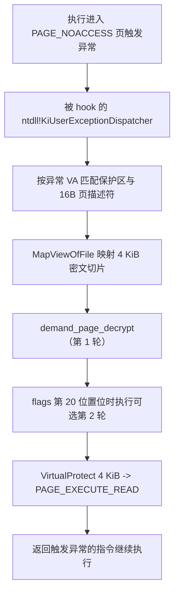

# 页面保护与加载器代码

## 按需缺页加密保护（`640` -> `840`）

页面保护是按模块独立配置的运行期保护层（通常在宿主 EXE 上开启，在插件 DLL 上关闭）：

1. 在阶段 `640`，可执行节先完成整块批量解密。
2. 到阶段 `840`，可执行页面按 4 KiB 粒度逐页重新加密并设为 `PAGE_NOACCESS`，同时在 `ntdll!KiUserExceptionDispatcher` 头部写入 inline hook，跳转至 `HtdpStub2.dll`（详见 [手动映射辅助模块](mapped-modules.md)）。
3. 当执行流进入 `PAGE_NOACCESS` 页面触发访问违例时，异常分发 hook 会在所有 SEH 链之前截获异常，按需解密当前 4 KiB 页面，将属性改为 `PAGE_EXECUTE_READ`，随后恢复原指令执行。

由于未被执行到的页面始终保持 `PAGE_NOACCESS`（部分构建还会开启 **`scribble` 页面涂抹**，在两次缺页之间用异或掩码遮蔽驻留明文页中的部分字节），因此进入 OEP 后仅做单次内存转储，只能拿到已触发过缺页的工作集；若要恢复完整代码，必须主动遍历触发所有受保护页面并还原涂抹字节。

## 按需页解密算法



在 `HtdpStub2.dll` 内部，每个受保护模块都会注册一个区域描述符，指向位于 `region_base + page_table_offset` 的 16 字节页描述符数组（按 `(fault_va - region_base) >> 12` 索引）：

| 结构体 | 偏移 | 大小 | 实测含义 |
| --- | --- | --- | --- |
| 区域描述符 | `+0x08` | 8 | `region_base` 虚拟地址 |
| 区域描述符 | `+0x10` | 4 | 保护区域字节大小 |
| 区域描述符 | `+0x20` | 4 | 相对于 `region_base` 的 `page_table_offset` |
| 区域描述符 | `+0x24` | 4 | 4 KiB 页面总数 |
| 区域描述符 | `+0x28` | 8 | 传给 `MapViewOfFile` 的节对象句柄 |
| 区域描述符 | `+0x34` | 4 | 已解密页面计数 |
| 页描述符（`16B`） | `+0x00` | 4 | `flags`（`bit 20`，即位索引 `0x14` / 掩码 `0x00100000`，启用第 2 轮解密） |
| 页描述符（`16B`） | `+0x04` | 4 | 单页密钥分量 `key_part` |
| 页描述符（`16B`） | `+0x08` | 4 | 最近一次 `GetTickCount` 时间戳 |
| 页描述符（`16B`） | `+0x0C` | 2 | 缺页触发计数 |
| 页描述符（`16B`） | `+0x0E` | 2 | 含义待确认的 16 位字段 |

第 1 轮解密用 `page_va + region_base` 的低 32 位与 `key_part` 异或派生 32 位密钥，并对整页 4 KiB 数据执行滚动双字解密：

```python
def demand_page_key(page_va, region_base, key_part):
    return ((page_va + region_base) ^ key_part) & MASK32


def demand_page_decrypt(buf, key):
    count = len(buf) >> 2
    state = ((key << 16) ^ key) & MASK32
    prev = state
    for i in range(count):
        enc = get_u32(buf, i * 4)
        state = rol32((state + i) & MASK32, 3)
        put_u32(buf, i * 4, enc ^ prev ^ state)
        prev = enc
```

`get_u32`、`put_u32`、`rol32` 与 `MASK32` 的定义见 [滚动密钥与循环移位算法](../data-transforms/rolling-and-rotation.md)，可运行的测试向量见 [primitives.py](https://app.gitbook.com/s/L9bXLua8yrIPEUZOHO21/primitives.py)。当 `flags & 0x00100000` 非零时，在调用 `VirtualProtect` 将页面切换为 `PAGE_EXECUTE_READ` 之前还会执行与具体构建相关的第 2 轮变换。

## 加载器多态变形、诱饵指令与磁盘自映射

* **多份多态序言副本：** Stage 5 会为同一套解密例程生成最多 16 份指令排布与花指令跳转各不相同的等价副本。
* **反汇编失步跳转与返回地址计算：** 无条件跳转后紧跟垃圾字节、跳入指令中间的分支目标，以及基于 `call $+5` 的常量偏移修正，都会干扰线性反汇编和常规递归下降反汇编。
* **计时与 `#DB` SEH 诱饵：** 一类诱饵先保存全部 16 个通用寄存器，执行 `0x5658` 端口的 `in eax, dx` 探测，再接一条 `jne $+2`（`disp = 0`，无论条件是否成立都落到下一条指令）后直接返回，专门用于拉大外部调试时的耗时；另一类诱饵置位 `TF`（`pushfq; or [rsp], 0x100; popfq`），使正常运行经由 SEH 转向真实路径，而吞掉 `#DB` 异常的调试器或模拟器则会落入死代码分支。
* **启动后擦除表项与磁盘自映射：** Stage 5 通过系统已解析的导入函数调用 `GetModuleFileNameW` 获取自身路径，打开并映射磁盘原文件（`CreateFileW` / `CreateFileMappingA` / `MapViewOfFile`），在阶段 `655` 自行处理 `.reloc` 重定位项，并在进入 `280` 前将用完的阶段表与特征标记清零。
