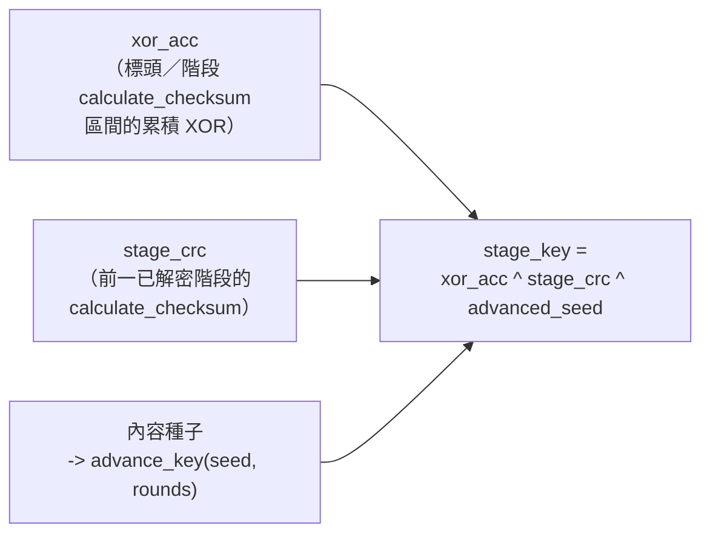

# 校驗和與金鑰推進

## 反射式 CRC-32 校驗和

階段驗證與金鑰衍生採用標準反射式 CRC-32（多項式 `0xEDB88320`，與 zlib 及 IEEE 802.3 相同；`crc32(b"123456789") == 0xCBF43926`）。描述子提供 `(offset, length)` 配對，`calculate_checksum` 則將該區間的 CRC-32 與 `length` 做 XOR：

```python
def _build_crc_table():
    table = []
    for i in range(256):
        c = i
        for _ in range(8):
            c = 0xEDB88320 ^ (c >> 1) if c & 1 else c >> 1
        table.append(c)
    return table

CRC_TABLE = _build_crc_table()

def crc32_append(initial, data):
    crc = ~initial & MASK32
    for b in data:
        crc = CRC_TABLE[(crc ^ b) & 0xFF] ^ (crc >> 8)
    return ~crc & MASK32

def crc32(data):
    return crc32_append(0, data)

def calculate_checksum(d, pos):
    """crc32(region) ^ length, where (offset, length) is read from d[pos]."""
    offset = get_u32(d, pos)
    length = get_u32(d, pos + 4)
    return crc32(d[offset:offset + length]) ^ length
```

另有一種串接變體會將前一段輸出傳入 `crc32_append(initial, data)`，跨多個原始檔案片段累加計算，用於[階段鏈與標記版型](../loading-and-pe-repair/loading/stage-chain.md)中純驗證性質的 `walk3` 檢查。

## 三角級數金鑰推進

從前一階段取出的種子 dword 在混入下一階段金鑰前，會先經過 `iterations` 輪三角級數累加（第 `m` 輪累加 `1 + 2 + ... + (m + 1) * 100`）：

```python
def advance_key(key, iterations):
    for m in range(iterations):
        bound = ((m + 1) * 25) << 2
        for n in range(1, bound + 1):
            key = (key + n) & MASK32
    return key
```

## 階段金鑰合成



每個後續階段的金鑰皆由三項輸入做 XOR 合成：

* **`xor_acc`：** 對錨點表或標頭表中的描述子陣列逐一執行 `calculate_checksum` 後累加的 XOR 值。
* **前序階段 CRC-32（`stage_crc`）：** 對先前階段解密出的明文位元組計算 `calculate_checksum`。
* **內容衍生種子：** 從剛解密完成的階段讀取一個 dword，並以 `advance_key` 推進後的結果。

由於每把階段金鑰都同時依賴前序明文位元組與標頭校驗和，各階段必須嚴格依序解碼；只要位移、旋轉位數或任一位元組有誤，後續的階段解密與 Huffman 解壓縮便會立即失敗。
