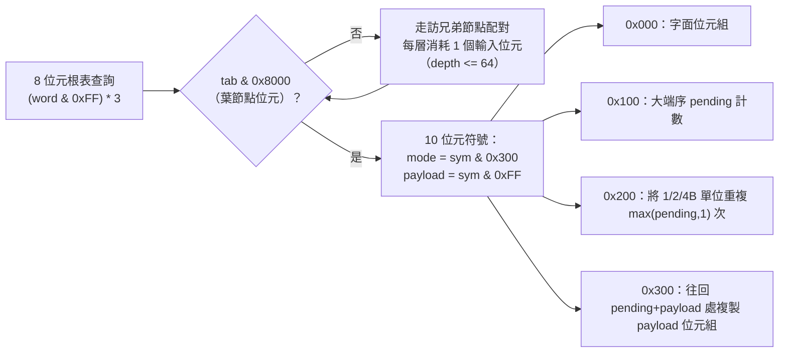

# Huffman 與 LZ 壓縮

## 混合式 Huffman/LZ 串流格式

Stage 3 至 Stage 5 與壓縮區段區塊會透過位於工作緩衝區 `key_offset` 處、每節點 3 位元組的 Huffman 表解碼，產生 10 位元的 token 串流：



* **3 位元組表項目：** 每個項目為 `(u16 tab, u8 bits)`。先以最低 8 個輸入位元查根表；`tab & 0x8000` 代表葉節點，內部節點則記錄兄弟節點配對的索引，每往下一層多消耗 1 個輸入位元以決定分支（共消耗 `8 + depth` 個位元）。
* **10 位元葉節點符號：** 位元 `8..9` 選擇模式，位元 `0..7` 則攜帶 `payload`：

| 模式（`tab & 0x300`） | 負載值（`tab & 0xFF`） | 動作 |
| --- | --- | --- |
| `0x000` | 字面位元組 | 寫入 `payload`（輸出 `1` 位元組） |
| `0x100` | 計數位元組 | 若 `pending >= 256` 則視為無效並中止；否則併入 `pending = (pending << 8) \| payload`（輸出 `0` 位元組） |
| `0x200` | 單位寬度（`1`、`2` 或 `4`） | 令 `reps = max(pending, 1)`，將前一個 `payload` 位元組寬的單位重複寫入 `reps` 次（輸出 `reps * payload` 位元組），並將 `pending` 歸零 |
| `0x300` | 複製長度（`payload`） | 從 `dest` 往回 `pending + payload` 位元組處複製 `payload` 位元組，接著將 `pending` 歸零 |

```python
def decompress(d, src, dest, key_offset, s_size, d_size):
    """Decompress s_size bytes at `src` into d_size bytes at `dest`,
    in place within buffer `d`. Returns True when exactly d_size bytes
    were produced."""
    bit_pos = 0
    buf = bytearray(d[src:src + s_size]) + bytearray(3)  # 3 bytes of slack
    buf_off = 0
    src_consumed = 0
    pending = 0
    written = 0

    while src_consumed < s_size and written < d_size:
        word = get_u32(buf, buf_off) >> bit_pos
        tab_addr = key_offset + (word & 0xFF) * 3
        tab = get_u16(d, tab_addr)
        if tab & 0x8000:  # leaf
            tab &= 0x7FFF
            bits = d[tab_addr + 2]
        else:             # internal node: walk down one bit per level
            bits = d[tab_addr + 2]
            if bits >= 32:
                return False
            mask = 1 << bits
            bits += 1
            idx = (tab & 0x7FFF) + (1 if word & mask else 0)
            t2 = get_u16(d, key_offset + idx * 3)
            depth = 0
            while not (t2 & 0x8000):
                depth += 1
                if depth > 64:
                    return False
                mask <<= 1
                bits += 1
                idx = (t2 & 0x7FFF) + (1 if word & mask else 0)
                t2 = get_u16(d, key_offset + idx * 3)
            tab = t2 & 0x7FFF

        bit_pos += bits
        advance = bit_pos // 8
        buf_off += advance
        src_consumed += advance
        bit_pos %= 8

        mode = tab & 0x300
        payload = tab & 0xFF
        if mode == 0x000:  # literal
            step = 1
            d[dest] = payload
        elif mode == 0x100:  # count accumulator
            step = 0
            if pending >= 256:
                return False
            pending = payload if pending == 0 else (pending << 8) | payload
        elif mode == 0x200:  # run fill
            if pending == 0:
                pending = 1
            step = pending * payload
            if step + written > d_size:
                return False
            if payload == 1:
                if dest < 1:
                    return False
                v = d[dest - 1]
                for k in range(pending):
                    d[dest + k] = v
            elif payload == 2:
                if dest < 2:
                    return False
                v = get_u16(d, dest - 2)
                for k in range(pending):
                    put_u16(d, dest + k * 2, v)
            elif payload == 4:
                if dest < 4:
                    return False
                v = get_u32(d, dest - 4)
                for k in range(pending):
                    put_u32(d, dest + k * 4, v)
            else:
                return False
            pending = 0
        else:  # 0x300: LZ back-reference
            step = payload
            if written + payload > d_size or pending + payload > written:
                return False
            back = pending + payload
            for k in range(payload):
                d[dest + k] = d[dest + k - back]
            pending = 0

        dest += step
        written += step
        if bits == 0 and step == 0:
            return False

    return written == d_size
```

由於 `decompress` 會嚴格檢查樹深度、回溯參照邊界、`pending` 位元寬度，以及輸出長度是否精確滿足 `written == d_size`，因此在[載入與區段還原](../loading-and-pe-repair/loading/README.md)流程中，試解壓縮能可靠篩除錯誤的階段金鑰、旋轉位數猜測值與誤判的位元組碼存根。同一套 3 位元組表結構與四種 token 模式亦用於 [CrackProof for Android SO 內部機制](https://app.gitbook.com/s/HezwIJwx0lhm5CUG7g8R/data-transforms/compression)。
