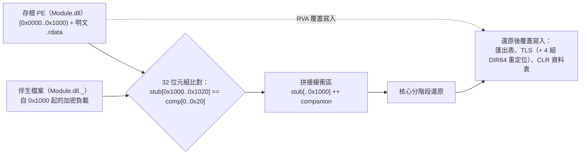

# 區段資料與伴生檔案

## 區段負載檔案基底（`0x1080`）

在所有 Windows 組建家族中，區段區塊描述子皆以相對位移記錄來源位置，其基底位址則透過位元反相（bitwise NOT）編碼於檔案位移 `0x1080`：

```text
section_data_file_base = (~u32@0x1080 + 0x1000) & 0xFFFFFFFF
```

每個描述子的 `src` 欄位在容器內對應到檔案位移 `src + section_data_file_base`（若為伴生檔案組建，則對應至拼接後的虛擬緩衝區 `stub[..4096] ++ companion`）。

## 外部伴生檔案版型（`._` 檔案）

部分採用 EXE 式外殼的 PE32+ 組建，會將受保護的 EXE 或 DLL 拆成同資料夾下的兩個檔案：

* **`Module.dll` / `App.exe`（存根檔）：** 保留外層 PE 標頭（`0x0000..0x0FFF`）、位於 `0x1000..0x101F` 的 32 位元組 `info` 標頭、極簡的載入器進入區段，以及位於 `.rdata` 中的特定明文資料目錄。
* **`Module.dll._` / `App.exe._`（伴生檔案）：** 高熵負載檔，存放容器位移 `0x1000` 起算的所有位元組，本身不含獨立的 PE 標頭。



配對時，`stub[4096..4128]` 與 `companion[0..32]`（即加密態 `info` 標頭）的 32 位元組必須完全一致。


**進入點跳板中的伴生檔案宣告。** 在 PE32+ 外殼中，63 位元組的載入器進入點跳板亦會標明是否需要外部伴生檔案：位移 `+53` 存放 `~0x1000`（單一檔案組建則為 `~0`），位移 `+58` 存放 `~u32("._\0\0")`。靜態分析時可藉此區分「遺失 `._` 伴生檔案」與「單一檔案本身損毀」。


## 僅保留於存根檔中的明文區域

由於加密的 `._` 伴生檔案省略或清零了數個供 Windows 載入器或 CLR 讀取的資料表，完成核心區段還原後，還須依 RVA 從存根 PE 覆蓋寫回這些區域：

* **匯出目錄（`DD[0]`）：** 伴生負載中的匯出表範圍仍處於加密或未填入狀態，須由存根檔直接複製還原。
* **TLS 目錄（`DD[9]`）：** 伴生負載會將 `DD[9]`、`IMAGE_TLS_DIRECTORY64` 結構與 TLS 原始資料範本清零；重建時須從存根檔還原，並為 `IMAGE_TLS_DIRECTORY64` 內的 4 個 VA 欄位補上 4 筆 `IMAGE_REL_BASED_DIR64` 基底重定位項。
* **ASLR 與基底重定位（`DD[5]`）：** 伴生檔案模組保留 `DllCharacteristics`（`DYNAMIC_BASE` / `HIGH_ENTROPY_VA`）與有效的基底重定位表，而非強制改為 `/FIXED`。
* **受控伴生檔案的 CLR 中繼資料（`DD[14]`）：** `._` 負載存放加密的 IL 方法本體，存根檔則保留 `COR20` 標頭及其指向的中繼資料（`BSJB`）、資源、強式名稱與 vtable 修補範圍（詳見[重定位、分頁轉換與 CLR 資料](../loading-and-pe-repair/pe-reconstruction/relocations-managed.md)）。
