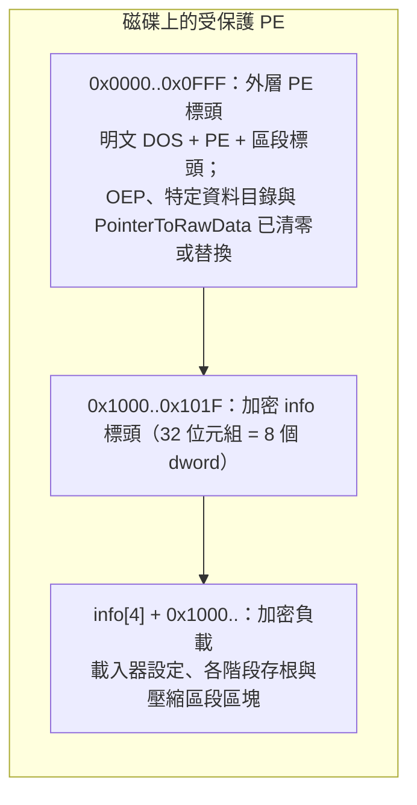

# 容器結構與加密標頭

受保護的 PE 會以加密容器取代原有的區段結構。前 4,096 位元組（`0x0000..0x0FFF`）保留明文的外層 PE 標頭，位移 `0x1000` 存放 32 位元組的加密參數區塊，檔案其餘部分則存放加密的載入器資料表、各階段存根與壓縮後的應用程式區段。

## 容器佈局



| 區域 | 檔案位移 | 內容 |
| --- | --- | --- |
| 外層 PE 標頭 | `0x0000..0x0FFF` | DOS/PE 簽章、COFF 標頭、可選標頭與區段表。原始進入點（OEP）、特定資料目錄與各區段的 `PointerToRawData` 已清零或改指向載入器。 |
| `info` 標頭 | `0x1000..0x101F` | 由 `header_kdf` 解出的 8 個小端序 dword，提供整個容器的魔術數字、RVA 映射位置與負載範圍。 |
| 加密負載 | 自 `info[4] + 0x1000` 起 | 加密的載入器資料表、各階段程式碼與壓縮區段資料。 |

目前觀察到的所有 Windows 組建皆以 `0x1000` 為界切分標頭與容器本體；[外部伴生檔案版型](companion-layout.md)亦同，只是將 `0x1000` 起算的容器位元組移至獨立的 `._` 檔案。

## `info` 標頭與金鑰衍生

位移 `0x1000` 處的 `info[0]` 以明文存放；`info[1..7]` 則透過混入原始密文 dword 與 `i * i` 的滾動金鑰解密：

```python
def header_kdf(file_data, offset=4096):
    info = [0] * 8
    info[0] = get_u32(file_data, offset)
    k = info[0]
    for i in range(7):
        cell = get_u32(file_data, offset + 4 + 4 * i)
        info[i + 1] = k ^ cell
        k = (i * i) ^ ((k + cell - i) & 0xFFFFFFFF)
    return info
```

無論是 PE32 或 PE32+、EXE 或 DLL、單一檔案或伴生檔案組建，皆共用同一套 32 位元組 KDF：

| 欄位 | 意義 |
| --- | --- |
| `info[0]` | 明文種子金鑰；同時作為 `payload_xor_chain` 的初始種子 |
| `info[1]` | 格式魔術數字（小端序 `0x4E4E4F4B`，對應 ASCII `KONN`） |
| `info[2]` | 保留欄位／組建變體欄位 |
| `info[3]` | 負載映射至工作映像緩衝區時的目標基底 RVA |
| `info[4]` | 相對 `0x1000` 的檔案位移：負載位元組自檔案位移 `info[4] + 4096` 開始 |
| `info[5]` | 複製至映像範圍 `[info[3], info[3] + info[5])` 的負載總位元組長度 |
| `info[6]` | 加密載入器前綴與錨點搜尋的結束 RVA 標記 |
| `info[7]` | 保留欄位／組建變體欄位 |

## 負載搬移與 `decrypt_size`

檔案位元組 `[info[4] + 4096, info[4] + 4096 + info[5])` 會映射至工作映像 RVA `[info[3], info[3] + info[5])`：

* **標準前綴解密：** 在 64 位元組建與標準型 PE32 組建中，前 `decrypt_size = info[6] - info[3] + 8192` 位元組以 `payload_xor_chain` 解密（詳見[滾動金鑰與旋轉加密](../data-transforms/rolling-and-rotation.md)），`info[5]` 剩餘尾端則原樣複製。
* **全負載加密 PE32 變體：** 較早期的精簡型 PE32 組建會加密整段負載（`decrypt_size = info[5]`，這同時會改變初始 XOR 種子 `info[0] + ~decrypt_size`）。在 PE32 靜態還原時，若前綴解密後找不到任何能通過 `SecondStage` 驗證的 `tbl` 候選項，即改用 `decrypt_size = info[5]` 重試。

負載搬移完成後，會在映像 RVA `info[3]` 處寫入 dword `4096`（`0x1000`），並將檔案前 `4096` 位元組複製到 `[0, 0x1000)` 作為工作 PE 標頭。
