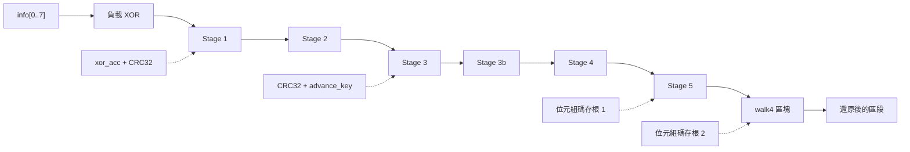
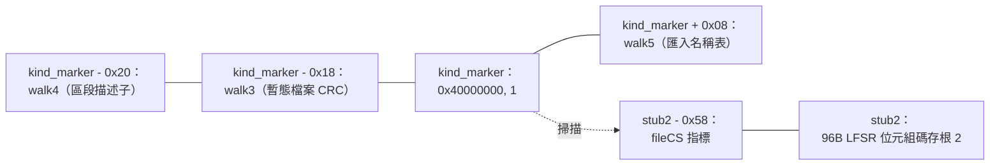

# 階段鏈與標記版型

`payload_xor_chain` 解開的是外層載入器的工作區，而非應用程式本體。在此工作區內，Stage 1 至 Stage 5 依序層層解開：每個階段的金鑰皆結合了標頭校驗和、前一已解密階段的 CRC-32，以及經 `advance_key` 推進後的內容種子。

## 複合式階段解密流程（Stage 3..5）

Stage 2 之後的每個階段皆由 16 位元組四元組 `{src, src_len, dest, dest_len}` 描述，並分四個步驟解碼：

1. **AES-CBC 解密：** 使用階段金鑰排程 `key_offsets[3]` 對 `d[src .. src + src_len]` 原地解密。
2. **XOR 與右旋：** 以衍生出的階段金鑰對 `{src, src_len}` 執行 `xor_ror_dwords`（右旋 `19` 位元）。
3. **位元組碼轉換**（僅限 Stage 5）：將 `src .. src + src_len` 內的每個位元組透過位元組碼存根 1 轉換。
4. **Huffman/LZ 解壓縮：** 當 `src_len != dest_len` 時，使用階段 Huffman 表 `key_offsets[1]` 將 `src -> dest` 解壓展開。

## 64 位元帶標記版型九步驟管線



### 步驟 1 與 2：`info` 標頭與負載前綴

在位移 `0x1000` 以 `header_kdf` 解出 `info[0..7]`，驗證 `info[1] == 0x4E4E4F4B`（`KONN`），配置清零的 `SizeOfImage` 工作緩衝區，從檔案位移 `info[4] + 4096` 對前 `decrypt_size = info[6] - info[3] + 8192` 位元組執行 `payload_xor_chain` 寫入 `info[3]`，剩餘的 `info[5] - decrypt_size` 尾端原樣複製；接著在 `info[3]` 寫入 `0x1000`，並將檔案前 `0x1000` 位元組（`[0, 0x1000)`）複製到映像緩衝區開頭。



### 步驟 3：設定錨點與 Stage 1

掃描 `[info[6] + 1000, info[6] + 8000)` 尋找 `anchor`，條件為 `u32@anchor == info[3]`，且 `u32@(anchor + 8)` 落在 `info[6]` 下方 `0x1000` 範圍內並對齊 `0x200` 邊界。接著對 `anchor + 120 + extra` 處的 Stage 1 `{base, length}` 描述子測試 `extra in (0, 8)`（須滿足 `base >= info[3]`、`length >= 16` 且位於映像範圍內）。

由 `anchor + 8` 與 `anchor + 4` 還原 `DD[1]`（匯入目錄）的 `(RVA, size)`，對 `anchor + 184 + extra` 處的 `(offset, length)` 描述子陣列逐項累加 `xor_acc`，計算 `chk1 = calculate_checksum(d, anchor + 56 + extra)` 與 `v = u32@(anchor + 20)`，最後以 `xor_ror_dwords(d, anchor + 120 + extra, xor_acc ^ chk1 ^ v, 21)` 解開 Stage 1。



### 步驟 4：Stage 2 與四組 `key_offsets`

掃描 Stage 1 找出唯一的 16 位元組 Stage 2 四元組（`stage2_off`），條件為 `d0 == d2` 且落在負載範圍內、`d1 > 0x10000`、以及 `0 < d3 < d1`。往回走訪至 `chk_src_start`（連續四組合法的 `(src, len)` 配對），從 `chk_src_start - 20` 讀取 Stage 2 金鑰，並以右旋位數 `19` 解開 Stage 2。

在 Stage 2 內定位 `(1, 0, info[3], 0)`（記為 `table_start`），處理 `table_start + 32` 處的兩筆 `head` 項目（類型 `1`/`0x11` 執行 `byte_rotate3`；類型 `2` 為 `(src, len, dst, chk)` 複製清單），再以 `byte_rotate3` 解密 `head - 88` 處的四個 `walk2` 槽位：

| 槽位 | 資料表用途 |
| --- | --- |
| `key_offsets[0]` | **區段**解壓縮專用的 Huffman 表 |
| `key_offsets[1]` | **階段**解壓縮專用的 Huffman 表 |
| `key_offsets[2]` | **區段**解密專用的 AES 金鑰排程 |
| `key_offsets[3]` | **階段**解密專用的 AES 金鑰排程 |



### 步驟 5：Stage 3、3b、4 與 5

依相對 `stage2_off` 的位移依序解碼四組階段四元組：

| 階段 | 四元組位移 | 金鑰公式 |
| --- | --- | --- |
| Stage 3 | `stage2_off + 88` | `xor_acc ^ chk2 ^ advance_key(u32@(chk_src_start - 16), rounds)`（預設 `rounds = 4`；若解壓縮或搜尋 `v4` 失敗，則依序重試 `0..=8`） |
| Stage 3b | `stage2_off + 104` | `xor_acc ^ chk3 ^ v4`，其中 `v4` 為 Stage 3 內 `C3 CC CC CC` 之後最後一個非零 dword |
| Stage 4 | `stage2_off + 136` | `xor_acc ^ chk4 ^ ~v5`，其中 `v5 = u32@(Stage 3b 內第一個 "Virtual..." 字串位址 - 8)` |
| Stage 5 | `stage2_off + 216` | `xor_acc ^ chk4 ^ chk5 ^ advance_key(accum2, rounds)`（預設 `rounds = 3`；解壓縮失敗時依序重試 `0..=8`），並經由**位元組碼存根 1** 轉換 |

在 Stage 4 中，於反除錯 API 字串（`IsDebuggerPresent`、`CheckRemoteDebuggerPresent`）附近以 LFSR 掃描定位位元組碼存根 1，並從最後一處 `48 EB 01 B9` 序列正後方（略過任何 `0xCC` 填補位元組）讀取 `accum2`。



### 步驟 6：Stage 5 標記結構與位元組碼存根 2

在 Stage 5 內定位 `"pm\0\0cm\0\0"`（`70 6D 00 00 63 6D 00 00`）以及類型標記 `0x40000000, 1`（`00 00 00 40 01 00 00 00`）：

* **`walk3`：** 暫態解密以驗證原始檔案區間的串接式 CRC-32，驗證後立即還原為原本的加密位元組。
* **`fileCS`**（`stub2 - 0x58`）：原地永久解密（對每筆 16 位元組項目執行 `byte_rotate2`，直到 `len == 0`）。
* **存根 2：** 以 LFSR 解密，並預先算成 256 位元組查表。



### 步驟 7：可平行化的區段還原（`walk4`）

`walk4` 由連續排列的 16 位元組 `{src, len, dst, plain_len}` 描述子組成（在各自 RVA 處以 `byte_rotate2` 解密），並以 `len == 0` 的項目結尾。每個區塊會將 `file[src + section_data_file_base .. +len]` 複製到 `image[dst]`，執行 `aes_decrypt`（`key_offsets[2]`），透過存根 2 轉換位元組，並在 `len != plain_len` 時呼叫 `decompress`（`key_offsets[0]`）。隨後第二組 `walk4` 描述子陣列會將 `.bss` 範圍清零。由於各區塊的目的區間互不重疊，無論循序或平行執行，還原結果皆完全一致。



### 步驟 8：`walk5` 匯入名稱解密

當 `walk5` 非空時（原生模組），每筆 20 位元組項目會指向加密的 DLL 名稱（`+12`，以初始金鑰 `name_rva & 0xFF` 執行 `string_cipher` 解密並轉為小寫）及 thunk 陣列（`+0` 或 `+16`）。每個依名稱匯入的 thunk（位元 63 為 0）會以初始金鑰 `hint_name_rva & 0xFF` 從 `hint_name_rva + 2` 解密符號名稱（保留原始大小寫），並將 2 位元組 `Hint` 清零。受控模組的 `walk5` 指標為零。



### 步驟 9：PE 標頭、分頁擾碼與資料目錄收尾

將各區段的 `PointerToRawData` 對齊 RVA 佈局、還原 `.text` 分頁擾碼（`dd8`）、暫態解密並寫回進入點與資料目錄，最後套用 TLS、重定位與 CLR 中繼資料覆蓋資料（詳見 [PE 重建](../pe-reconstruction/README.md)）。


