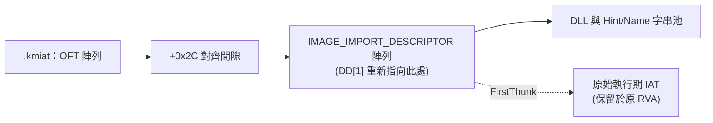

# 匯入表、TLS 與匯出表

## 匯入表與字串還原

加密的匯入字串採用 `string_cipher`（`dd7`）：位於 `name_rva` 的 DLL 名稱從 `pos = name_rva` 開始解密，初始金鑰為 `key = name_rva & 0xFF`；而依名稱匯入的 `IMAGE_IMPORT_BY_NAME` 項目位於 `hint_name_rva`，會跳過開頭 2 位元組的 `Hint`（並將 `Hint` 清零），從 `pos = hint_name_rva + 2` 開始解密，初始金鑰則為 `hint_name_rva & 0xFF`。依序數（Ordinal）匯入的 thunk（PE32+ 為第 63 位元，PE32 為第 31 位元；在 PE32+ 上務必讀取完整的 64 位元 thunk）則保持原樣不動。



* 走訪第 5 階段 `walk5` 資料表中每筆 20 位元組的項目（`+12` 為 DLL 名稱 RVA，`+0` / `+16` 為 thunk 串列）。受控組件的 `walk5 == 0`。
* 原地解密每個 DLL 名稱並轉為小寫；位於 `hint_name_rva + 2` 的函式名稱字串則在原地解密後**保留原始大小寫**（符號名稱區分大小寫），同時將 `Hint` 清零。
* `DataDirectory[12]`（IAT）取自先前從 `info[3]` 解密保存的 128 位元組資料目錄陣列。



* 由於匯入字串存放在 `.text` 區段內，必須等 `.text` 完成 `dd8` 分頁還原**之後**，才從已還原的 `DataDirectory[1]` 開始走訪 `IMAGE_IMPORT_DESCRIPTOR`（若保存的資料目錄中 `DD[1]` 為零，則改用錨點記錄的匯入表 RVA）。
* 若模組名稱或函式名稱本身已是可列印 ASCII 字串，則跳過 `string_cipher`；解密後的 DLL 名稱會轉為小寫，函式名稱則保留原始大小寫。
* 掃描所有描述元的 `FirstThunk` 串列上下界，據此計算出 `DataDirectory[12]`（IAT）的範圍。



* 直接順著匯入表原地解密 DLL 名稱與依名稱匯入的函式字串，且不將 DLL 名稱轉為小寫。
* 從 `info[3] + 16` 處的 656 位元組 `byte_rotate2` 區塊還原 `DataDirectory[12]`。



* 在 `EighthStage`（`+0x18`）匯入表與保存的資料目錄匯入表（`DD[1]`）之間擇一使用。
* **原地 `.idata` 型 PE32：** 直接在原地解密名稱字串（`.idata` 型 EXE 由 thunk 上下界計算 `DD[12]`；PE32 DLL 則將 `DD[12]` 清為 `(0, 0)`）。
* **`.kmiat` 重建（僅限 PE32 EXE）：** 當載入器寫入的 IAT 配置與標準 `.idata` 結構不一致時，會將最後一個區段改名為 `.kmiat`（大小設為 `0x7000`，屬性旗標 `0xE0000060`），在其中重新建立匯入描述元、OriginalFirstThunk 陣列（保留 `+0x2C` 對齊間隙），以及轉小寫的 DLL 名稱與保留大小寫的符號字串（並將 `api-ms-win-crt-*` 正規化為 `ucrtbase.dll`）；實際執行期使用的 IAT 則留在原位，並將 `DD[12]` 清為 `(0, 0)`：




## TLS 還原與重定位重新啟用

CrackProof 會從加密酬載中移除 TLS 狀態，改由執行期載入器自行處理 TLS；若靜態還原時未從明文外層 stub 補回 TLS 資料，輸出的靜態映像在存取 `_tls_index` 或執行 `LdrpAllocateTlsEntry` 時就會發生 `0xC0000005` 存取違規：

* **單一檔案 64 位元含特徵標記組建：** 保存的資料目錄仍留有非零的 `DD[9]`，但目標 RVA 處的 `IMAGE_TLS_DIRECTORY64` 已被清零；重建流程會依對應 RVA 從受保護原檔複製明文結構與原始資料範本（單一檔案含特徵標記組建採用 `/FIXED`，無須合成重定位項目；無特徵標記的單一檔案組建若發現還原出的結構全為零，則直接清空 `DD[9]`）。
* **外部伴生檔案（`._`）64 位元組建：** 伴生酬載會將 `DD[9]`、TLS 結構與範本全數清零，並捨棄對應的基底重定位項目。重建時必須從外層 stub PE 補回 `DD[9]`、`IMAGE_TLS_DIRECTORY64` 結構與原始資料範本，接著在 `.reloc` 尾端**補上四筆 `IMAGE_REL_BASED_DIR64` 重定位項目**，分別涵蓋 `StartAddressOfRawData`、`EndAddressOfRawData`、`AddressOfIndex` 與 `AddressOfCallBacks`。
* **PE32 EXE 與 DLL：** 從載入器 stub 複製明文 `IMAGE_TLS_DIRECTORY32` 與資料範本（若 stub 中不存在，則退回建立最小化的 `.tls` / `.data` 佔位結構）。在 **PE32 DLL** 上，CrackProof 會將 `.reloc` 內對應四個 TLS 指標的重定位項目降級為 `IMAGE_REL_BASED_ABSOLUTE`（`type = 0`），但仍保留非零的分頁內偏移量；重建時必須**將這四個槽位重新改回 `IMAGE_REL_BASED_HIGHLOW`（`type = 3`）**，DLL 變更載入基底時才能正確修正 `IMAGE_TLS_DIRECTORY32` 的四個指標欄位。

## 匯出表目錄（`DD[0]`）

單一檔案組建在受保護原檔的對應 RVA 處仍保有明文匯出表目錄。外部伴生檔案（`._`）酬載在匯出表範圍內解密出來則是雜訊資料，因此重建時需直接從外層 stub PE 的 `.rdata` 區段將整個 `DataDirectory[0]` 區間覆寫回來。
