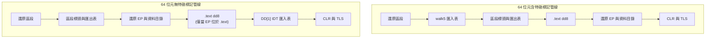

# 重定位、分頁轉換與 CLR 資料

## 基底重定位：`/FIXED` 與 ASLR 策略

* **單一檔案 64 位元含特徵標記組建與 32 位元 EXE（`/FIXED`）：** 加殼器已捨棄基底重定位表並清空 `DllCharacteristics`。靜態重建時會將 `DataDirectory[5]` 與 `DllCharacteristics` 一併清零，使 EXE 固定載入於預設的 `ImageBase`。
* **所有 DLL（32 位元與 64 位元，不分家族）：** DLL 必須維持可重定位能力；重建流程會保留 `DataDirectory[5]`、確保設定 `IMAGE_DLLCHARACTERISTICS_DYNAMIC_BASE`（`0x0040`），並在 PE32 DLL 上重新啟用被改為 `ABSOLUTE` 的 TLS 重定位項目。
* **無特徵標記 64 位元組建與外部伴生檔案（`._`）組建：** 保留原有的 ASLR 旗標（`DYNAMIC_BASE` / `HIGH_ENTROPY_VA`）與 `DataDirectory[5]`（若伴生檔案還原了 TLS，則同步補入四筆 `DIR64` TLS 重定位項目）。

## `.text` 分頁打亂（`dd8`）執行順序

無特徵標記組建會將加密的匯入字串與明文 CLR 中繼資料一併存放在 `.text` 內，因此含特徵標記與無特徵標記兩套管線必須在不同時間點執行 `dd8`：

在無特徵標記組建上，`dd8` 必須排在區段標頭及進入點／資料目錄還原之後（且僅在 `AddressOfEntryPoint` 落於 `.text` 區段內時執行），並排在 `DD[1]` IDT 匯入名稱解密與 CLR 覆寫**之前**；否則 `dd8` 會把剛解密完的匯入字串再次打亂，或破壞覆寫回來的 `COR20` / `BSJB` 位元組。

## 精準覆寫還原 CLR 中繼資料

受控（Managed）CrackProof 組建會將 IL 方法本體放在區段酬載內加密，而 ECMA-335 中繼資料結構則以明文保留在外層檔案或伴生 stub 中：

* **單一檔案無特徵標記 64 位元組建：** 在 `dd8` 完成後，依對應 RVA 覆寫補回 `COR20` 標頭（`cb == 0x48`）與 `BSJB` 中繼資料串流。
* **單一檔案含特徵標記 64 位元組建：** 覆寫補回 `COR20`、`BSJB` 中繼資料，以及 `COR20.Resources`（`+0x18`）。
* **受控伴生檔案（`._`）DLL：** 從外層 stub PE 覆寫補回 `COR20`（`0x48` 位元組），並逐一檢查其參照的七個子區間，凡非零者一併覆寫：`MetaData`（`BSJB`，必備）、`Resources`、`StrongNameSignature`、`CodeManagerTable`、`VTableFixups`（連同其參照的各個槽位陣列）、`ExportAddressTableJumps` 與 `ManagedNativeHeader`。


**區段還原完成後，切勿整段複製含有 CLR 的區段。** IL 方法本體與 `COR20`、`BSJB` 共用 `.text` 區段，且已由 `walk4` + `dd8` 解密還原；若事後拿受保護原檔或 stub 的整個區段直接蓋過去，已解密的 IL 方法本體就會被密文覆蓋。（唯有舊版專用 64 位元 DLL 管線是**先**預填 CLR 區段，再由 `walk4` 將還原的方法本體寫在上方。）


若 `DataDirectory[14]` 指向全零的 `COR20` 標頭（`cb == 0`）且找不到合法的保留副本，則直接清空 `DataDirectory[14]`。Unity IL2CPP 作品則是對原生 `GameAssembly.dll` 加殼（不含 CLR 標頭），並另外對 `global-metadata.dat` 做混淆處理；詳見 [il2cpp 中繼資料混淆](../../analysis/il2cpp-metadata.md)。
