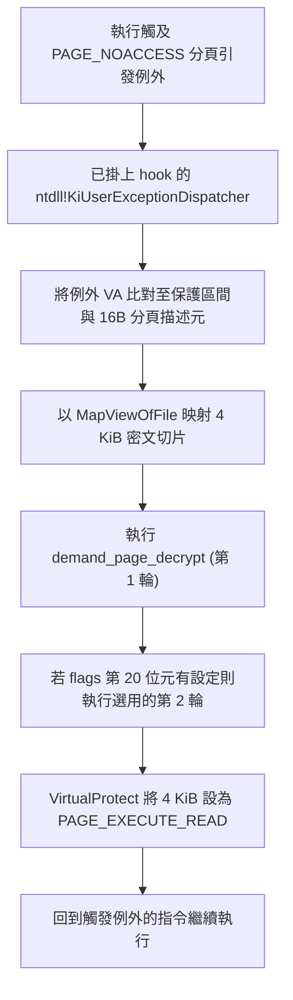

# 分頁保護與載入器程式碼

## 隨選分頁保護與例外解密（`640` -> `840`）

分頁保護是可依模組個別啟用的執行期保護層（常見組態為宿主 EXE 啟用、外掛 DLL 停用）：

1. 在階段 `640` 期間，先將可執行區段整批解密。
2. 到了階段 `840`，可執行分頁會以 4 KiB 為單位逐頁重新加密並設為 `PAGE_NOACCESS`，同時對 `ntdll!KiUserExceptionDispatcher` 寫入 inline hook，使其跳轉至 `HtdpStub2.dll`（參見[手動映射輔助模組](mapped-modules.md)）。
3. 當執行流觸及 `PAGE_NOACCESS` 分頁而觸發存取違規例外時，分派器 hook 會在所有 SEH 鏈之前攔截該例外，隨選解密該 4 KiB 分頁、將權限改為 `PAGE_EXECUTE_READ`，再恢復指令執行。

由於尚未執行到的分頁會一直維持加密的 `PAGE_NOACCESS` 狀態（且部分組建還會啟用 **scribble** 機制，在分頁存取違規之間對已解密分頁的部分位元組套用 XOR 遮蔽），抵達 OEP 後若只擷取單次記憶體快照，就只能拿到目前已執行並完成解密的分頁；必須逐一觸發所有受保護分頁完成解密並還原 scribble 遮蔽，才能取得完整程式碼。

## 隨選分頁解密演算法



在 `HtdpStub2.dll` 內部，每個受保護模組都會註冊一筆區間描述元，指向位於 `region_base + page_table_offset` 的 16 位元組分頁描述元陣列（索引計算方式為 `(fault_va - region_base) >> 12`）：

| 結構 | 偏移量 | 大小 | 實測用途 |
| --- | --- | --- | --- |
| 區間描述元 | `+0x08` | 8 | `region_base` 虛擬位址 |
| 區間描述元 | `+0x10` | 4 | 區間位元組大小 |
| 區間描述元 | `+0x20` | 4 | 相對於 `region_base` 的 `page_table_offset` |
| 區間描述元 | `+0x24` | 4 | 4 KiB 分頁總數 |
| 區間描述元 | `+0x28` | 8 | 傳給 `MapViewOfFile` 的 Section 控點 |
| 區間描述元 | `+0x34` | 4 | 已解密分頁計數器 |
| 分頁描述元（`16B`） | `+0x00` | 4 | `flags`（`bit 20`，位元索引 `0x14` / 遮罩 `0x00100000`，啟用第 2 輪解密） |
| 分頁描述元（`16B`） | `+0x04` | 4 | 該分頁專屬的 `key_part` |
| 分頁描述元（`16B`） | `+0x08` | 4 | 最近一次 `GetTickCount` 時間戳記 |
| 分頁描述元（`16B`） | `+0x0C` | 2 | 分頁存取違規觸發次數 |
| 分頁描述元（`16B`） | `+0x0E` | 2 | 用途未確認的 16 位元欄位 |

第 1 輪會取 `page_va + region_base` 的低 32 位元與 `key_part` 做 XOR 推導出 32 位元金鑰，再對整個 4 KiB 分頁執行滾動 dword 解密：

```python
def demand_page_key(page_va, region_base, key_part):
    return ((page_va + region_base) ^ key_part) & MASK32


def demand_page_decrypt(buf, key):
    count = len(buf) >> 2
    state = ((key << 16) ^ key) & MASK32
    prev = state
    for i in range(count):
        enc = get_u32(buf, i * 4)
        state = rol32((state + i) & MASK32, 3)
        put_u32(buf, i * 4, enc ^ prev ^ state)
        prev = enc
```

`get_u32`、`put_u32`、`rol32` 與 `MASK32` 定義於[滾動金鑰與位元旋轉加密](../data-transforms/rolling-and-rotation.md)，可執行的測試向量則收錄於 [primitives.py](https://app.gitbook.com/s/2p7kzW649ZlKfmpYdJ87/primitives.py)。當 `flags & 0x00100000` 非零時，會在呼叫 `VirtualProtect` 將分頁切換為 `PAGE_EXECUTE_READ` 之前，額外執行第 2 輪與組建相關的解密轉換。

## 載入器多態花指令、SEH 陷阱與磁碟自我映射

* **重複的多態函式序言（Prologue）：** 第 5 階段會針對同一套解密函式產生最多 16 份外觀經排列變形、夾雜不同花指令跳轉配置的副本。
* **破壞反組譯同步的跳轉與返回位址運算：** 無條件跳轉後方緊接花指令位元組、跳入指令中間的分支目標，以及 `call $+5` 搭配常數偏移調整返回位址等手法，會讓線性掃描與單純的遞迴下降反組譯失準。
* **計時干擾片段與 `#DB` SEH 陷阱：** 其中一種混淆片段會先保存全部 16 個通用暫存器（GPR），執行 `0x5658` 的 `in eax, dx` 探測，接著執行 `jne $+2`（位移量 `disp = 0`，無論條件成立與否都會落到下一條指令）後直接返回，純粹用來拉開時間差供外部計時檢查觀測；另一種則是設定 `TF`（`pushfq; or [rsp], 0x100; popfq`）的 SEH 陷阱，讓正常執行流透過 SEH 轉往真實路徑，而吞掉 `#DB` 單步例外的除錯器或模擬器則會直接落入後方的無效指令。
* **啟動後抹除資料表與磁碟自我映射：** 第 5 階段會透過作業系統解析好的匯入函式呼叫 `GetModuleFileNameW` 取得自身路徑，開啟並映射磁碟上的自身檔案（`CreateFileW` / `CreateFileMappingA` / `MapViewOfFile`），在階段 `655` 自行套用 `.reloc` 重定位項目，並在進入 `280` 前將已用畢的各階段資料表與特徵標記全數清零。
