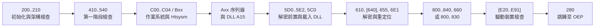

# 啟動流程與狀態回報

在原始程式開始執行前，CrackProof 會橫跨宿主 stub 與手動映射的輔助模組，依組態執行一套啟動管線，最後以狀態碼 `280`（跳轉至 OEP）收尾：

## 啟動流程與狀態碼 

每個啟用的階段都會寫入一組 12 位元十六進位狀態碼：

| 狀態碼 | 階段說明 |
| --- | --- |
| `200` / `210` | 載入器啟動／宿主架構檢查 |
| `410` | 使用者模式反除錯檢查（`IsDebuggerPresent`；動態擷取確認商用版 `410` 內部不含 SEH 子階段） |
| `510` | 載入器記憶體區間的 CRC-32 完整性檢查 |
| `520` / `52F` | `NtQueryInformationProcess` 除錯檢查／核心除錯器檢查 |
| `540` | VMware I/O 埠後門探測及／或 CPU 功能旗標檢查 |
| `560` / `561` | 區段解密初始化／輔助模組選取 |
| `C00` | Windows 最低組建版本檢查：記錄兩筆 `(0x01A00000 + build)` dword（系統實際組建號與最低需求組建號） |
| `C01` | 開機組態檢查（`testsigning`、`disableintegritychecks`） |
| `C02` / `C03` / `C04` | 安裝 `Htsysm` 服務（`Htsysm7679`、`Htsysm767901` 或 `Htsysm1B4001`）／初始化驅動程式／註冊回呼或啟用 `EPROCESS` 受保護行程與 API hook |
| `A03` | 父行程名稱檢查（`explorer.exe` / `cmd.exe`） |
| `A09` | VM 硬體／BIOS 登錄檔字串前綴檢查 |
| `A0F` | 注入 DLL 掃描 |
| `A08` / `A04` | 從磁碟複製乾淨的 `ntdll` / `kernel32` `.text` 區段（若磁碟上的系統 DLL 遭竄改，`A04` 亦會中止啟動） |
| `A07` / `A01` | 終止非預期執行緒／若仍有外來執行緒殘留則中止啟動 |
| `A11` | DLL 宿主行程驗證（檢查宿主 EXE 是否含有 `peC` 區段，或精確大小寫的 `KeRnEl32.dLl` 匯入項目） |
| `A15` | DLL 序列器標記，於宿主檢查通過後緊接在 `5D0` 之後記錄（本身無檢查邏輯，EXE 絕不會記錄此碼） |
| `B00` / `BD0` / `BE0` | 相容作業系統檢查／`C:\Windows\msc.log.log` 不存在檢查／舊版 SoftICE 與 Syser 裝置檢查 |
| `B21` / `BB0` | 載入舊版核心輔助模組（`HtsyskNT.dll` / `HtpecmNT.dll`） |
| `5D0` `552` `570` `590` `5B0` `5B1` `598` `5A0` `5E1` `5E2` | 分階段解密前置步驟 |
| `A06` / `5C0` | 後期 API hook／載入執行期匯入的 DLL |
| `610` | 區段與標頭整批解密 |
| `640` | 啟用分頁保護前的可執行分頁整批解密 |
| `655` / `6E1` | 基底重定位修正／尾端區段收尾設定 |
| `800` `810` `820` `840` | 分頁保護初始化（`800`..`820`），以及 hook `KiUserExceptionDispatcher`、重新加密分頁並設為 `PAGE_NOACCESS`（`840`） |
| `830` | 未啟用分頁加密之原生組建的分頁設定收尾（`800` -> `830`） |
| `660` | 分頁保護啟用後、進入 `280` 前的交接階段 |
| `E20` `E40` `E52`..`E59` `E55` `E91` | `1B40` 家族組建上的後期完整性與分析工具驅動裝置檢查 |
| `280` | 最終交棒跳轉至原始進入點（OEP） |

從多模組行程的實際執行記錄即可看出各模組獨立的保護設定（參見[除錯記錄範例](https://app.gitbook.com/s/2p7kzW649ZlKfmpYdJ87/sample-debug-logs)）：啟用分頁加密的宿主 EXE 會走 `610 -> 640 -> 655 -> 6E1 -> 800..840 -> 660 -> 280`，而同一行程內採整批解密的原生外掛 DLL 則是走 `610 -> 655 -> 6E1 -> 800 -> 830 -> 280`。`A` 系列檢查由單一模式驅動的序列器分批派發執行。

## 除錯記錄 

* **`%temp%\<12 hex>` 資料夾開關：** 每個受保護模組都會推導出一組 12 位十六進位字元的資料夾名稱；只要 `%temp%\<12 hex>` 資料夾存在，且建立時間距今在約 48 小時以內，載入器就會寫入明文追蹤檔（EXE 為 `HHMMSSmmmE-...`，DLL 為 `HHMMSSmmmD-...`）。對 `CreateFileW` 設中斷點或掛上 hook，即可直接看出載入器探測的路徑。
* **`\\.\mailslot\ErrLog-Pec<4 hex>` 診斷通道：** 另一條獨立的診斷通道會取 12 位十六進位記錄金鑰的第一個 16 位元 word，以 `((key + 1) * 0x3039) mod 0x8003` 推導出 `<4 hex>`；當系統中存在對應的 mailslot 監聽端時，便會寫入一份經滾動 XOR 混淆的報告（自 `-- Version` 起套用 `state = (derive(key) + 1)^2 ^ ~length; word ^= state; state = ror32(state + i, 7)`）。
* **`AAA-BBB-CCC` 結尾狀態碼：** 兩條通道在結束時都會寫入一組 9 字元狀態碼：
  * **`AAA`（3 位十進位數字）：** 正常啟動完成時為 `000`；失敗時則為失敗階段在 104 項階段表中的十進位索引（由 1 起算，例如 `C03` -> `046`、`A09` -> `048`、`E91` -> `601`）。
  * **`BBB`（3 位大寫十六進位數字）：** 失敗階段期間記錄到的第一個子階段碼。
  * **`CCC`（3 位大寫十六進位數字）：** 在 `BBB` 尚未設定前所記錄到的第一個原因／錯誤碼（實測範例如 `046-019-01F`、`048-012-002`、`601-000-008`）。


**在記憶體中定位各階段的狀態碼送出點。** 記錄輔助函式透過 `ECX` 傳入打包後的 12 位元代碼，並以最低 4 位元（nibble）標記類型：階段狀態碼為 `1`（`(code << 4) | 1`，例如 `0xC01` -> `0xC011`），`CCC` 原因碼為 `3`（`(code << 4) | 3`），`BBB` 子階段碼則為 `5`（`(code << 4) | 5`）。只有核心引導狀態碼（`200`、`560`、`590`、`5A0`、`5E1`、`5E2`、`800`）位在宿主模組自身的載入器區段內（且第一階段的立即值會在執行後抹除）；`410` / `510` / `520` / `540`、`Cxx` 與 `Axx` 的立即值則都位在手動映射的輔助 DLL（如 `HtpecIt`、`dm` 等）內部。

