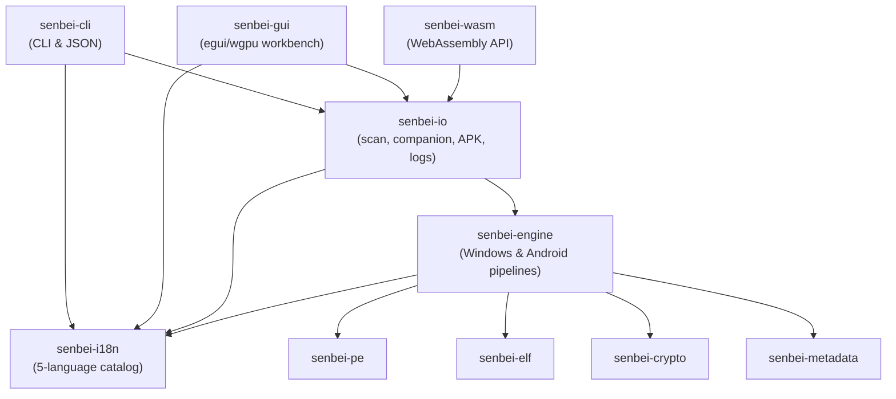

# Design

## Workspace architecture

The Cargo workspace contains nine member crates, with `senbei-wasm` (browser bindings) and `fuzz` (`libFuzzer` harness) excluded as standalone crates:

| Crate | Responsibility |
| --- | --- |
| `senbei-cli` | Command-line parser, terminal color/locale output, JSON emitter, and integration suites |
| `senbei-gui` | Native `eframe`/`wgpu` desktop workbench (`Workbench` UI is filesystem-free; `native.rs` runs background jobs) |
| `senbei-i18n` | `unsafe`-free 5-language catalog (`Msg`, `Step`, `Term`, `Cli`, `Message`); keeps English wire strings for `--json` and `.log` |
| `senbei-io` | Folder scanning, Windows `._` splicing, Android `.apk`/`.apks`/`.xapk` streaming, `RunObserver`, and `CancelToken` |
| `senbei-engine` | Windows PE and Android ELF static recovery pipelines, `profile.rs` report model, and bounded research trace sink |
| `senbei-pe` / `senbei-elf` | Pure format parsers, RVA/offset mapping, and ELF SysV/GNU hash & layout helpers (zero filesystem I/O) |
| `senbei-crypto` | Windows (`src/windows/`) and Android (`src/android/`) ciphers, AES schedules, bytecode VM, and Huffman/LZ |
| `senbei-metadata` | Layout definitions (`layout.rs`), shared structural `v31` remap, and Android seeded `v24.1`/`v29`/`v31`/`v39` & slim `v24` restoration |
| `senbei-wasm` | Standalone `wasm32-unknown-unknown` bindings driving `senbei-io`'s in-memory byte API inside disposable Web Workers |

Multi-platform crates isolate platform-specific code under `src/windows/` and `src/android/` while keeping shared models directly under `src/`.

## Protection profiles, research traces, and observer hooks

* **`senbei-engine/src/profile.rs`:** records input format, recognition evidence, every attempted candidate route and its rejection error, the winning route, recovery status, and static validation findings (`format_version` versions the report schema rather than a CrackProof build).
* **Bounded research trace (`inspect`):** `inspect` combines parsed input structures and bounded header/stage probes with the trace events emitted during full static recovery, tagging every offset with its coordinate space (`file`, `spliced`, `payload`, or `rva`) before discarding temporary outputs.
* **Observer and cooperative cancellation:** `senbei-engine::progress` streams stage transitions to `senbei-io::observe::RunObserver` (`scanned`, `input_started`, `progress`, `produced`, `input_finished`). `produced` fires before `Inspect` or `DryRun` cleans up its temporary workspace so `senbei-gui` can retain restored images up to its configured MiB cap, and `CancelToken` stops batch runs cleanly between inputs.

## Windows, Android, and metadata pipelines

* **Windows (`senbei-engine/src/windows/`):** trial-decrypts and validates candidate anchors, shifts, seeds, and bytecode stubs across PE32 (standard and compact), 64-bit marker, 64-bit marker-less, dedicated 64-bit DLL, and `stub[..4096] ++ companion` (`._`) inputs, running deterministic parallel section decompression and post-recovery PE/CLR/directory integrity checks.
* **Android (`senbei-engine/src/android/`):** `extract/` decodes Stage 1 and nested Stage 2 streams into a temporary workspace under `ResourceLimits`; `restore/` applies primary `PT_LOAD` writers and auxiliary relocation containers (`0x9B`, `0x9D`, `0x9E`, plus reversing optional `0x96` symbol permutations and interpreting `0x98` AArch64 constructors), placing rebuilt dynamic tables in-place or in an appended `PF_R` `PT_LOAD` and clearing `e_entry`.
* **Scanning & packages (`senbei-io/`):** folder scans filter for `.exe`, `.dll`, `.so`, `global-metadata.dat`, `.apk`, `.apks`, and `.xapk` above the `4,128`-byte floor without opening bulk game assets. ZIP package handling reads the ZIP central directory first and streams only `.so` and `global-metadata.dat` entries to temporary files.
