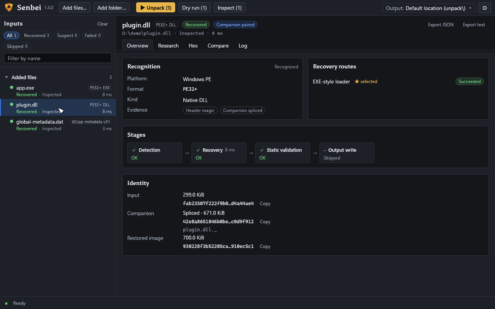
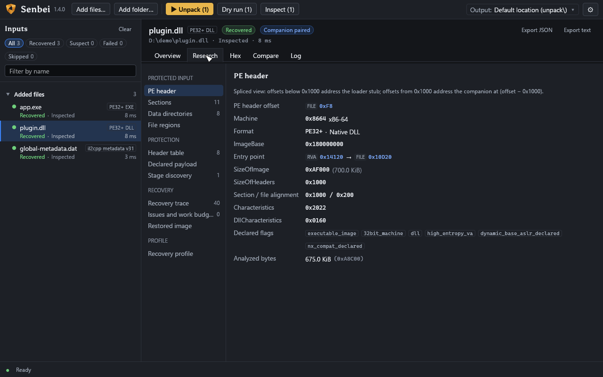
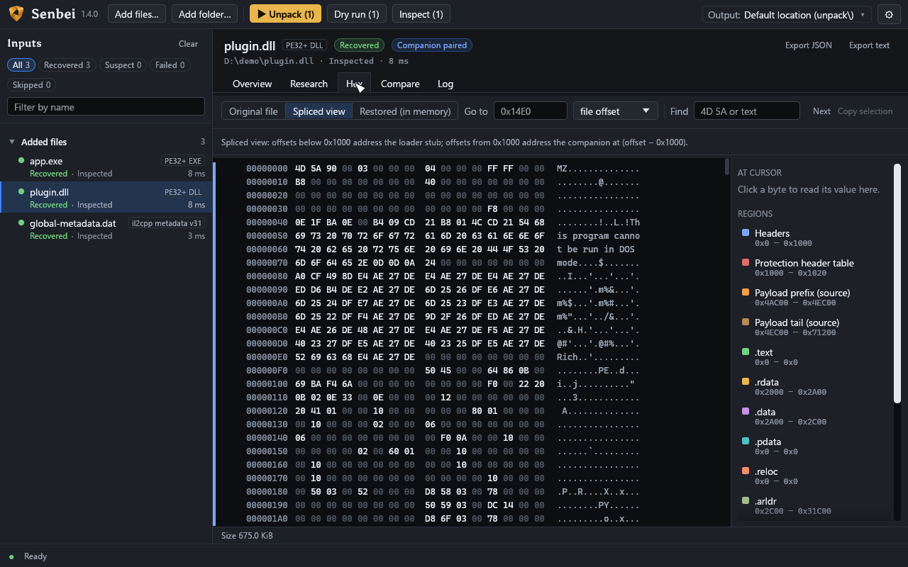
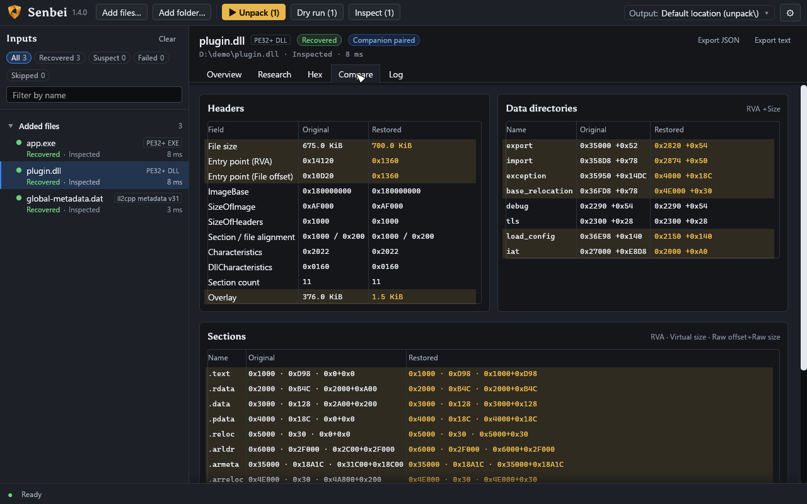

# GUI

`senbei-gui` (`senbei-gui.exe` on Windows, `./senbei-gui` on Linux) is Senbei's native Rust desktop workbench built on `eframe` and `wgpu` (Direct3D 12 on Windows, Vulkan on X11/Wayland). Every native release archive packages `senbei` and `senbei-gui` together; from source, build or launch it with:

```cmd
cargo build --release -p senbei-gui
cargo run --release -p senbei-gui
```

## Workbench views



















*(Screenshots rendered from synthetic dummy PE, companion `._`, and v31 metadata fixtures.)*

## Inputs, batch modes, and cancellation

* **First-launch legal notice:** on initial startup, a modal legal notice (with a five-language switcher in its header) blocks file drops and actions until **I understand and accept** is selected. Reopen it anytime from **Settings -> About -> Show legal notice**.
* **Staging files and folders:** use **Add files…** (`Ctrl+O`), **Add folder…**, or drag and drop onto the window. For loose files, the GUI reads up to 1 MiB to identify headers and pairs sibling `<name>._` companions automatically; added folders are scanned in the background. Filter rows with **All**, **Recovered**, **Suspect**, **Failed**, **Skipped**, and **Filter by name**, multi-select with `Ctrl+Click`, or remove idle items with `Delete`.
* **Three run modes:** run **Unpack**, **Dry run**, or **Inspect** on the active selection (or across all queued items when nothing is selected). Queued folders run the full directory pipeline, preserving companion pairing, split-APK grouping, per-app `v24.1` metadata matching, deduplication, and mirrored output subdirectories.
* **Cooperative cancellation:** **Cancel** stops the batch cleanly after the current input finishes (`Stopping after the current input…`), leaving completed items intact and marking unreached items as `Will not run`. Closing the window mid-run prompts **Keep running** vs **Stop and close**.

## Detail tabs and report export

| Tab | What it shows |
| --- | --- |
| **Overview** | Recognition summary, attempted recovery routes (`★ selected` plus rejection reasons), stage timeline, static validation verdict, input/companion/output sizes and SHA-256 copy buttons, plus metadata or restored-ELF cards. |
| **Research** | Populated by **Inspect** (or click **Inspect this input** after an unpack/dry run): Windows PE headers, sections, directories, file regions, decoded `info[0..7]` table, stage discovery, and recovery trace; Android Stage 1, streams, modules, artifacts, and 7 ELF restoration views; metadata image tables; and clickable `FILE` / `RVA` / `HDR` / `PAYLOAD` jump badges into **Hex**. |
| **Entries** | Shown for `.apk`, `.apks`, and `.xapk` packages: candidate `.so` and `global-metadata.dat` rows (plus **Show non-targets (N)**), each opening its own **Overview**, **Research**, and **Hex** views. |
| **Hex** | Reads files up to `2 GiB` across **Original file**, **Spliced view** (`stub[..0x1000] ++ companion`, default when paired), and **Restored (in memory)**; supports **Go to** (`file offset` or `RVA`), **Find** (hex bytes like `4D 5A` or ASCII text, `F3` for next), **Copy selection** (up to 1 MiB), live little-endian cursor decoding (`u8`..`u64`, `RVA`), and clickable **Regions**. |
| **Compare** | Available on inspected Windows PE inputs: side-by-side **Original** vs **Restored** diffs for PE headers, data directories, and section tables, plus a 1 MiB **Section bytes** diff viewer with **Next difference**. |
| **Log** | Filterable run log (**All**, **Hide steps**, **Problems only**) with **Copy log**; structured log lines re-translate immediately when switching the UI language. |

Select **Export JSON** (`<name>.senbei.json`, English schema v1) or **Export text** (`<name>.senbei.txt`) on any finished item or folder group to save standalone reports.

## Settings and environment variables

Preferences persist in `%APPDATA%\senbei\data\app.ron` on Windows and `$XDG_DATA_HOME/senbei/app.ron` (or `~/.local/share/senbei/app.ron`) on Linux:

* **General:** **Language** (`English`, `简体中文`, `繁體中文`, `日本語`, `한국어`), **Default output folder** (`Default location (unpack\)`, `Last used folder`, or `Choose a folder…`), and **Write a log file** (default `on`, applies to **Unpack**).
* **Processing:** **Worker threads** (`Automatic (N)` default, or explicit count) and **Probe small files** (default `off`, equivalent to `--scan-all`).
* **Android limits:** **Largest single entry** (`2048` MiB default), **Total budget** (`8192` MiB default), **Maximum entries** (`100000` default), and **Maximum nesting depth** (`32` default).
* **Memory:** **Keep restored bytes for Hex and Compare** (default `on` for `Inspect` and `Dry run`; `Unpack` reads its saved output file from disk) and **Maximum retained image size** (`512` MiB default per produced image; larger images still show full structural summaries without keeping raw bytes in RAM).

`senbei-gui` takes no command-line flags. It honors `SENBEI_LANG` until a language is explicitly chosen in **Settings**, honors `SENBEI_THREADS` when **Worker threads** is set to `Automatic`, and displays a top warning banner if debug variables `DD8_SHIFT` or `SEL_DIAG` are set in the environment.
