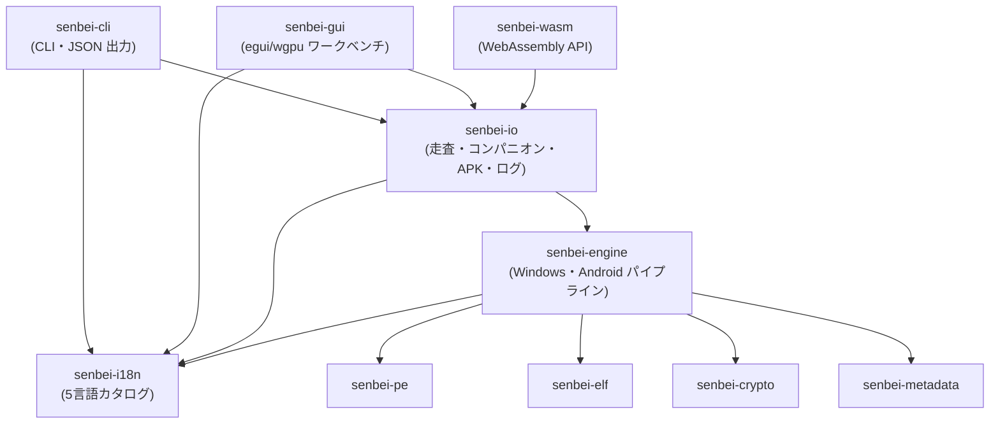

# 設計

## ワークスペース構成

Cargo ワークスペースは9つのメンバークレートで構成されており、`senbei-wasm`（ブラウザー向けバインディング）と `fuzz`（`libFuzzer` ハーネス）はワークスペース外の独立クレートとして分離されています。

| クレート | 役割 |
| --- | --- |
| `senbei-cli` | コマンドライン引数パーサー、端末カラー・ロケール出力、JSON 出力、および統合テストスイート |
| `senbei-gui` | ネイティブ `eframe`/`wgpu` デスクトップワークベンチ（`Workbench` UI 層はファイルシステム非依存、`native.rs` がバックグラウンドジョブを実行） |
| `senbei-i18n` | `unsafe` 不使用の5言語カタログ（`Msg`、`Step`、`Term`、`Cli`、`Message`）。`--json` と `.log` 向けの固定英語文字列も保持 |
| `senbei-io` | フォルダー走査、Windows `._` コンパニオン連結、Android `.apk`/`.apks`/`.xapk` ストリーム処理、`RunObserver`、`CancelToken` |
| `senbei-engine` | Windows PE および Android ELF の静的復元パイプライン、`profile.rs` レポートモデル、サイズ上限付きの調査トレース記録 |
| `senbei-pe` / `senbei-elf` | 純粋なフォーマットパーサー、RVA／ファイルオフセット変換、ELF SysV/GNU ハッシュおよびレイアウト補助処理（ファイルシステム I/O なし） |
| `senbei-crypto` | Windows（`src/windows/`）および Android（`src/android/`）向け暗号処理、AES 鍵スケジュール、バイトコード VM、Huffman/LZ 展開 |
| `senbei-metadata` | レイアウト定義（`layout.rs`）、共通の `v31` 構造リマップ、および Android のシード派生型 `v24.1`/`v29`/`v31`/`v39` と埋め込みスリム `v24` 復元 |
| `senbei-wasm` | 使い捨て Web Worker 内で `senbei-io` のインメモリバイト API を駆動する独立 `wasm32-unknown-unknown` バインディング |

複数プラットフォームを扱うクレートでは、プラットフォーム固有の実装を `src/windows/` と `src/android/` に分離し、共通モデルを `src/` 直下に配置しています。

## 保護プロファイル・調査トレース・Observer hook

* **`senbei-engine/src/profile.rs`:** 入力フォーマット、認識根拠、試行したすべての候補ルートとその棄却エラー、採用されたルート、復元ステータス、および静的検証の結果を記録します（`format_version` は CrackProof のビルド番号ではなくレポートスキーマのバージョンを表します）。
* **サイズ上限付きの調査トレース（`inspect`）:** `inspect` はパース済みの入力構造および上限付きのヘッダー／ステージプローブ結果と、完全な静的復元中に発行されるトレースイベントを組み合わせます。すべてのオフセットに基準種別（`file`、`spliced`、`payload`、または `rva`）をタグ付けしたうえで、一時出力を破棄します。
* **Observer と協調的キャンセル:** `senbei-engine::progress` はステージ遷移を `senbei-io::observe::RunObserver`（`scanned`、`input_started`、`progress`、`produced`、`input_finished`）へ通知します。`produced` は `Inspect` や `DryRun` が一時作業領域を削除する前に発火するため、`senbei-gui` は設定された MiB 上限まで復元イメージをメモリに保持できます。`CancelToken` により、バッチ実行を入力単位の区切りで安全に停止できます。

## Windows・Android・メタデータ各パイプライン

* **Windows（`senbei-engine/src/windows/`）:** PE32（標準およびコンパクト）、64ビットマーカーあり、64ビットマーカーなし、専用 64ビット DLL、および `stub[..4096] ++ companion`（`._`）入力にわたり、候補となるアンカー・シフト量・シード・バイトコードスタブを試行復号して検証します。セクション展開は決定論的な並列処理で行われ、復元後に PE・CLR・各種ディレクトリの整合性検証を実施します。
* **Android（`senbei-engine/src/android/`）:** `extract/` が `ResourceLimits` の制約下で Stage 1 とネストされた Stage 2 ストリームを一時作業領域へ復号・展開します。続いて `restore/` が主 `PT_LOAD` の書き込みストリームと補助再配置コンテナー（`0x9B`、`0x9D`、`0x9E`）を反映し、さらに任意の `0x96` シンボル順列の逆変換と `0x98` AArch64 コンストラクター解決を行ったうえで、再構築した動的テーブルをインプレースまたは末尾追加の `PF_R` `PT_LOAD` に配置して `e_entry` をクリアします。
* **フォルダー走査とパッケージ処理（`senbei-io/`）:** フォルダー走査では大容量のゲームアセットを開かず、`4,128` バイト以上の `.exe`・`.dll`・`.so`・`global-metadata.dat`・`.apk`・`.apks`・`.xapk` のみを対象に絞り込みます。ZIP パッケージ処理では先にセントラルディレクトリを読み取り、`.so` と `global-metadata.dat` エントリのみを一時ファイルへストリーム展開します。
