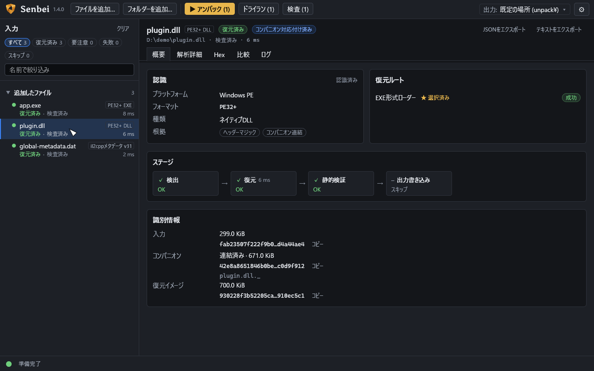
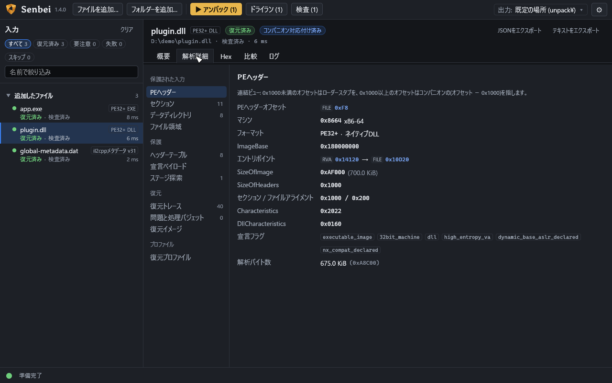
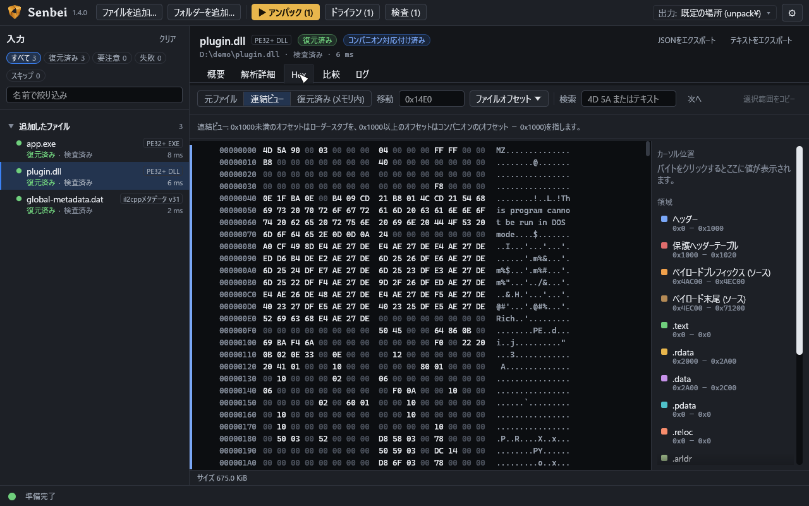
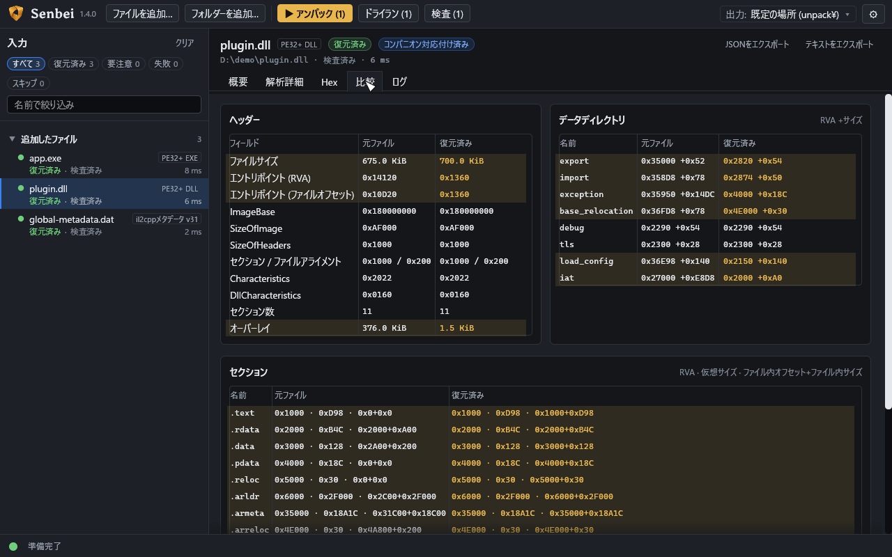

# GUI

`senbei-gui`（Windows では `senbei-gui.exe`、Linux では `./senbei-gui`）は、`eframe` と `wgpu`（Windows では Direct3D 12、X11/Wayland では Vulkan）上に構築された Senbei のネイティブ Rust デスクトップワークベンチです。すべてのネイティブリリースアーカイブには `senbei` と `senbei-gui` の両方が同梱されています。ソースからビルド・起動するには次のコマンドを実行します。

```cmd
cargo build --release -p senbei-gui
cargo run --release -p senbei-gui
```

## ワークベンチの各ビュー



















（スクリーンショットは合成ダミー PE、`._` コンパニオン、および v31 メタデータのテスト fixture を読み込んだ画面です。）

## 入力の追加・バッチ実行・キャンセル

* **初回起動時の法的通知:** 初回起動時にはモーダルダイアログ **法的通知: ご利用前にお読みください**（ヘッダーに5言語のスイッチャー付き）が表示され、**理解して同意する**（または **終了**）を選択するまでファイルのドロップや各種操作はブロックされます。後からいつでも **設定** -> **バージョン情報** -> **法的通知を表示** から再表示できます。
* **ファイルとフォルダーのステージング:** **ファイルを追加…**（`Ctrl+O`）、**フォルダーを追加…**、またはウィンドウへのドラッグ＆ドロップで対象を追加します。単体ファイルの場合は先頭最大 1 MiB を読み取ってヘッダーを識別し、同じフォルダーにある `<name>._` コンパニオンを自動でペアリングします。追加されたフォルダーはバックグラウンドで走査されます。一覧は **すべて**、**復元済み**、**要注意**、**失敗**、**スキップ**、および **名前で絞り込み** でフィルタリングでき、`Ctrl+Click` で複数選択、待機中項目の削除には `Delete` キー（または **クリア**）を使用できます。
* **3つの実行モード:** 選択中の項目（何も選択していない場合はキュー内の全項目）に対して **アンパック**、**ドライラン**、または **検査** を実行できます。フォルダー項目にはディレクトリ処理パイプラインがそのまま適用され、コンパニオンのペアリング、split APK のグループ化、アプリ単位の `v24.1` メタデータ照合、重複除外、およびサブディレクトリ構造を保った書き出しが行われます。
* **協調的キャンセル:** **キャンセル** をクリックすると、現在処理中の入力が完了した時点でバッチを安全に停止します（`現在の入力の完了後に停止します…`）。完了済みの項目はそのまま保持され、未着手の項目は `実行されません` と表示されます。処理中にウィンドウを閉じようとすると **ジョブを実行中です** モーダルが表示され、**実行を続ける** か **停止して閉じる** を選択できます。

## 詳細タブとレポートのエクスポート

| タブ | 表示内容 |
| --- | --- |
| **概要** | 認識サマリー、試行した復元ルート（採用ルート `★` と棄却理由）、ステージのタイムライン、静的検証の判定結果、入力・コンパニオン・出力のサイズと SHA-256 コピーボタン、およびメタデータまたは復元済み ELF の情報カード。 |
| **解析詳細** | **検査** の実行時（またはアンパック／ドライラン後に **この入力を検査** をクリックした際）に内容が生成されます。Windows PE のヘッダー、セクション、データディレクトリ、ファイル領域、復号された `info[0..7]` テーブル、ステージ検出結果、復元トレースのほか、Android の Stage 1・ストリーム・モジュール・アーティファクト・7種類の ELF 復元ビュー、メタデータのイメージテーブル、クリックで **Hex** へジャンプする `FILE` / `RVA` / `HDR` / `PAYLOAD` バッジを表示します。 |
| **エントリ** | `.apk`・`.apks`・`.xapk` パッケージ選択時に表示されます。候補となる `.so` と `global-metadata.dat` の行（および **対象外を表示 (N)**）が並び、各エントリから個別の **概要**、**解析詳細**、**Hex** ビューを開けます。 |
| **Hex** | 最大 `2 GiB` までのファイルを **元ファイル**、**連結ビュー**（`stub[..0x1000] ++ companion`、ペアリング時の既定ビュー）、**復元済み (メモリ内)** で表示します。**移動**（`ファイルオフセット` または `RVA`）、**検索**（`4D 5A` などの16進バイト列または ASCII 文字列、`F3` で次を検索）、**選択範囲をコピー**（最大 1 MiB）、**カーソル位置** のリトルエンディアン値デコード（`u8`..`u64`、`RVA`）、クリック可能な **領域** 一覧に対応しています。 |
| **比較** | 検査済みの Windows PE 入力で利用できます。PE **ヘッダー**、データディレクトリ、セクションテーブルについて **元ファイル** と **復元済み** の差分を左右に並べて表示するほか、**次の相違点** ジャンプ付きの 1 MiB **セクションバイト** 差分ビューアーを備えています。 |
| **ログ** | **すべて**、**ステップを隠す**、**問題のみ** で絞り込める実行ログと **ログをコピー** ボタンを備えています。構造化ログ行は UI の表示言語を切り替えると即座に再翻訳されます。 |

完了した項目やフォルダーグループで **JSONをエクスポート**（`<name>.senbei.json`、英語スキーマ v1）または **テキストをエクスポート**（`<name>.senbei.txt`）を選択すると、単体のレポートファイルとして保存できます。

## 設定と環境変数

設定は Windows では `%APPDATA%\senbei\data\app.ron`、Linux では `$XDG_DATA_HOME/senbei/app.ron`（または `~/.local/share/senbei/app.ron`）に保存されます（**設定** モーダルでは **既定値に戻す** で初期値を復元し、**完了** で閉じます）。

* **一般:** **言語**（`English`、`简体中文`、`繁體中文`、`日本語`、`한국어`）、**既定の出力フォルダー**（`既定の場所 (unpack\)`、`前回使用したフォルダー`、または `フォルダーを選択…`）、および **ログファイルを書き込む**（既定はオン、**アンパック** 実行時に適用）。
* **処理:** **ワーカースレッド数**（既定は `自動 (N)`、または明示的なスレッド数）および **小さいファイルもプローブする**（既定はオフ、`--scan-all` 相当）。
* **Androidの上限:** **単一エントリの最大サイズ**（既定 `2048` MiB）、**総バジェット**（既定 `8192` MiB）、**最大エントリ数**（既定 `100000`）、および **最大ネスト深さ**（既定 `32`）。
* **メモリ:** **Hexと比較用に復元データをメモリに保持**（**検査** および **ドライラン** では既定でオン、**アンパック** ではディスク上の保存済み出力ファイルを読み取ります）および **保持するイメージの最大サイズ**（生成イメージあたり既定 `512` MiB。上限を超えるイメージは生バイト列を RAM に保持せず、構造サマリーのみを表示します）。

`senbei-gui` にコマンドラインフラグはありません。**設定** で言語が明示的に選択されるまでは `SENBEI_LANG` を参照し、**ワーカースレッド数** が `自動 (N)` に設定されている間は `SENBEI_THREADS` を参照します。また、デバッグ用環境変数 `DD8_SHIFT` または `SEL_DIAG` が設定されている場合はウィンドウ上部に警告バナーを表示します。
