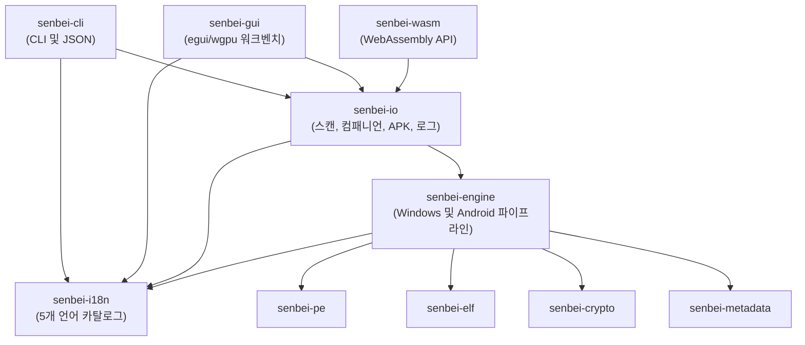

# 설계

## 워크스페이스 아키텍처

Cargo 워크스페이스는 9개의 멤버 크레이트로 구성되며, 브라우저 바인딩인 `senbei-wasm`과 `libFuzzer` 하네스인 `fuzz`는 독립 크레이트로 분리되어 있습니다.

| 크레이트 | 역할 |
| --- | --- |
| `senbei-cli` | 명령줄 파서, 터미널 색상/로케일 출력, JSON 리포트 생성기 및 통합 테스트 스위트 |
| `senbei-gui` | 네이티브 `eframe`/`wgpu` 데스크톱 워크벤치 (`Workbench` UI는 파일시스템 I/O가 없으며 `native.rs`에서 백그라운드 작업 실행) |
| `senbei-i18n` | `unsafe` 없는 5개 언어 카탈로그 (`Msg`, `Step`, `Term`, `Cli`, `Message`), `--json` 및 `.log`용 영문 고정 문자열 유지 |
| `senbei-io` | 폴더 스캔, Windows `._` 결합, Android `.apk`/`.apks`/`.xapk` 스트리밍, `RunObserver` 및 `CancelToken` |
| `senbei-engine` | Windows PE 및 Android ELF 정적 복구 파이프라인, `profile.rs` 리포트 모델, 크기 제한이 있는 상세 분석 트레이스 싱크 |
| `senbei-pe` / `senbei-elf` | 순수 포맷 파서, RVA/오프셋 매핑, ELF SysV/GNU 해시 및 레이아웃 헬퍼 (파일시스템 I/O 없음) |
| `senbei-crypto` | Windows(`src/windows/`) 및 Android(`src/android/`) 암호 알고리즘, AES 키 스케줄, 바이트코드 VM, Huffman/LZ 압축 해제 |
| `senbei-metadata` | 레이아웃 정의(`layout.rs`), 공통 구조 기반 `v31` 리매핑, Android 시드 기반 `v24.1`/`v29`/`v31`/`v39` 및 경량 `v24` 복원 |
| `senbei-wasm` | 일회용 Web Worker 내부에서 `senbei-io`의 인메모리 바이트 API를 구동하는 독립 `wasm32-unknown-unknown` 바인딩 |

멀티플랫폼 크레이트는 플랫폼별 코드를 `src/windows/`와 `src/android/` 아래에 분리하고, 공통 모델은 `src/` 바로 아래에 둡니다.

## 보호 프로필, 분석 트레이스 및 옵저버 hook

* **`senbei-engine/src/profile.rs`:** 입력 포맷, 식별 근거, 시도한 모든 후보 복구 경로와 기각 오류, 최종 선택된 경로, 복구 상태, 정적 검증 결과를 기록합니다(`format_version`은 CrackProof 빌드 버전이 아니라 리포트 스키마 버전을 나타냄).
* **크기 제한 분석 트레이스 (`inspect`):** `inspect`는 파싱된 입력 구조체와 크기 상한이 적용된 헤더·단계 프로브 결과에 전체 정적 복구 과정에서 기록되는 트레이스 이벤트를 결합하며, 모든 오프셋에 좌표 공간(`file`, `spliced`, `payload`, `rva`) 태그를 붙인 뒤 임시 결과물을 폐기합니다.
* **옵저버 및 협력적 취소:** `senbei-engine::progress`는 단계 전환 이벤트를 `senbei-io::observe::RunObserver`(`scanned`, `input_started`, `progress`, `produced`, `input_finished`)로 전달합니다. `Inspect` 또는 `DryRun`이 임시 작업 공간을 정리하기 전에 `produced` 콜백이 먼저 호출되므로 `senbei-gui`는 설정된 MiB 한도 내에서 복원 이미지를 메모리에 유지할 수 있으며, `CancelToken`은 입력 단위로 배치 실행을 안전하게 중단합니다.

## Windows, Android 및 메타데이터 파이프라인

* **Windows (`senbei-engine/src/windows/`):** PE32(표준 및 소형), 64비트 마커형, 64비트 비마커형, 전용 64비트 DLL, `stub[..4096] ++ companion`(`._`) 입력 전반에 걸쳐 후보 앵커, 시프트, 시드, 바이트코드 스텁을 시험 복호화하여 검증하고, 결정론적 병렬 섹션 압축 해제와 복구 후 PE/CLR/디렉터리 무결성 검사를 수행합니다.
* **Android (`senbei-engine/src/android/`):** `extract/`는 `ResourceLimits` 한도 안에서 Stage 1과 중첩된 Stage 2 스트림을 임시 작업 공간으로 디코딩합니다. `restore/`는 기본 `PT_LOAD` 기록 컨테이너와 보조 재배치 컨테이너(`0x9B`, `0x9D`, `0x9E`와 선택적 `0x96` 심볼 순열 역변환 및 `0x98` AArch64 생성자 해석 포함)를 적용하고, 재구성된 동적 테이블을 제자리나 끝에 추가한 `PF_R` `PT_LOAD` 세그먼트에 배치한 뒤 `e_entry`를 0으로 초기화합니다.
* **스캔 및 패키지 처리 (`senbei-io/`):** 폴더 스캔은 대용량 게임 에셋을 열지 않고 `4,128`바이트 이상인 `.exe`, `.dll`, `.so`, `global-metadata.dat`, `.apk`, `.apks`, `.xapk` 파일만 선별합니다. ZIP 패키지 처리기는 센트럴 디렉터리를 먼저 읽어 `.so`와 `global-metadata.dat` 항목만 임시 파일로 스트리밍합니다.
