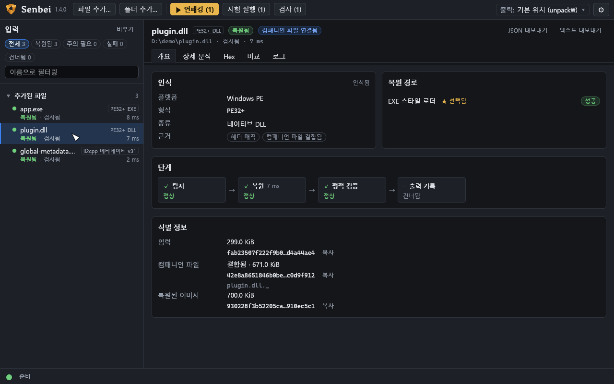
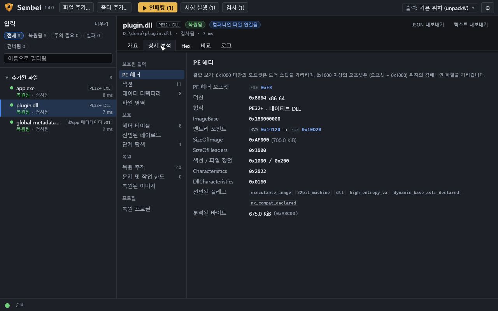
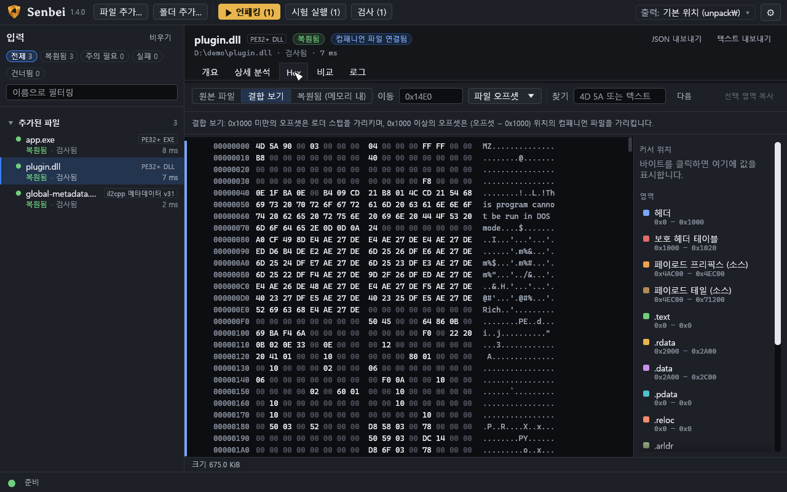
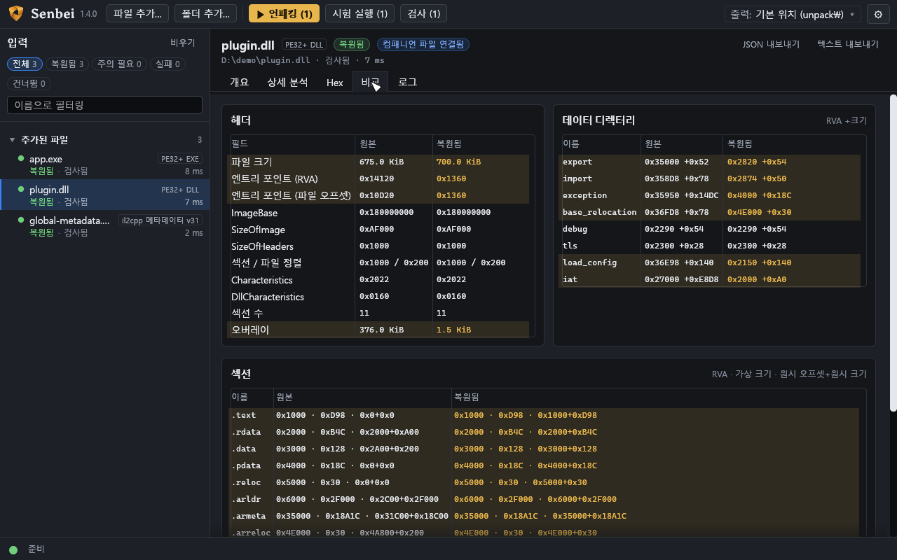

# GUI

`senbei-gui`(Windows에서는 `senbei-gui.exe`, Linux에서는 `./senbei-gui`)는 `eframe`과 `wgpu`(Windows Direct3D 12, X11/Wayland Vulkan) 기반의 네이티브 Rust 데스크톱 워크벤치입니다. 모든 네이티브 릴리스 아카이브에는 `senbei`와 `senbei-gui`가 함께 포함되며, 소스에서는 다음 명령으로 빌드하거나 실행합니다.

```cmd
cargo build --release -p senbei-gui
cargo run --release -p senbei-gui
```

## 워크벤치 화면



















(스크린샷은 합성 더미 PE, 컴패니언 `._`, v31 메타데이터 fixture로 렌더링한 화면입니다.)

## 입력 추가, 배치 실행 모드 및 작업 취소

* **최초 실행 시 법적 고지:** 처음 실행하면 상단 헤더에 5개 언어 전환기가 포함된 **법적 고지: 사용 전 필독** 모달이 표시되며, **이해했으며 동의합니다**를 선택하기 전까지 파일 드롭과 작업 실행이 차단됩니다(**종료**를 선택하면 앱이 닫힙니다). 이 고지는 언제든지 **설정 -> 정보 -> 법적 고지 표시**에서 다시 열 수 있습니다.
* **파일 및 폴더 대기열 구성:** **파일 추가…**(`Ctrl+O`), **폴더 추가…**를 누르거나 창에 드래그 앤 드롭하여 대상을 추가합니다. 개별 파일은 최대 1 MiB까지 읽어 헤더를 식별하고 같은 위치의 `<name>._` 컴패니언 파일을 자동으로 연결하며, 폴더는 백그라운드에서 스캔합니다. 필터 칩인 **전체**, **복원됨**, **주의 필요**, **실패**, **건너뜀**과 **이름으로 필터링** 입력란으로 목록을 좁히고, `Ctrl+Click`으로 다중 선택하거나 `Delete` 키(또는 목록 **비우기**)로 대기 중인 항목을 제거할 수 있습니다.
* **세 가지 실행 모드:** 선택한 항목(선택이 없으면 대기열 전체)에 대해 **언패킹**, **시험 실행**, **검사** 중 하나를 실행합니다. 대기열에 추가된 폴더는 컴패니언 파일 매칭, 분할 APK 그룹화, 앱별 `v24.1` 메타데이터 연결, 중복 제거, 하위 디렉터리 출력 구조 유지를 포함한 전체 디렉터리 파이프라인을 그대로 수행합니다.
* **협력적 작업 취소:** **취소**를 누르면 현재 처리 중인 입력이 끝난 뒤 배치를 안전하게 멈추며(`현재 입력 완료 후 중지 중…`), 이미 완료된 항목은 그대로 유지하고 아직 실행되지 않은 항목은 `실행 안 함`으로 표시합니다. 작업 실행 도중 창을 닫으려 하면 **작업이 아직 실행 중입니다** 대화상자에서 **계속 실행**과 **중지 후 닫기** 중 하나를 선택할 수 있습니다.

## 상세 탭 및 리포트 내보내기

| 탭 | 표시 내용 |
| --- | --- |
| **개요** | 포맷 식별 요약, 시도한 복구 경로(`★ selected` 표시 및 기각 사유), 단계별 타임라인, 정적 검증 판정, 입력/컴패니언/출력 크기 및 SHA-256 복사 버튼, 메타데이터 또는 복원된 ELF 요약 카드를 표시합니다. |
| **상세 분석** | **검사** 실행 시(또는 언패킹/시험 실행 후 **이 입력 검사** 클릭 시) 채워집니다. Windows PE 헤더, 섹션 헤더, 데이터 디렉터리, 파일 영역, 복호화된 `info[0..7]` 테이블, 단계 탐색 및 복구 트레이스, Android Stage 1, 스트림, 모듈, 아티팩트 및 7종의 ELF 복원 뷰, 메타데이터 이미지 테이블을 보여주며 클릭 시 **Hex** 탭의 해당 위치로 이동하는 `FILE` / `RVA` / `HDR` / `PAYLOAD` 점프 배지를 제공합니다. |
| **항목** | `.apk`, `.apks`, `.xapk` 패키지에서 표시됩니다. 복구 대상 `.so` 및 `global-metadata.dat` 항목(**비대상 항목 표시 (N)** 토글 포함)을 나열하며 각 항목마다 개별 **개요**, **상세 분석**, **Hex** 보기를 열 수 있습니다. |
| **Hex** | **원본 파일**, **결합 보기**(`stub[..0x1000] ++ companion`, 컴패니언 연결 시 기본값), **복원됨 (메모리 내)** 소스에 대해 최대 `2 GiB` 파일을 읽습니다. **이동**(`파일 오프셋` 또는 `RVA`), **찾기**(`4D 5A` 같은 16진수 바이트 또는 ASCII 텍스트, `F3`으로 다음 찾기), 최대 1 MiB **선택 영역 복사**, **커서 위치** 기준 리틀 엔디언 실시간 디코딩(`u8`..`u64`, `RVA`), 클릭 가능한 **영역** 목록을 지원합니다. |
| **비교** | 검사를 마친 Windows PE 입력에서 활성화됩니다. PE **헤더**, 데이터 디렉터리, 섹션 테이블을 **원본**과 **복원됨**으로 나란히 대조해 보여주며, **다음 차이** 이동 기능이 있는 1 MiB **섹션 바이트** 비교 뷰어를 제공합니다. |
| **로그** | 필터링 가능한 실행 로그(**전체**, **단계 숨기기**, **문제만**)와 **로그 복사** 기능을 제공하며, 구조화된 로그 줄은 UI 언어를 변경하면 즉시 해당 언어로 다시 번역됩니다. |

처리가 완료된 개별 항목이나 폴더 그룹에서 **JSON 내보내기**(`<name>.senbei.json`, 영문 스키마 v1) 또는 **텍스트 내보내기**(`<name>.senbei.txt`)를 선택하면 독립 리포트 파일로 저장됩니다.

## 설정 및 환경 변수

환경 설정은 Windows의 `%APPDATA%\senbei\data\app.ron`, Linux의 `$XDG_DATA_HOME/senbei/app.ron`(또는 `~/.local/share/senbei/app.ron`)에 저장됩니다(**설정** 창 하단의 **기본값으로 재설정**으로 초기화하고 **완료**로 닫을 수 있습니다).

* **일반:** **언어**(`English`, `简体中文`, `繁體中文`, `日本語`, `한국어`), **기본 출력 폴더**(`기본 위치 (unpack\)`, `최근 사용한 폴더`, `폴더 선택…`), **로그 파일 기록**(기본값 켜짐, **언패킹** 실행 시 적용).
* **처리:** **작업자 스레드**(기본값 `자동 (N)` 또는 직접 지정한 개수) 및 **작은 파일 프로브**(기본값 꺼짐, CLI의 `--scan-all`과 동일).
* **Android 제한:** **단일 항목 최대 크기**(기본값 `2048` MiB), **전체 한도**(기본값 `8192` MiB), **최대 항목 수**(기본값 `100000`), **최대 중첩 깊이**(기본값 `32`).
* **메모리:** **Hex 및 비교 보기를 위해 복원된 데이터를 메모리에 유지**(**검사** 및 **시험 실행** 시 기본값 켜짐, **언패킹**은 디스크에 저장된 출력 파일을 직접 읽음) 및 **메모리에 유지할 최대 이미지 크기**(생성된 이미지당 기본값 `512` MiB, 이를 초과하는 이미지는 원시 바이트를 RAM에 유지하지 않고 전체 구조 요약만 표시함).

`senbei-gui`는 명령줄 플래그를 받지 않습니다. **설정**에서 언어를 직접 선택하기 전까지는 `SENBEI_LANG` 환경 변수를 따르고, **작업자 스레드**가 `자동 (N)`일 때는 `SENBEI_THREADS`를 반영하며, 디버그 환경 변수인 `DD8_SHIFT` 또는 `SEL_DIAG`가 설정되어 있으면 상단에 경고 배너를 표시합니다.
