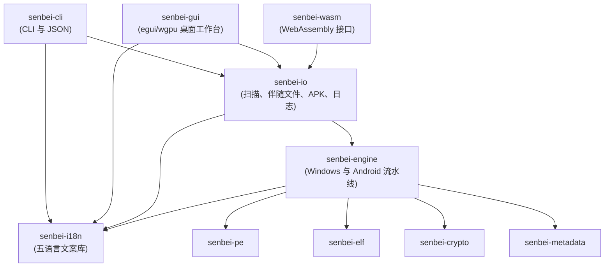

# 架构设计

## 工作区结构

Cargo 工作区包含九个成员 crate，`senbei-wasm`（浏览器端绑定）与 `fuzz`（`libFuzzer` 测试驱动）作为独立 crate 排除在主工作区之外：

| Crate | 职责 |
| --- | --- |
| `senbei-cli` | 命令行解析、终端着色与多语言输出、JSON 序列化及集成测试套件 |
| `senbei-gui` | 原生 `eframe`/`wgpu` 桌面工作台（`Workbench` 界面层不直接访问文件系统，由 `native.rs` 驱动后台任务） |
| `senbei-i18n` | 零 `unsafe` 的五语言文案库（`Msg`、`Step`、`Term`、`Cli`、`Message`），同时为 `--json` 和 `.log` 保留固定英文协议字符串 |
| `senbei-io` | 文件夹扫描、Windows `._` 伴随文件拼接、Android `.apk`/`.apks`/`.xapk` 流式读取、`RunObserver` 与 `CancelToken` |
| `senbei-engine` | Windows PE 与 Android ELF 静态还原流水线、`profile.rs` 报告模型及带容量上限的分析追踪收集器 |
| `senbei-pe` / `senbei-elf` | 纯内存格式解析器、RVA/文件偏移换算，以及 ELF SysV/GNU 哈希表与布局辅助函数（零文件系统 I/O） |
| `senbei-crypto` | Windows（`src/windows/`）与 Android（`src/android/`）加密算法、AES 轮密钥编排、字节码 VM 及 Huffman/LZ 解压 |
| `senbei-metadata` | 元数据布局定义（`layout.rs`）、跨平台共用的 `v31` 结构重映射，以及 Android 种子派生 `v24.1`/`v29`/`v31`/`v39` 与精简版 `v24` 还原 |
| `senbei-wasm` | 独立的 `wasm32-unknown-unknown` 绑定层，在一次性 Web Worker 内调用 `senbei-io` 的纯内存字节接口 |

跨平台 crate 将平台专有实现隔离在 `src/windows/` 与 `src/android/` 子目录下，共享数据模型直接放在 `src/` 根目录。

## 分析报告、追踪记录与状态回调

* **`senbei-engine/src/profile.rs`：** 记录输入格式、识别依据、每条尝试过的候选路径及其淘汰错误、最终命中的路径、还原状态与静态校验结果（其中 `format_version` 表示报告 schema 版本号，而非 CrackProof 壳版本）。
* **带上限的分析追踪（`inspect`）：** `inspect` 将解析出的输入结构、受限范围的头部/阶段探测结果，以及完整静态还原期间记录的追踪事件（带数量上限）汇总到一起，并在清理临时产物前为每个偏移标明所属坐标空间（`file`、`spliced`、`payload` 或 `rva`）。
* **状态回调与协作式取消：** `senbei-engine::progress` 将各阶段进度事件实时推送给 `senbei-io::observe::RunObserver`（包含 `scanned`、`input_started`、`progress`、`produced`、`input_finished`）。`produced` 会在 `Inspect` 或 `DryRun` 清理临时工作目录之前触发，使 `senbei-gui` 能在配置的 MiB 上限内保留恢复后的内存映像；`CancelToken` 则用于在两个输入项之间停止批处理。

## Windows、Android 与元数据流水线

* **Windows（`senbei-engine/src/windows/`）：** 覆盖 PE32（标准与紧凑布局）、带标记 64 位、无标记 64 位、旧版专用 64 位 DLL，以及 `stub[..4096] ++ companion`（`._`）等输入形态，对候选锚点、位移量、种子和字节码存根逐一试解密并校验，随后执行确定性并行节解压及恢复后的 PE/CLR/数据目录完整性检查。
* **Android（`senbei-engine/src/android/`）：** `extract/` 在 `ResourceLimits` 配额约束下将 Stage 1 与嵌套 Stage 2 数据流解码到临时工作目录；`restore/` 执行主 `PT_LOAD` 段写入并处理辅助重定位容器（`0x9B`、`0x9D`、`0x9E`，同时还原可选的 `0x96` 符号置换、解释执行 `0x98` AArch64 构造函数），将重建后的动态表原地写回或追加到末尾 `PF_R` `PT_LOAD` 段中，最后清零 `e_entry`。
* **目录扫描与安装包处理（`senbei-io/`）：** 文件夹扫描仅筛选不小于 `4,128` 字节的 `.exe`、`.dll`、`.so`、`global-metadata.dat`、`.apk`、`.apks` 和 `.xapk` 文件，避免打开大量无关资源文件。ZIP 安装包处理会先解析中央目录，仅按需流式解出 `.so` 与 `global-metadata.dat` 条目到临时文件。
