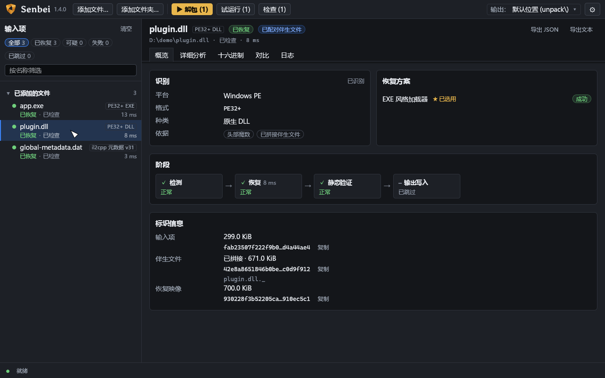
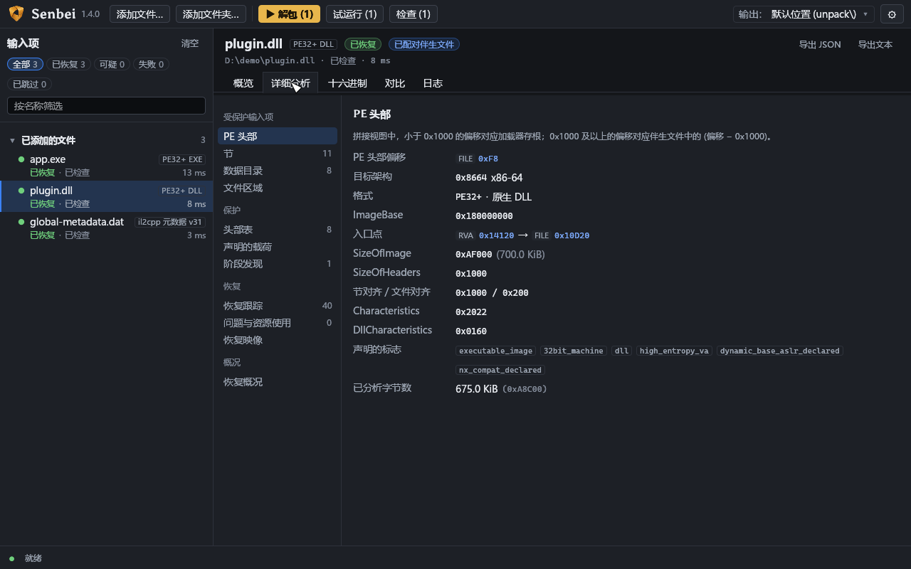
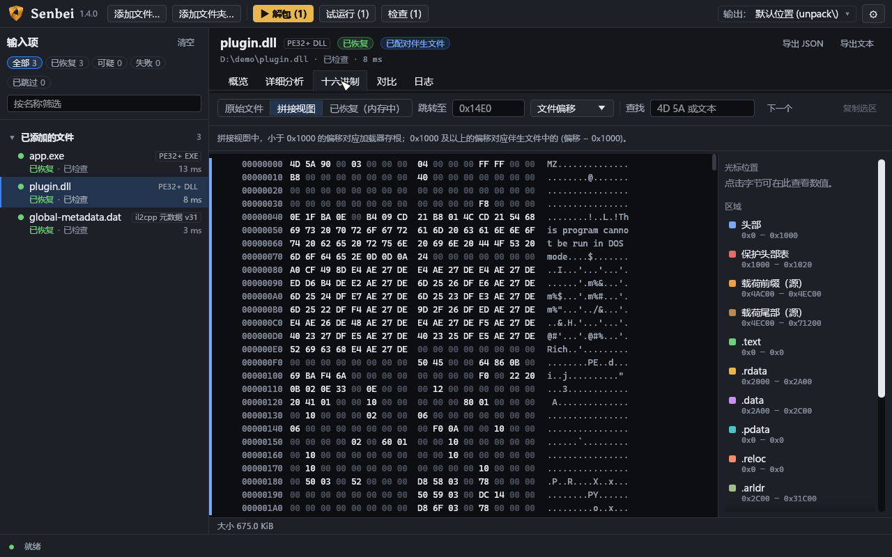
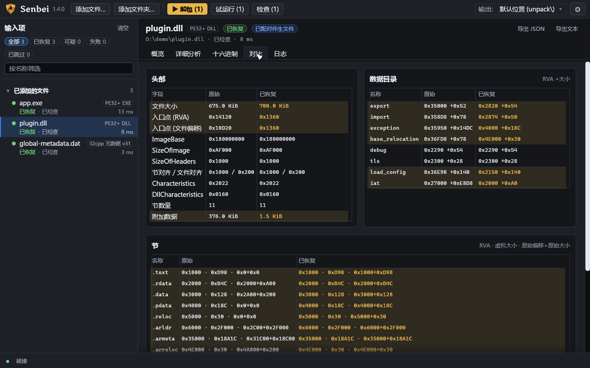

# 桌面 GUI

`senbei-gui`（Windows 下为 `senbei-gui.exe`，Linux 下为 `./senbei-gui`）是 Senbei 基于 `eframe` 与 `wgpu`（Windows 使用 Direct3D 12，X11/Wayland 使用 Vulkan）构建的原生 Rust 桌面工作台。每个原生发行压缩包均同时打包了 `senbei` 与 `senbei-gui`；从源码编译或直接启动的命令如下：

```cmd
cargo build --release -p senbei-gui
cargo run --release -p senbei-gui
```

## 工作台视图



















*（截图由合成测试 PE、`._` 伴随文件与 v31 元数据 fixture 渲染生成。）*

## 添加输入、批处理模式与取消任务

* **首次启动法律声明：** 首次启动时会弹出模态对话框 **法律声明：使用前请阅读**（标题栏附带五语言切换器），在选择 **我已理解并接受** 前会拦截文件拖放与各项操作（点击 **退出** 则直接关闭程序）。后续可随时通过 **设置 -> 关于 -> 显示法律声明** 重新打开。
* **添加文件与文件夹：** 可通过 **添加文件…**（`Ctrl+O`）、**添加文件夹…** 或直接拖放到窗口中导入目标。对于独立文件，GUI 最多读取前 1 MiB 来识别头部，并自动配对同目录下的 `<name>._` 伴随文件；添加的文件夹会在后台异步扫描。列表支持通过 **全部**、**已恢复**、**可疑**、**失败**、**已跳过** 筛选标签与 **按名称筛选** 过滤条目，用 `Ctrl+Click` 多选，按 `Delete` 移除选中的空闲项，或点击 **清除** 清空列表。
* **三种运行模式：** 可对当前选中项执行 **解包**、**试运行** 或 **检查**（未选中任何行时默认对队列中全部项目执行）。队列中的文件夹会运行完整的目录处理流水线，保留伴随文件配对、split APK 分组、按应用归属配对 `v24.1` 元数据、重复文件去重，并保持原有的输出子目录层级。
* **协作式取消：** 点击 **取消** 后，批处理会在当前输入项处理完毕后停止，已完成的条目保持不变，未开始的条目不再执行。任务运行期间关闭窗口会弹出 **仍有任务正在运行** 提示框，供选择 **继续运行** 或 **停止并关闭**。

## 详情标签页与报告导出

| 标签页 | 显示内容 |
| --- | --- |
| **概览** | 识别摘要、尝试过的各条还原路径（`★` 标出选中路径，其余列出淘汰原因）、阶段耗时轴、静态校验结论、输入/伴随/输出文件大小与 SHA-256 复制按钮，以及元数据或还原后 ELF 的信息卡片。 |
| **详细分析** | 执行 **检查** 后生成（在解包或试运行完成后也可点击 **检查此输入项** 补全）：Windows PE 头部、节表、数据目录、文件区间、解码后的 `info[0..7]` 表、阶段参数定位与还原追踪；Android Stage 1、数据流、模块、中间产物及 7 组 ELF 还原视图；元数据映像表；以及可一键跳转到 **十六进制** 对应位置的 `FILE` / `RVA` / `HDR` / `PAYLOAD` 徽标。 |
| **条目** | 针对 `.apk`、`.apks` 与 `.xapk` 应用包显示：列出候选 `.so` 与 `global-metadata.dat` 条目（并可展开非目标文件计数），每个条目均可独立打开各自的 **概览**、**详细分析** 与 **十六进制** 视图。 |
| **十六进制** | 支持读取最大 `2 GiB` 的文件，可在 **原始文件**、**拼接视图**（`stub[..0x1000] ++ companion`，配对伴随文件时默认选中）与 **已恢复（内存中）** 之间切换；提供 **跳转至**（支持 `文件偏移` 或 `RVA`）、**查找**（支持 `4D 5A` 等十六进制字节或 ASCII 文本，`F3` 跳至下一处）、**复制选区**（上限 1 MiB）、**光标位置** 处的实时小端序数值解码（`u8`..`u64`、`RVA`），以及可点击定位的 **区域** 列表。 |
| **对比** | 适用于已完成检查的 Windows PE 输入：并排展示原始映像与恢复后映像在 PE **头部**、数据目录和节表上的差异，并提供带 **下一处差异** 跳转的 1 MiB **节字节** 差异对比视图。 |
| **日志** | 支持按 **全部**、**隐藏步骤**、**仅问题** 筛选运行日志，并提供 **复制日志** 按钮；切换界面语言时，结构化日志行会实时切换为当前语言。 |

在任意已完成条目或文件夹分组上点击 **导出 JSON**（`<name>.senbei.json`，英文 schema v1）或 **导出文本**（`<name>.senbei.txt`），即可保存独立分析报告。

## 设置与环境变量

偏好设置保存在 Windows 的 `%APPDATA%\senbei\data\app.ron` 或 Linux 的 `$XDG_DATA_HOME/senbei/app.ron`（未设置时为 `~/.local/share/senbei/app.ron`）。在 **设置** 对话框中可配置以下分组（底部提供 **恢复默认设置** 与 **完成**）：

* **常规：** **语言**（`English`、`简体中文`、`繁體中文`、`日本語`、`한국어`）、**默认输出文件夹**（`默认位置 (unpack\)`、`上次使用的文件夹` 或 `选择文件夹…`）与 **写入日志文件**（默认开启，作用于 **解包**）。
* **处理：** **工作线程**（默认 `自动 (N)`，也可指定固定线程数）与 **探测小文件**（默认关闭，等价于 `--scan-all`）。
* **Android 限制：** **单个条目上限**（默认 `2048` MiB）、**总预算**（默认 `8192` MiB，累计解压与恢复数据量上限）、**最大条目数**（默认 `100000`）与 **最大嵌套深度**（默认 `32`）。
* **内存：** **为十六进制与对比视图保留恢复后的数据**（**检查** 与 **试运行** 默认开启；**解包** 直接从磁盘读取已保存的输出文件）与 **保留映像大小上限**（每个生成映像默认 `512` MiB；超出上限的映像仍会展示完整的结构化摘要，但不在内存中保留原始字节）。

`senbei-gui` 不接受命令行参数。在 **设置** 中手动选定语言前，程序会读取 `SENBEI_LANG` 作为初始界面语言；当 **工作线程** 设为 `自动 (N)` 时会读取 `SENBEI_THREADS`；若环境中设置了调试变量 `DD8_SHIFT` 或 `SEL_DIAG`，窗口顶部会显示警告横幅。
