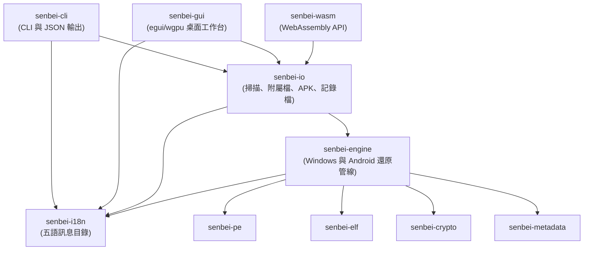

# 架構設計

## Workspace 架構

Cargo workspace 包含九個成員 crate，而 `senbei-wasm`（瀏覽器綁定層）與 `fuzz`（`libFuzzer` 測試框架）則作為獨立 crate 排除於 workspace 之外：

| Crate | 職責 |
| --- | --- |
| `senbei-cli` | 命令列解析器、終端機色彩與語系輸出、JSON 輸出器，以及整合測試套件 |
| `senbei-gui` | 原生 `eframe`/`wgpu` 桌面工作台（`Workbench` UI 不存取檔案系統，由 `native.rs` 執行背景工作） |
| `senbei-i18n` | 不含 `unsafe` 的五語目錄（`Msg`、`Step`、`Term`、`Cli`、`Message`）；為 `--json` 與 `.log` 維持固定英文輸出字串 |
| `senbei-io` | 資料夾掃描、Windows `._` 附屬檔拼接、Android `.apk`/`.apks`/`.xapk` 串流處理、`RunObserver` 與 `CancelToken` |
| `senbei-engine` | Windows PE 與 Android ELF 靜態還原管線、`profile.rs` 報告模型，以及設有容量上限的分析追蹤收集器 |
| `senbei-pe` / `senbei-elf` | 純格式解析器、RVA／偏移映射，以及 ELF SysV/GNU 雜湊與版面配置輔助函式（零檔案系統 I/O） |
| `senbei-crypto` | Windows（`src/windows/`）與 Android（`src/android/`）加密演算法、AES 金鑰排程、bytecode VM 與 Huffman/LZ 解壓縮 |
| `senbei-metadata` | 版面定義（`layout.rs`）、共用結構化 `v31` 重新映射，以及 Android 種子衍生 `v24.1`/`v29`/`v31`/`v39` 與精簡型 `v24` 還原 |
| `senbei-wasm` | 獨立的 `wasm32-unknown-unknown` 綁定層，在單次使用的 Web Worker 內驅動 `senbei-io` 的記憶體位元組 API |

跨平台 crate 將平台專屬程式碼隔離於 `src/windows/` 與 `src/android/` 底下，共用模型則直接置於 `src/`。

## 保護 Profile、結構追蹤與觀察者介面

* **`senbei-engine/src/profile.rs`：** 記錄輸入格式、辨識證據、每條嘗試過的候選路徑與排除錯誤、最終採用的路徑、還原狀態，以及靜態驗證結果（`format_version` 代表報告 schema 版本，而非 CrackProof 保護版本）。
* **設有上限的分析追蹤（`inspect`）：** `inspect` 會結合解析後的輸入結構、限制範圍的標頭／階段探測，以及完整靜態還原期間發出的追蹤事件，在捨棄暫存輸出前為每個偏移標註所屬座標空間（`file`、`spliced`、`payload` 或 `rva`）。
* **觀察者與協作式取消：** `senbei-engine::progress` 會將各階段轉換事件依序傳遞至 `senbei-io::observe::RunObserver`（`scanned`、`input_started`、`progress`、`produced`、`input_finished`）。`produced` 會在 `Inspect` 或 `DryRun` 清理暫存工作區之前觸發，讓 `senbei-gui` 能在設定的 MiB 上限內保留已還原映像；`CancelToken` 則會在兩個輸入項之間安全停止批次作業。

## Windows、Android 與中繼資料管線

* **Windows（`senbei-engine/src/windows/`）：** 針對 PE32（標準與精簡版面）、64 位元含標記版、64 位元無標記版、64 位元專用 DLL，以及 `stub[..4096] ++ companion`（`._`）輸入，逐一試解密並驗證候選定位點、位移量、種子與 bytecode stub，接著執行確定性的平行區段解壓縮，以及還原後的 PE／CLR／資料目錄完整性檢查。
* **Android（`senbei-engine/src/android/`）：** `extract/` 會在 `ResourceLimits` 配額內將 Stage 1 與巢狀 Stage 2 資料流解碼至暫存工作區；`restore/` 套用主要 `PT_LOAD` 寫入器與輔助重定位容器（`0x9B`、`0x9D`、`0x9E`，並還原選用的 `0x96` 符號排列與解譯 `0x98` AArch64 建構函式），將重建後的動態表原地放回或寫入附加於尾端的 `PF_R` `PT_LOAD` 區段，最後清除 `e_entry`。
* **資料夾掃描與套件處理（`senbei-io/`）：** 資料夾掃描僅篩選超過 `4,128` 位元組門檻的 `.exe`、`.dll`、`.so`、`global-metadata.dat`、`.apk`、`.apks` 與 `.xapk` 檔案，避免開啟大量遊戲素材檔。ZIP 套件處理會先讀取 ZIP 中央目錄，僅將 `.so` 與 `global-metadata.dat` 條目串流寫入暫存檔。
