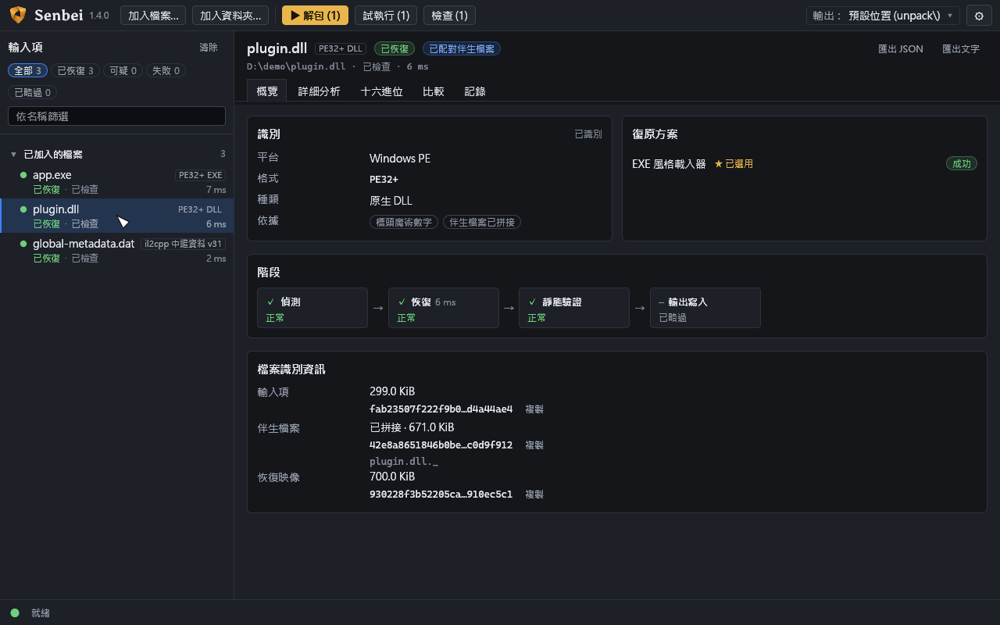
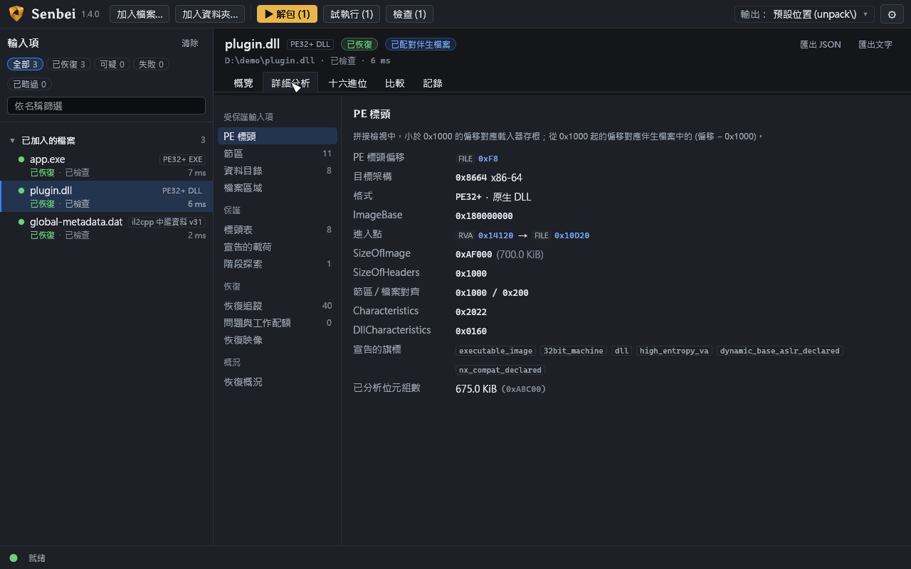
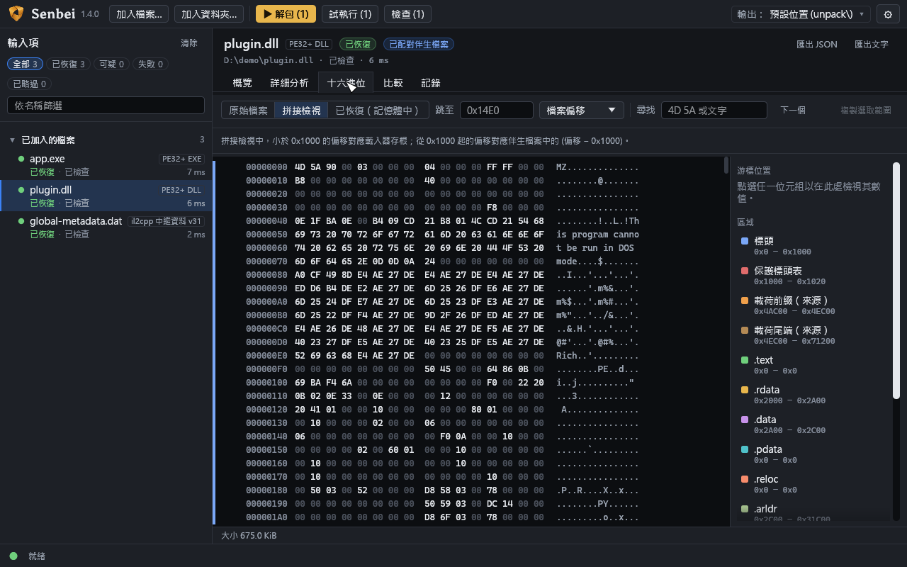
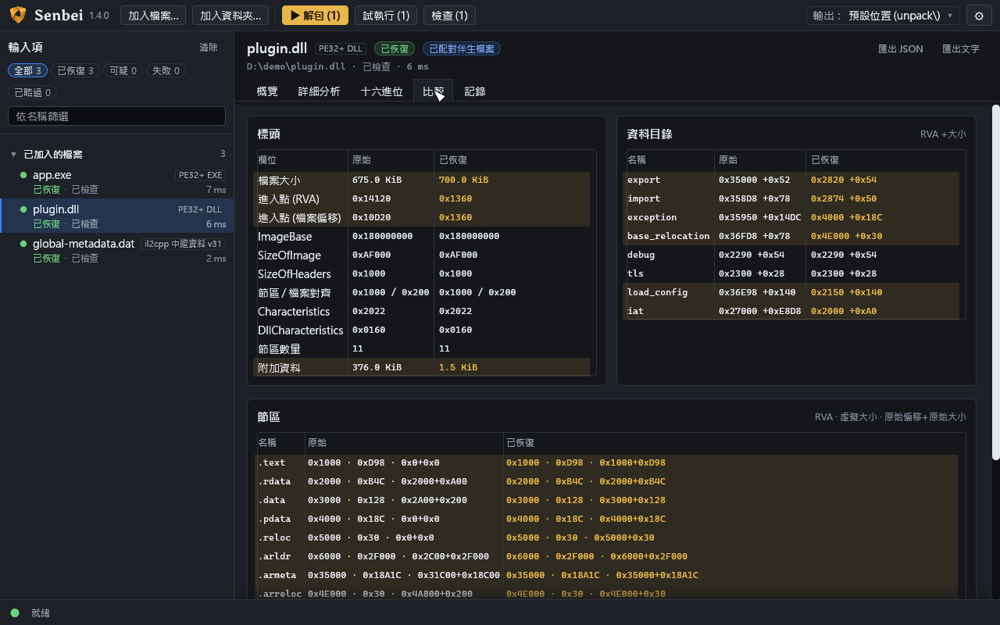

# GUI 介面

`senbei-gui`（Windows 為 `senbei-gui.exe`，Linux 為 `./senbei-gui`）是 Senbei 以 `eframe` 與 `wgpu` 打造的原生 Rust 桌面工作台（Windows 使用 Direct3D 12，X11/Wayland 使用 Vulkan）。每個原生發行壓縮檔皆同時包含 `senbei` 與 `senbei-gui`；若從原始碼建置或啟動，可執行：

```cmd
cargo build --release -p senbei-gui
cargo run --release -p senbei-gui
```

## 工作台檢視畫面



















*(畫面擷圖取自合成測試用 PE、`._` 附屬檔與 v31 中繼資料 fixture。)*

## 輸入項目、批次模式與取消機制

* **首次啟動法律聲明：** 初次開啟程式時會跳出 **法律聲明：使用前請詳閱** 對話框（標題列內建五語切換器），在點選 **我已瞭解並同意** 之前會鎖定拖放與各項操作（點選 **結束** 則立即關閉程式）。日後可隨時從 **設定** -> **關於** -> **顯示法律聲明** 重新檢視。
* **加入檔案與資料夾：** 點選 **加入檔案…** (`Ctrl+O`)、**加入資料夾…**，或直接將項目拖放至視窗中。處理單一檔案時，GUI 最多讀取前 1 MiB 以辨識標頭，並自動配對同目錄下的 `<name>._` 附屬檔；加入的資料夾則會在背景掃描。可透過 **全部**、**已恢復**、**可疑**、**失敗**、**已略過** 篩選鈕與 **依名稱篩選** 過濾清單，以 `Ctrl+Click` 多選，按 `Delete` 移除選取的閒置項目，或點選 **清除** 清空非執行中的佇列項目。
* **三種執行模式：** 對目前選取項目執行 **解包**、**試執行** 或 **檢查**（未選取任何項目時會處理佇列中的所有項目）。佇列中的資料夾會執行完整的目錄管線，保留附屬檔配對、split APK 分組、依應用程式配對 `v24.1` 中繼資料、去除重複檔案，以及按原目錄階層建立輸出子目錄。
* **協作式取消：** 點選 **取消** 會在目前輸入項處理完畢後安全停止批次作業，保留已完成的結果，並將尚未處理的項目狀態標示為 `不會執行`。若在作業期間關閉視窗，會跳出 **仍有工作正在執行** 對話框，可選擇 **繼續執行** 或 **停止並關閉**。

## 明細分頁與報告匯出

| 分頁 | 顯示內容 |
| --- | --- |
| **概覽** | 檔案辨識摘要、嘗試過的還原路徑（標示採用路徑與排除原因）、階段時間軸、靜態驗證判定、輸入／附屬檔／輸出大小與 SHA-256 複製按鈕，以及中繼資料或已還原 ELF 資訊卡。 |
| **詳細分析** | 執行 **檢查** 後填入（或在 **解包**／**試執行** 完成後點選 **檢查此輸入項**）：Windows PE 標頭、區段、資料目錄、檔案區域、解碼後的 `info[0..7]` 表格、階段探索與還原追蹤；Android Stage 1、資料流、模組、產物與 7 項 ELF 還原檢視；中繼資料映像表；以及可點擊跳轉至 **十六進位** 分頁的 `FILE` / `RVA` / `HDR` / `PAYLOAD` 標籤。 |
| **條目** | 針對 `.apk`、`.apks` 與 `.xapk` 套件顯示：列出候選 `.so` 與 `global-metadata.dat` 項目（並可展開非目標條目），每個項目皆可開啟獨立的 **概覽**、**詳細分析** 與 **十六進位** 檢視。 |
| **十六進位** | 支援檢視最大 `2 GiB` 的檔案，可切換 **原始檔案**、**拼接檢視**（`stub[..0x1000] ++ companion`，配對附屬檔時為預設檢視）與 **已恢復（記憶體中）**；提供 **跳至** `檔案偏移` / `RVA`、**尋找**（如 `4D 5A` 等十六進位位元組或 ASCII 文字，按 `F3` 跳至下一筆）、**複製選取範圍**（上限 1 MiB）、即時小端序 **游標位置** 解碼（`u8`..`u64`、`RVA`），以及可點擊定位的 **區域** 清單。 |
| **比較** | 適用於已完成檢查的 Windows PE 輸入：並排對照原始檔與已還原映像的 **標頭**（PE 標頭、資料目錄、區段表），並提供 1 MiB **節區位元組** 差異檢視器與 **下一個差異** 跳轉按鈕。 |
| **記錄** | 可篩選的執行記錄（**全部**、**隱藏步驟**、**僅顯示問題**），附有 **複製記錄** 按鈕；切換介面語言時，結構化記錄行會即時重新翻譯。 |

在任何已完成的項目或資料夾群組上點選 **匯出 JSON**（`<name>.senbei.json`，英文 schema v1）或 **匯出純文字**（`<name>.senbei.txt`），即可另存獨立報告。

## 設定與環境變數

偏好設定在 Windows 上儲存於 `%APPDATA%\senbei\data\app.ron`，在 Linux 上儲存於 `$XDG_DATA_HOME/senbei/app.ron`（或 `~/.local/share/senbei/app.ron`）。開啟 **設定** 後可調整下列分區，並於視窗底部點選 **重設為預設值** 或 **完成**：

* **一般：** **語言**（`English`、`简体中文`、`繁體中文`、`日本語`、`한국어`）、**預設輸出資料夾**（`預設位置 (unpack\)`、`上次使用的資料夾` 或 `選擇資料夾…`），以及 **寫入記錄檔**（預設開啟，適用於 **解包**）。
* **處理：** **工作執行緒**（預設為 `自動 (N)`，亦可指定固定數量）與 **探測小型檔案**（預設關閉，等同於 `--scan-all`）。
* **Android 限制：** **單一條目上限**（預設 `2048` MiB）、**總配額上限**（預設 `8192` MiB）、**條目數量上限**（預設 `100000`）與 **最大巢狀深度**（預設 `32`）。
* **記憶體：** **為十六進位與比較檢視保留復原後的資料**（在 **檢查** 與 **試執行** 中預設開啟；**解包** 則直接從磁碟讀取已儲存的輸出檔案）與 **保留映像大小上限**（每個產出映像預設 `512` MiB；超過上限的映像仍會顯示完整結構摘要，但不會將原始位元組保留在記憶體中）。
* **關於：** 版本資訊與 **顯示法律聲明**。

`senbei-gui` 不接受任何命令列旗標。在使用者於 **設定** 中明確指定語言前會採用 `SENBEI_LANG`；當 **工作執行緒** 設為 `自動 (N)` 時會採用 `SENBEI_THREADS`；若環境中設定了除錯變數 `DD8_SHIFT` 或 `SEL_DIAG`，視窗頂端會顯示警告橫幅。
